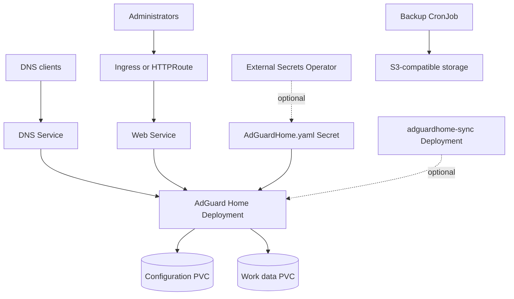

# AdGuard Home Chart Design

## Scope

This chart deploys AdGuard Home as a single-instance DNS filtering service with
an optional web setup wizard, pre-seeded configuration, synchronization helper,
Gateway API or Ingress routing, External Secrets integration, and S3 backup.

The chart is intended for home labs, small networks, and production Kubernetes
clusters that want DNS-level ad and tracker blocking with explicit persistence
and operational controls.

## Architecture

## Main Design Choices

- Keep the default in setup-wizard mode so first-time users can deploy without
  writing an `AdGuardHome.yaml` file.
- Use `config.adGuardHome` or `config.existingSecret` to bypass the wizard and
  seed a managed configuration for repeatable deployments.
- Keep the workload single-replica with `Recreate` strategy because AdGuard Home
  stores mutable DNS configuration and runtime data on local volumes.
- Expose web and DNS services separately so users can route the admin UI
  independently from DNS traffic.
- Support optional `adguardhome-sync` for users who run multiple AdGuard Home
  instances outside the scope of this chart's primary pod.
- Render ExternalSecret resources only when explicitly enabled; the chart does
  not install External Secrets Operator or manage provider-side stores.
- Keep S3 backup opt-in and use the HelmForge `mc` utility image for uploads.
- Treat application listeners and public Service ports as separate contracts.
  Wizard and configured HTTP ports are passed to the pinned image through its
  supported `--web-addr` argument. The chart writes the DNS listener into a
  chart-managed `AdGuardHome.yaml`, and Services target named Pod ports.
- Disable Kubernetes API token automount by default because the server, sync,
  and backup workloads do not call the Kubernetes API.

## Configuration and Data Lifecycle

AdGuard Home persists two independent data sets. The configuration volume holds
`AdGuardHome.yaml`, authentication state, and certificates. The work volume
holds query logs, statistics, and downloaded filter data. Both default to
`ReadWriteOnce` PVCs, so the Deployment uses one replica and the `Recreate`
strategy. This avoids two Pods concurrently mutating a filesystem that the
application does not coordinate as a clustered data store.

Wizard mode starts without a seed Secret. The chart pins the setup listener
with `--web-addr` so the Web Service remains valid after the wizard writes the
persistent configuration. Preconfigured mode copies the initial Secret only
when `AdGuardHome.yaml` is absent; subsequent application-side changes are not
silently overwritten on every Pod restart. Consequently, operators changing
the DNS listener on an existing PVC must update the persisted configuration as
well as `containerPorts.dns`. New chart-managed configurations receive the
canonical DNS listener directly from that value.

The configuration checksum includes the listener contract so HTTP argument
changes restart the Pod. Runtime configuration is mutable application data,
not a continuously reconciled ConfigMap. Back up both PVCs before replacing a
seed, restoring a release, or changing storage classes.

## Security Boundary

The chart controls the Pod, its Services, optional routing objects, Secret
references, and persistent volumes. It does not control clients, upstream DNS
providers, the LoadBalancer implementation, Ingress or Gateway controllers,
External Secrets providers, or S3 authorization. Those components remain
separate trust boundaries and must be hardened by the cluster operator.

Kubernetes API tokens are not mounted by default. Secret-backed configuration
and S3 credentials should be preferred over inline credentials in production.
The optional NetworkPolicy limits ingress to the actual web and DNS listener
ports. An empty peer list intentionally accepts all sources so externally
originating DNS traffic is not broken; production environments can restrict it
with namespace, Pod, or IPBlock peers. Egress isolation is opt-in through
explicit rules because upstream resolvers, HTTPS filter sources, S3 endpoints,
and the Kubernetes DNS Service vary by cluster.

AdGuard Home normally binds the privileged DNS port 53. A non-root deployment
must either grant the narrowly scoped bind capability or select an unprivileged
DNS listener and expose port 53 through the Service. The chart does not invent
privileges automatically. The permission init container is separately
hardened and exists only to prepare volume ownership; disable it when the CSI
driver already provides correct ownership.

## Observability Boundary

Startup, readiness, and liveness probes use the named HTTP port and therefore
follow the active setup or configured listener. Kubernetes events, Pod logs,
Service endpoints, and AdGuard Home's own query statistics are the primary
operational signals. The chart does not create a metrics exporter,
`ServiceMonitor`, dashboard, or alert rules because the pinned application does
not provide a stable Prometheus contract that the chart can safely assume.

Operators should alert on unavailable web endpoints, empty DNS Service
endpoints, Pod restarts, backup Job failures, PVC capacity, and externally
measured DNS resolution latency. Query logs may contain client addresses and
requested names; retention, export, and access controls are an operator privacy
decision rather than a chart default.

## Production Boundary

Production users should set explicit values for:

- `config.adGuardHome` or `config.existingSecret`
- `service.dns.type` and any external load balancer address
- `persistence.conf.size`, `persistence.work.size`, and storage classes
- `resources`
- `ingress` or `gateway` routing for the admin UI
- backup S3 credentials via existing Kubernetes Secrets or External Secrets
- network policy and egress rules suitable for upstream DNS providers

Production validation should exercise DNS over both UDP and TCP, the admin UI
through its selected routing layer, restore from the current backup format, and
the exact upstream resolvers configured in `AdGuardHome.yaml`. A successful Pod
rollout alone does not prove that recursive DNS or external LoadBalancer traffic
works from the client network.

## Known Gaps and Limitations

- A configuration already present on the conf PVC is not reconciled from Helm
  values. This preserves application-side edits but requires coordinated port
  and configuration changes during upgrades.
- Configuration from `config.existingSecret` is opaque to Helm. Its DNS port
  must match `containerPorts.dns`, and its schema must be compatible with the
  pinned AdGuard Home version.
- The backup feature uploads archives but does not schedule restore drills or
  verify application-level DNS behavior after a restore.
- NetworkPolicy enforcement depends on a compatible CNI. LoadBalancer source
  addresses and required egress destinations are environment-specific.
- `adguardhome-sync` is a separate synchronization tool, not active-active
  clustering or shared-storage coordination.

## Non-Goals

- Installing or configuring External Secrets Operator
- Managing DNS provider or router configuration outside Kubernetes
- Multi-replica AdGuard Home from one Stateful workload
- Automatic filter list curation beyond what AdGuard Home itself manages
- Provisioning S3 buckets or cloud load balancers

<!-- @AI-METADATA
type: design
title: AdGuard Home Chart Design
description: Design document for the AdGuard Home Helm chart

keywords: adguard-home, dns, design, gateway-api, external-secrets, backup

purpose: Document architecture, chart boundaries, and production choices for AdGuard Home
scope: Chart Design

relations:
  - charts/adguard-home/README.md
  - charts/adguard-home/docs/sync.md
  - charts/adguard-home/docs/backup.md
path: charts/adguard-home/DESIGN.md
version: 1.0
date: 2026-06-09
-->
