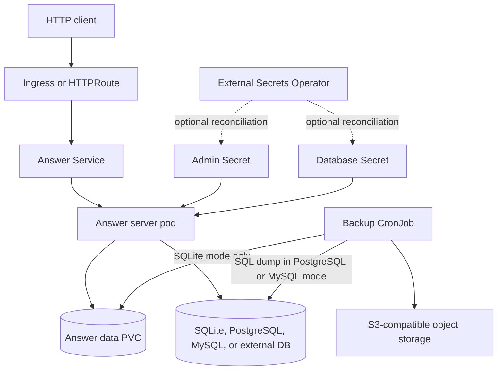

<!-- SPDX-License-Identifier: Apache-2.0 -->

# Apache Answer Chart Design

## Scope

This chart deploys one Apache Answer server using the official pinned image and
supports four database modes: SQLite, a bundled HelmForge PostgreSQL subchart, a
bundled HelmForge MySQL subchart, or an existing external PostgreSQL/MySQL service.
It owns the Kubernetes objects needed to run Answer, route HTTP traffic, persist
application state, source credentials, and optionally upload scheduled backups.

The chart targets a single Answer replica. `/data` contains generated Answer
configuration, uploads, plugins, and the SQLite database when SQLite is selected.
That volume remains necessary with a SQL database because the database does not
replace Answer's file-backed application state.

## Architecture

The backup CronJob includes `/data` only in SQLite mode. PostgreSQL and MySQL
backups contain the SQL dump but not Answer's file-backed uploads,
configuration, or plugins, so SQL-mode operators must back up `/data`
separately and restore it together with the database dump.

The Service exposes `service.port` to clients and targets the named `http` port.
The server container declares that named port from `containerPorts.http`. The chart
sets the upstream-supported `INSTALL_PORT`, `SITE_ADDR`, and
`SWAGGER_ADDRESS_PORT` variables from the same value. This preserves a strict
separation between the application listener and Service presentation port while
keeping installation, runtime, Swagger metadata, probes, and Service routing
consistent.

## Main Design Choices

Database mode is explicit or deterministically inferred. In `auto` mode, an
external host or secret takes precedence, followed by PostgreSQL, MySQL, and then
SQLite. Multiple configured candidates fail rendering because silently choosing
one could start Answer against the wrong data store. Non-SQLite modes include a
small init container that waits for the selected database endpoint before Answer
starts.

SQLite is the default because it gives evaluators a useful installation without a
second workload. It is not presented as a transparent substitute for a managed SQL
database. The chart deliberately does not automate cross-engine migration.

Unattended setup is enabled by default. Initial administrator and database values
are delivered through Secrets, while ordinary settings use environment variables.
The chart rejects listener variables in `answer.extraEnv` because Kubernetes keeps
the last duplicate environment entry and an override could make the declared port,
probe, and real process disagree.

The root filesystem is read-only. `/data` is the durable write boundary and `/tmp`
is an ephemeral `emptyDir` for caches and temporary files. A checksum annotation on
generated Secrets rolls the Deployment when chart-owned credentials change.

## Production Boundary

Production operators own capacity, availability, external DNS, TLS issuers,
database durability, and object-storage lifecycle. They should provide stable
Secrets, explicit resource requests and limits, a tested storage class, a public
`answer.siteUrl`, and either a managed external database or a deliberately sized
bundled database. SQLite remains appropriate only where one pod and file-level
durability meet the service objective.

The chart renders one Answer replica because upstream horizontal-scaling behavior
depends on shared file storage and deployment-specific plugin state. A replica
count, HPA, and PDB would imply a validated multi-replica contract that this chart
does not currently offer. Database subcharts expose their own topology settings,
but their presence does not make the Answer server highly available.

Backups are opt-in. Enabling a CronJob does not establish retention, immutability,
restore testing, encryption policy, or recovery objectives. Operators must test a
restore into an isolated environment and retain both database and `/data` content.

## Security Boundary

The Answer pod runs as non-root UID/GID `1000`, receives RuntimeDefault seccomp,
cannot escalate privileges, and has a read-only root filesystem. All capabilities
are dropped before adding only `NET_BIND_SERVICE`, which is required for the
official port-80 default. Changing the listener to an unprivileged port does not
automatically remove that capability because security-context shape must remain
stable across upgrades; operators with a port above 1024 may set `capabilities.add`
to an empty list.

Service-account token mounting is disabled because Answer does not call the
Kubernetes API. The default NetworkPolicy selects the `server` component rather
than broad release labels, so validation clients and sibling database workloads
are not accidentally isolated. It allows only the named HTTP port for ingress.
The default has no source selector, preserving compatibility with ingress
controllers, Gateway implementations, and direct cluster clients. Operators may
populate `networkPolicy.extraIngress` to restrict sources.

The policy intentionally does not restrict egress. Answer can integrate with SMTP,
OAuth/OIDC providers, plugin services, and externally embedded content; a generic
egress allowlist would either break supported behavior or provide misleading
protection. Clusters that require egress control should add a policy tailored to
their destinations through `extraManifests` or platform policy tooling.

Secrets may be chart-generated, pre-created, or reconciled by External Secrets
Operator. The chart does not install the operator and never owns provider-side
secret stores. Inline secret values remain supported for local evaluation but are
not the recommended production path.

## Observability Boundary

Startup, liveness, and readiness probes call `/healthz` through the named HTTP port.
The behavioral test installs every CI scenario, verifies workload readiness and
Service endpoints, checks `SITE_ADDR` against the declared container port, and
requests the health endpoint through the Kubernetes Service. Logs remain on
standard output and standard error for collection by the cluster logging stack.

Answer does not expose a chart-managed Prometheus metrics contract. Consequently,
the chart does not create a ServiceMonitor, PodMonitor, or alert rules. Operators
should monitor HTTP availability, pod restarts, probe failures, PVC consumption,
database health, backup completion, and application error logs using their chosen
platform. The chart's NOTES provide commands for rollout, pod, event, init-container,
and application-log inspection.

## Known Gaps and Limitations

- A single Answer server replica is supported; multi-replica correctness is not
  asserted.
- There is no automated migration between SQLite, PostgreSQL, and MySQL.
- Backup restoration is an operator-run process and is not implemented as a Job.
- NetworkPolicy egress is intentionally outside the generic chart contract.
- SMTP, identity-provider, and plugin health are not covered by the default probes.
- The chart does not create TLS certificates, Gateways, ingress controllers,
  external databases, object-storage buckets, or External Secrets providers.
- Existing PVC ownership must permit UID/GID `1000`; legacy volumes may require a
  one-time ownership migration before enabling the hardened defaults.

## Non-Goals

- Installing or administering External Secrets Operator.
- Provisioning external databases, S3-compatible storage, DNS, or TLS issuers.
- Compiling custom Answer plugins inside the application startup path.
- Claiming high availability from database replication alone.
- Managing database major-version upgrades or cross-engine data conversion.
