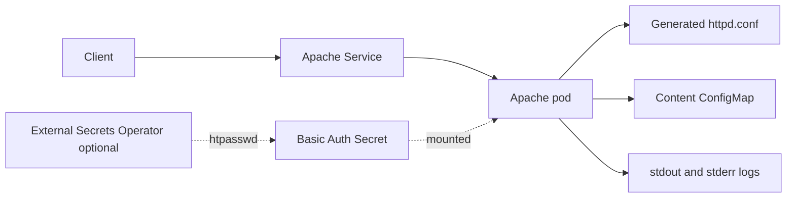

# Apache Chart Design

## Scope

This chart deploys the official Apache HTTP Server image for static sites,
simple reverse proxy configuration, and internal web endpoints that need a
small, hardened web server.

The chart intentionally focuses on Apache itself. It does not bundle a content
build system, a certificate manager, an ingress controller, or a monitoring
stack.

## Architecture

Optional integrations:

- Ingress for classic controller-based HTTP routing
- Gateway API HTTPRoute for Gateway-based platforms
- NetworkPolicy for explicit traffic boundaries
- Basic Auth from an existing Secret or ExternalSecret
- Apache exporter sidecar and ServiceMonitor

## Main Design Choices

- Use the official `httpd` image.
- Run Apache on port `8080` as a non-root user.
- Keep the root filesystem read-only and write logs to stdout/stderr.
- Generate a hardened baseline `httpd.conf` from structured values.
- Keep static content in a generated or user-managed ConfigMap.
- Support Gateway API and Ingress through separate, non-overlapping values.
- Support dual-stack Service fields on the primary Service.
- Render External Secrets Operator resources only when explicitly enabled.

## Security Boundary

Defaults are suitable for internal test and platform-owned static content. For
production, operators should provide explicit content management, network
boundaries, TLS at the ingress or Gateway layer, resource sizing, and optional
Basic Auth or upstream authentication.

## Production Boundary

The chart owns the Apache Deployment, Service, generated configuration, and
optional routing, policy, autoscaling, disruption, monitoring, and
ExternalSecret resources. The platform owns DNS, TLS termination, ingress or
Gateway controllers, certificate issuance, SecretStore configuration, and the
lifecycle of any externally supplied content ConfigMap or Basic Auth Secret.

Production releases should use immutable content ConfigMap names, explicit
resource sizing, controlled routing, and at least two replicas with a PDB when
availability matters. Inline content is release data and is best suited to
small pages; a chart rollback restores its prior ConfigMap but cannot undo
external content or controller changes. The chart does not provide persistent
storage because the official image serves read-only configuration and content.

## Observability Boundary

Apache access and error logs are redirected to container output and are the
primary request-level evidence. HTTP probes and the Helm test verify `/healthz`
through the actual listener and Service. When enabled, the exporter scrapes the
local `mod_status` endpoint and exposes Prometheus metrics. The chart renders a
ServiceMonitor when both metrics flags are enabled; the cluster must provide
the ServiceMonitor CRD, and a Prometheus Operator must select the object for
scraping.

Operators remain responsible for log collection, alert rules, dashboards,
external availability checks, TLS telemetry, and monitoring the routing
controller. A healthy probe proves that Apache serves the generated health
resource, not that every custom virtual host or external content dependency is
correct.

## Known Gaps And Operational Risks

- Custom `httpd.extraConfig` and virtual hosts can override the hardened
  baseline or make the generated configuration invalid.
- Basic Auth protects only paths covered by the generated Apache rules; it is
  not a replacement for centralized identity or authorization.
- The exporter requires `mod_status`; broadening `serverStatus.require` can
  expose operational details beyond the pod.
- NetworkPolicy effectiveness depends on the cluster network plugin, and
  routing-controller namespaces must be allowed explicitly.
- HPA decisions require a metrics provider and do not account for request
  latency or connection concurrency by default.
- A rolling update can briefly serve both old and new immutable content unless
  the deployment strategy is changed outside the chart contract.

## Explicit Non-Goals

- building application assets
- managing TLS certificates
- installing an ingress controller or Gateway implementation
- dynamic application runtimes such as PHP-FPM
- content synchronization from Git or object storage
- full web application firewall behavior

<!-- @AI-METADATA
type: design
title: Apache Chart Design
description: Design document for the Apache HTTP Server Helm chart
keywords: apache, httpd, design, static-site, gateway-api, ingress
purpose: Document chart architecture, decisions, and production boundaries
scope: Chart Design
relations:
  - charts/apache/README.md
  - charts/apache/docs/production.md
  - charts/apache/docs/networking.md
path: charts/apache/DESIGN.md
version: 1.0
date: 2026-05-29
-->
