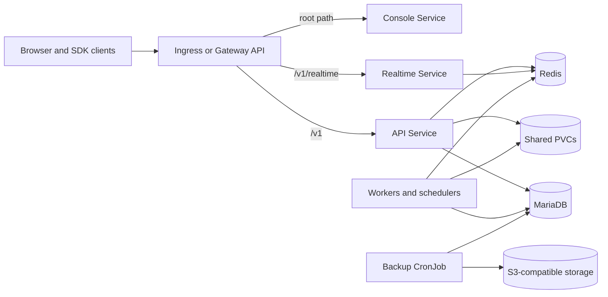

<!-- SPDX-License-Identifier: Apache-2.0 -->
# Appwrite Chart Design

## Scope

This chart deploys the Appwrite control plane: API, Console, realtime service,
workers, schedulers, maintenance task, MariaDB, Redis, and shared application
storage. MariaDB and Redis can instead be external services. The chart is
designed for self-hosted Appwrite installations that need explicit Kubernetes
contracts, upgrade guidance, and repeatable runtime validation.

## Architecture

Appwrite requires the Console, REST API, and realtime endpoint to share a
browser origin. Ingress and Gateway API rules therefore route path families to
three independent Services. Background components use the same application
image and configuration Secret, then communicate through MariaDB, Redis, and
the shared Appwrite volumes.

The API, Console, and realtime listener ports are process-level values. Their
Services keep separate cluster-facing ports and use the named `http` target so
changing a Service port never silently changes the process listener.

## Design choices and trade-offs

- The chart keeps MariaDB because existing HelmForge Appwrite releases used it.
  Changing to the upstream installer's PostgreSQL default would require an
  explicit data migration that a Helm upgrade cannot safely infer.
- MariaDB and Redis are subcharts by default for a complete evaluation path;
  external modes support managed production services and existing Secrets.
- Appwrite state is split into purpose-specific PVCs. This makes capacity and
  recovery policies explicit, but multi-replica consumers require an RWX-capable
  storage class.
- Workers remain individually switchable because Appwrite installations do not
  all use builds, messaging, certificates, or usage collection.
- The optional database backup uses argument arrays and Secret-backed
  credentials. It backs up MariaDB only; application PVCs need an independent
  snapshot or backup system.

## Production boundary

Production operators must provide a TLS-enabled shared origin, durable storage,
database and Redis recovery, monitoring, and capacity planning. Managed MariaDB
and Redis are preferred when higher availability is required. Shared PVCs must
support the access mode needed by the selected replica counts.

Functions and Sites execution require an external Appwrite executor and
orchestrator. Usage and execution history require externally managed ClickHouse
connections. Those systems and their lifecycle are outside this chart.

## Security boundary

The chart disables ServiceAccount token automount, drops Linux capabilities,
disables privilege escalation, applies RuntimeDefault seccomp, and creates
listener-specific NetworkPolicies. The official Appwrite runtime currently
needs writable filesystem paths and is not forced to a non-root UID by this
chart; the backup containers use a non-root, read-only filesystem profile.

Generated encryption and JWT values are kept in a Secret across upgrades.
Existing Secret paths are provided for Appwrite, SMTP, database, Redis, and S3
credentials. Default egress is intentionally open because Appwrite can call
SMTP, OAuth, webhook, storage, and function endpoints selected by the operator;
production installations should narrow `networkPolicy.egress` to their actual
destinations.

## Observability boundary

HTTP startup, readiness, and liveness probes cover the API, Console, and
realtime workloads. Kubernetes logs and events are the primary built-in
diagnostics, and the runtime scenario verifies the Appwrite version, account
flow, project state, persisted preferences, Console response, and image tags.
The chart does not create a ServiceMonitor, dashboards, tracing backend, or log
collector. Operators must connect their platform observability stack and alert
on restarts, queue depth, database health, PVC capacity, and backup failures.

## Known gaps and limitations

- OpenRuntimes executor, orchestrator, assistant, browser, and embedding
  services are not provisioned.
- No high-availability topology is created for bundled MariaDB or Redis.
- The Console has one replica and the chart does not currently create an HPA or
  PodDisruptionBudget.
- NetworkPolicy egress starts permissive because required external endpoints
  are installation-specific.
- The S3 backup CronJob covers MariaDB, not shared PVC data or external
  ClickHouse databases.

## Non-goals

- Automatically migrating an existing MariaDB installation to PostgreSQL.
- Building Appwrite or Console images, extensions, or function runtimes.
- Provisioning public DNS, TLS issuers, object storage, SMTP, OAuth providers,
  or external ClickHouse.
- Claiming application-level disaster recovery from a database-only backup.
- Hiding upstream migration commands inside install or upgrade hooks.

## References

- [Architecture and component reference](docs/architecture.md)
- [Configuration values](values.yaml)
- [Appwrite documentation](https://appwrite.io/docs)
- [Appwrite source](https://github.com/appwrite/appwrite)
