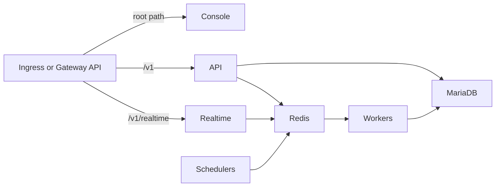

<!-- SPDX-License-Identifier: Apache-2.0 -->
# Appwrite Architecture

## Overview

Appwrite is deployed as a set of Kubernetes Deployments sharing a common container image (`appwrite/appwrite`) differentiated by entrypoint commands. The console uses a separate image (`appwrite/new`).

## Components

### API Server

The main HTTP server handling all REST and GraphQL API requests. It runs
`php -e app/http.php`, listens on `api.containerPort`, and supports horizontal
scaling through `api.replicaCount`.

### Console

The Appwrite web console is served by `appwrite/new` on
`console.containerPort` with same-origin API access. It runs as one replica.

### Realtime

The WebSocket server runs `php -e app/realtime.php`, listens on
`realtime.containerPort`, and supports horizontal scaling through
`realtime.replicaCount`.

### Workers

Background queue processors consuming jobs from Redis. Each worker type processes a specific job queue:

| Worker | Queue | Purpose |
|--------|-------|---------|
| jobs | Job processing | |
| screenshots | Screenshot processing | |
| executions | Execution events | |
| notifications | Notifications | |
| webhooks | Webhook delivery | |
| deletes | Resource cleanup | |
| databases | Database operations | |
| builds | Function code builds | |
| certificates | SSL certificate management | |
| functions | Function execution dispatch | |
| mails | Email delivery | |
| messaging | Push/SMS notifications | |
| migrations | Data migration jobs | |
| stats-resources | Resource usage stats | |
| stats-usage | API usage stats | |

Workers run their official `worker-*` entrypoints directly.

### Schedulers

Cron-like processes that enqueue scheduled jobs:

- **schedule-functions** — Triggers scheduled function executions
- **schedule-messages** — Triggers scheduled message delivery
- **schedule-executions** — Triggers scheduled task executions (disabled by default)

The `stats-resources` task is rendered only when usage collection and its task
toggle are both enabled. With usage disabled, upstream exits rather than running
a scheduler loop.

### Maintenance

Periodic housekeeping task that cleans expired sessions, logs, and other temporary data.

## Data Flow

## Shared Volumes

Several Appwrite services need access to the same filesystem paths:

| Volume | Mount Path | Used By |
|--------|-----------|---------|
| uploads | `/storage/uploads` | API, workers |
| cache | `/storage/cache` | API, workers |
| certificates | `/storage/certificates` | API, certificate worker |
| functions | `/storage/functions` | API, function/build workers |
| builds | `/storage/builds` | API, build worker |
| sites | `/storage/sites` | API, workers |

When running multiple API or worker replicas, the PVCs must support `ReadWriteMany` access mode. Update `persistence.accessModes` accordingly.

## Not Included (Alpha)

The following Appwrite services are not deployed by this chart:

- **openruntimes-executor** — Requires Docker socket access for function execution
- **appwrite-assistant** — AI assistant service (optional)
- **browser** — Screenshot/preview service (optional)

<!-- @AI-METADATA
type: chart-docs
path: charts/appwrite/docs/architecture.md
date: 2026-03-31
relations:
  - charts/appwrite/README.md
  - charts/appwrite/values.yaml
-->
