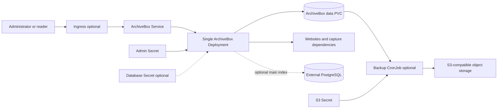

# ArchiveBox design

## Scope

This chart deploys the official ArchiveBox image as one self-hosted web archive.
It owns the single application workload, durable `/data` claim, Service,
optional Ingress, administrative Secret, optional S3 backup CronJob, scheduling,
and health configuration.

ArchiveBox stores configuration, Personas, local indexes, and captured artifacts
under `/data`. SQLite is the default main database; an existing PostgreSQL server
can hold the main index instead. Recovery always needs the full data directory
and, when configured, a matching external database backup.

## Architecture

The application runs as exactly one Recreate Deployment to keep one owner of
the archive filesystem and runtime. This remains true with PostgreSQL. The
upstream server supervises the web process, capture runner, and built-in Sonic
service in one container. Chromium uses a memory-backed `/dev/shm` volume.

## Main Design Choices

- Pin the official multi-architecture image without rebuilding it.
- Preserve the upstream entrypoint and initialization flow.
- Fix the workload at one replica with Recreate strategy to prevent overlapping
  SQLite and archive writers.
- Persist the full `/data` tree, not only the database.
- Generate and retain an administrative Secret when no existing Secret is
  supplied.
- Use the native `/health/` endpoint for startup, readiness, and liveness.
- Let the upstream root entrypoint select the collection UID/GID and prepare
  writable paths, then drop privileges for ArchiveBox and Chromium.
- Use `BASE_URL` for canonical URLs, proxy HTTPS, and CSRF configuration.
- Default to built-in Sonic search and disable anonymous URL submissions.
- Support an external PostgreSQL index using password credentials from a Secret.
- Offer an optional volume-level S3 backup CronJob with pinned tar and uploader
  images and explicit credential ownership.

## Production Boundary

Operators must provide durable expandable storage, size CPU and memory for
Chromium captures, configure an exact public hostname and TLS edge, restrict
public archive visibility, and protect administrative and S3 credentials. They
must also define capture egress, retention, legal policy, and off-cluster backup
retention for their environment.

A chart-managed PVC is retained on Helm uninstall, but namespace deletion and
storage-provider lifecycle remain outside Helm. Consistent backup requires a
quiesced writer or a storage snapshot mechanism that guarantees application
consistency. The tar CronJob does not provide those guarantees by itself and
does not back up PostgreSQL. Restore must include the entire `/data` tree and
any external database and be tested in an isolated namespace before it is trusted.

## Security Boundary

The main container starts as root with only `CHOWN`, `DAC_OVERRIDE`, `FOWNER`,
`SETUID`, and `SETGID` capabilities. The upstream entrypoint prepares ownership
and drops to the selected non-root account before starting the application.
Privilege escalation is disabled and seccomp is `RuntimeDefault`. Strict
non-root admission policies need a separately prepared runtime; setting a
non-root UID is not equivalent to `PUID`/`PGID` entrypoint selection. The chart
creates no RBAC permissions; platform ServiceAccount token automount policy
still applies. Credentials come from Secrets, not ConfigMaps.

The root filesystem remains writable for the upstream runtime and browser
tooling, including `/opt/archivebox`, `/tmp/archivebox`, and `/home/archivebox`.
`SERVER_SECURITY_MODE=auto` keeps ordinary public-host replay in the safer
single-domain mode without JavaScript. Isolated full replay requires explicit
subdomain mode plus wildcard DNS, ingress, and TLS. Anonymous URL submission
is disabled by default; snapshot visibility is managed through the UI.
NetworkPolicy, edge authentication, TLS policy, website capture egress, malicious-content
isolation, Secret rotation, and object-store access policy belong to the
operator and platform. `extraEnv`, extra volumes, extra manifests, Ingress
annotations, and inline credentials are explicit trust-boundary extensions.

## Observability Boundary

Native health probes cover application startup and listener health. Kubernetes
Deployment, Pod, PVC, CronJob, Job, event, and log signals cover the platform
surface. Production monitoring should include archive growth, PVC capacity,
capture failures, Chromium memory pressure, backup success and age, object-store
upload errors, and public endpoint availability.

The pinned release does not provide a stable Prometheus contract consumed by
this chart, so no ServiceMonitor or unrelated exporter is fabricated.

## Known Gaps and Improvement Candidates

- Recreate upgrades intentionally include downtime.
- The chart does not support multiple archive/runtime owners, including with
  PostgreSQL.
- The backup CronJob reads the live data volume; operators should schedule a
  quiesced window or use a consistency-capable snapshot workflow.
- Browser capture of untrusted websites is a high-egress workload and requires
  platform-level network and threat controls.
- A writable root filesystem remains necessary for the pinned upstream image.
- The chart does not install NetworkPolicy, a PostgreSQL server, or a separate
  search service. Sonic is bundled in the ArchiveBox container.

## Explicit Non-Goals

- provisioning, backing up, or automatically migrating data to PostgreSQL
- multiple application replicas against one archive
- installing an Ingress controller, CNI, certificate manager, storage provider,
  object store, or monitoring stack
- deciding what content may legally be captured or retained
- guaranteeing that arbitrary captured web content is safe
- managing off-cluster backup retention, encryption keys, or disaster-recovery
  infrastructure
- treating Helm rollback as a database or archive rollback

## Validation Strategy

The mandatory chart gate validates dependencies, strict lint, every CI values
profile, unit tests, real CRD schemas, Artifact Hub metadata, and sequential k3d
runtime behavior. Runtime scenarios cover the default persistent workload,
Ingress, external PostgreSQL, custom UID/GID, and the S3 backup resource set,
including stable rollout, Service endpoints, logs, events, and cleanup.

Upgrade validation starts from the latest public package with reviewed
replacement values. Removed keys must be migrated before reuse; see
[the upgrade guide](docs/upgrading.md). It verifies the retained PVC and
administrative Secret, preserves a pre-upgrade marker beside the real SQLite and
archive data, and requires the Recreate workload to become ready again.

<!-- @AI-METADATA
 type: guide
 title: ArchiveBox Chart Design
 description: Explain ArchiveBox architecture, boundaries, and recovery model
 audience: contributors, operators
 purpose: Explain chart architecture and limits
 scope: chart
 path: charts/archivebox/DESIGN.md
 version: 1.1
 date: 2026-11-01
-->

