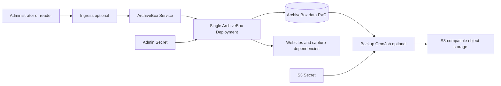

# ArchiveBox design

## Scope

This chart deploys the official ArchiveBox image as one self-hosted web archive.
It owns the single application workload, durable `/data` claim, Service,
optional Ingress, administrative Secret, optional S3 backup CronJob, scheduling,
and health configuration.

ArchiveBox stores its SQLite database, index, configuration, and every captured
artifact together under `/data`. The chart therefore treats the complete data
directory as one consistency and recovery boundary.

## Architecture

The application runs as exactly one Recreate Deployment because SQLite and the
archive filesystem form a single-writer dataset. Chromium uses a memory-backed
`/dev/shm` volume while persistent application state remains on `/data`.

## Main Design Choices

- Pin the official multi-architecture image without rebuilding it.
- Preserve the upstream entrypoint and initialization flow.
- Fix the workload at one replica with Recreate strategy to prevent overlapping
  SQLite and archive writers.
- Persist the full `/data` tree, not only the database.
- Generate and retain an administrative Secret when no existing Secret is
  supplied.
- Use the native `/health/` endpoint for startup, readiness, and liveness.
- Run the application as UID/GID 911 and scope the root ownership init container
  to the data mount required by the upstream image.
- Offer an optional volume-level S3 backup CronJob with pinned tar and uploader
  images and explicit credential ownership.

## Production Boundary

Operators must provide durable expandable storage, size CPU and memory for
Chromium captures, configure an exact public hostname and TLS edge, restrict
public archive visibility, and protect administrative and S3 credentials. They
must also define capture egress, retention, legal policy, and off-cluster backup
retention for their environment.

A chart-managed PVC is retained on Helm uninstall, but namespace deletion and
storage-provider lifecycle remain outside Helm. Consistent backup requires a
quiesced writer or a storage snapshot mechanism that guarantees application
consistency. Restore must include the entire `/data` tree and be tested in an
isolated namespace before it is trusted.

## Security Boundary

The main container runs as non-root UID/GID 911, cannot gain privileges, drops
all Linux capabilities, and uses RuntimeDefault seccomp. The chart creates no
RBAC permissions; platform ServiceAccount token automount policy still applies.
Credentials are sourced from Secrets rather than ConfigMaps. The backup Job
receives S3 credentials only when that feature is enabled.

The root filesystem remains writable because the pinned application and browser
tooling do not expose a stable immutable-filesystem contract. NetworkPolicy,
edge authentication, TLS policy, website capture egress, malicious-content
isolation, Secret rotation, and object-store access policy belong to the
operator and platform. `extraEnv`, extra volumes, extra manifests, Ingress
annotations, and inline credentials are explicit trust-boundary extensions.

## Observability Boundary

Native health probes cover application startup and listener health. Kubernetes
Deployment, Pod, PVC, CronJob, Job, event, and log signals cover the platform
surface. Production monitoring should include archive growth, PVC capacity,
capture failures, Chromium memory pressure, backup success and age, object-store
upload errors, and public endpoint availability.

The pinned release does not provide a stable Prometheus contract consumed by
this chart, so no ServiceMonitor or unrelated exporter is fabricated.

## Known Gaps and Improvement Candidates

- Recreate upgrades intentionally include downtime.
- SQLite prevents horizontal scaling and concurrent writers.
- The backup CronJob reads the live data volume; operators should schedule a
  quiesced window or use a consistency-capable snapshot workflow.
- Browser capture of untrusted websites is a high-egress workload and requires
  platform-level network and threat controls.
- A writable root filesystem remains necessary for the pinned upstream image.
- The chart does not install NetworkPolicy or a distributed search backend.

## Explicit Non-Goals

- replacing SQLite with an unsupported external database
- multiple application replicas against one archive
- installing an Ingress controller, CNI, certificate manager, storage provider,
  object store, or monitoring stack
- deciding what content may legally be captured or retained
- guaranteeing that arbitrary captured web content is safe
- managing off-cluster backup retention, encryption keys, or disaster-recovery
  infrastructure
- treating Helm rollback as a database or archive rollback

## Validation Strategy

The mandatory chart gate validates dependencies, strict lint, every CI values
profile, unit tests, real CRD schemas, Artifact Hub metadata, and sequential k3d
runtime behavior. Runtime scenarios cover the default persistent workload,
Ingress, and the S3 backup resource set, including stable rollout, Service
endpoints, logs, events, and cleanup.

Upgrade validation starts from the latest public package and exercises both
reset/default values and `--reuse-values`. It verifies the retained PVC and
administrative Secret, preserves a pre-upgrade marker beside the real SQLite and
archive data, and requires the Recreate workload to become ready again.

<!-- @AI-METADATA
 type: guide
 title: ArchiveBox Chart Design
 description: Explain ArchiveBox architecture, boundaries, and recovery model
 audience: contributors, operators
 purpose: Explain chart architecture and limits
 scope: chart
 path: charts/archivebox/DESIGN.md
 version: 1.1
 date: 2026-11-01
-->
