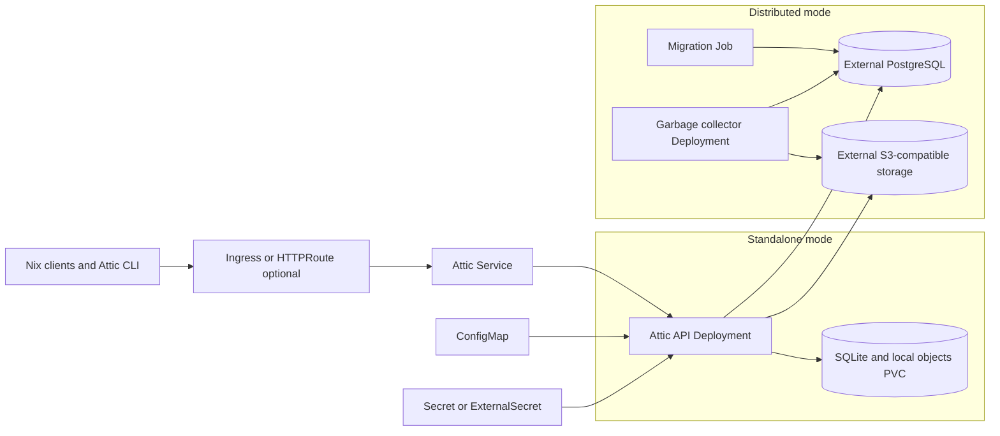

# Attic Chart Design

## Scope

This chart deploys the official Attic server image as a private Nix binary
cache. It owns the Attic workload, configuration, Service, optional exposure,
credentials adapter, persistence, network policy, and lifecycle Jobs needed by
the selected topology.

The chart supports two intentional operating models: a single-replica cache
with SQLite and local storage, and a horizontally scalable API tier backed by
external PostgreSQL and S3-compatible object storage. It does not own external
databases, object stores, ingress controllers, Gateway API controllers,
External Secrets Operator, or client-side Nix configuration.

## Architecture

Standalone mode uses a `Recreate` Deployment with one replica so SQLite and
local objects have a single writer. Distributed mode uses `RollingUpdate`, an
`api-server` Deployment, a Helm pre-install/pre-upgrade database migration Job,
and one garbage-collector Deployment when
`config.garbageCollection.enabled=true`. Disabling that component removes
automatic cleanup and requires an external garbage-collection procedure.

## Main Design Choices

- Keep standalone mode deliberately single-replica; a shared filesystem does
  not turn SQLite into a safe multi-writer database.
- Require PostgreSQL and S3-compatible storage together for distributed mode
  so API replicas remain stateless.
- Keep external data services outside the chart lifecycle so backup, restore,
  scaling, and upgrades can follow platform-specific policies.
- Require an existing Secret in distributed mode because migration hooks run
  before ordinary release resources and credentials must remain stable.
- Generate and reuse an HS256 key only for the standalone default; production
  operators can provide HS256 or RS256 material through a Secret.
- Render non-secret Attic configuration in a ConfigMap and run upstream
  `check-config` before the application starts.
- By default, derive the application listener from `config.listenAddress` and
  `containerPorts.http`; the same port is written to Attic configuration and
  the Pod while `service.port` remains an independent Kubernetes Service
  contract. A non-empty, deprecated `config.listen` overrides the derived
  socket only when its port matches `containerPorts.http`.
- Use TCP probes because the pinned upstream build has no dedicated health
  endpoint.

## Production Boundary

Standalone mode provides durable single-node operation when
`persistence.enabled=true`, not high availability. Its PVC contains both
SQLite metadata and local cache objects, so backup and restore must capture the
complete volume consistently. When persistence is disabled, `/data` uses
`emptyDir` and all metadata and objects are lost with the Pod. The `Recreate`
strategy prevents overlapping application Pods during rollouts.

Distributed mode makes the API tier replaceable, but PostgreSQL, object
storage, and the signing keys remain stateful production dependencies. The
operator must coordinate database and object-store backups, verify restores,
run enough API replicas for the intended availability target, and keep the
singleton garbage collector healthy.

Ingress and Gateway API resources terminate only the chart's routing contract.
DNS, TLS certificates, proxy body-size limits, client-reachable presigned S3
URLs, and controller availability remain platform responsibilities.

## Security Boundary

The chart runs the official image as UID/GID 10001 with RuntimeDefault
seccomp, no Linux capabilities, no privilege escalation, a read-only root
filesystem, and no mounted ServiceAccount token. Only `/tmp` and the optional
data volume are writable.

JWT signing material, PostgreSQL URLs, and optional S3 keys come from a
Kubernetes Secret or ExternalSecret-managed target. The chart does not rotate
signing keys automatically because rotation can invalidate issued tokens.
NetworkPolicy is opt-in; when egress restriction is enabled, operators must
allow the actual DNS, PostgreSQL, and object-storage destinations.

## Observability Boundary

Startup, liveness, and readiness probes verify that the configured TCP
listener accepts connections. They do not prove that PostgreSQL, object
storage, presigned URLs, or cache operations work. The chart-owned runtime
smoke test therefore checks the rendered listener and performs an HTTP request
against the application process.

Attic emits Rust tracing logs to stdout and stderr through `config.logLevel`.
The pinned build exposes no supported Prometheus endpoint, so the chart does
not create a metrics Service or ServiceMonitor. Production monitoring must
combine workload health, logs, external dependency monitoring, and a real
cache create/push/pull workflow.

## Known Gaps and Improvement Candidates

- Upstream publishes commit-based images rather than semantic releases, so
  release impact still requires source and migration review.
- There is no native Attic backup command or transactionally coordinated
  PostgreSQL/S3 snapshot mechanism.
- TCP readiness cannot distinguish a healthy listener from failed database or
  object-storage access.
- The chart does not yet provide opinionated alerts because the supported
  upstream build has no stable metrics surface.
- S3 workload identity configuration remains platform-specific and may require
  `extraEnv` or ServiceAccount annotations.

## Explicit Non-Goals

- installing or configuring Nix clients and builders
- provisioning PostgreSQL or S3-compatible object storage
- installing ingress, Gateway API, External Secrets, or monitoring operators
- automatically rotating JWT signing keys
- inventing a Prometheus endpoint that upstream does not expose
- making standalone SQLite/local storage horizontally scalable
- guaranteeing upstream API or database compatibility across commit updates

## Maturity

The chart is beta because upstream publishes no semantic releases, describes
the project as an early prototype, and may make incompatible database changes.
HelmForge provides a production-oriented deployment contract but cannot create
an upstream stability guarantee.

## Rejected Alternatives

- A generic app-template dependency would obscure Attic lifecycle and
  validation behavior.
- Floating `latest` or `main` image tags would violate reproducibility.
- Bundling a third-party PostgreSQL chart would couple unrelated data and
  application lifecycles.
- Multiple monolithic replicas would race SQLite/local storage and duplicate
  garbage collection.
