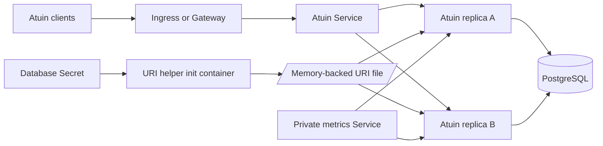

<!-- SPDX-License-Identifier: Apache-2.0 -->

# Atuin chart design

## Scope

This chart deploys the official Atuin shell-history synchronization server on
Kubernetes. It owns the Atuin Deployment, application and optional metrics
Services, SQLite persistence, optional HelmForge PostgreSQL dependency,
Ingress, Gateway API HTTPRoutes, ExternalSecret resources, NetworkPolicy,
ServiceMonitor, autoscaling and scheduling controls.

The chart supports two deliberate data topologies: a single Atuin replica with
SQLite on a persistent volume, and one or more stateless Atuin replicas using
PostgreSQL. It does not claim to operate external databases, ingress
controllers, Gateway implementations, certificate issuers, Prometheus
Operator, External Secrets Operator or database backup systems.

## Architecture

The default topology favors a safe, small installation. A ClusterIP Service
targets the named `http` container port, one Atuin pod stores configuration and
SQLite state on a ReadWriteOnce PVC, and public exposure is disabled.

```mermaid
flowchart LR
    Client[Atuin client] --> Service[ClusterIP Service]
    Service --> Server[Atuin server pod]
    Server --> Config[/config PVC]
    Config --> SQLite[(SQLite database and WAL)]
```

PostgreSQL mode moves shared state out of the pod. The chart can deploy the
HelmForge PostgreSQL dependency or read a complete external connection URI from
a Secret. In bundled mode, an init container URL-encodes the generated
credentials and writes the URI into a memory-backed volume before Atuin starts.



The HTTP listener is an end-to-end application contract.
`containerPorts.http` sets both `ATUIN_PORT` and the pod's named port.
`service.port` remains an independent Kubernetes-facing port and routes to that
name. Probes and NetworkPolicy follow the application port, while Ingress and
HTTPRoute resources follow the Service port.

## Design decisions

### Database topology is explicit

SQLite is the default because it keeps a personal installation small, but it
is not a shared multi-writer database. The chart therefore requires
`replicaCount=1`, disables HPA for SQLite and uses a `Recreate` strategy. A PVC
does not make SQLite safe for concurrent writers.

PostgreSQL mode enables shared state, multiple replicas and rolling updates.
Atuin embeds migrations and runs them during server startup; there is no
upstream migration-only command, so the chart does not invent a migration Job.
Each replica may open up to 100 database connections, which makes connection
capacity an operator responsibility when scaling manually or with HPA.

### Credentials are not rendered into ConfigMaps

External PostgreSQL uses `ATUIN_DB_URI` directly from an existing Secret. The
bundled dependency generates its own credentials. A short-lived Node init
container safely URL-encodes the username, password and database name, writes
the complete URI to a memory-backed volume, and exits. The main container reads
that file immediately before `exec`; the URI is never placed in a ConfigMap.

### Listener and Service ports are separate

Atuin officially supports `ATUIN_PORT`, so the chart exposes
`containerPorts.http` as the process listener. The Kubernetes Service can use a
different `service.port` without changing the process. Both application
listeners have a minimum of 1024 because the pod runs as UID 1000 with all
capabilities dropped. This prevents a values combination that Kubernetes can
render but the process cannot bind.

### Public exposure is TLS-first

The generated Ingress and HTTPRoutes expose only the Atuin HTTP Service.
Metrics stay on a distinct private Service. Atuin's synchronized history is
end-to-end encrypted, but login credentials are not safe over cleartext HTTP;
certificates, TLS listeners and DNS remain platform responsibilities.

## Production boundary

Production PostgreSQL must have adequate connection capacity, durable storage,
tested backups and a restoration procedure. The chart can deploy a standalone
PostgreSQL dependency for convenience, but database high availability,
point-in-time recovery, upgrades and managed-service operation remain outside
the Atuin chart.

The chart supplies replica, disruption-budget, topology-spread, affinity and
HPA controls. These controls do not create availability on their own. Multiple
Atuin replicas require PostgreSQL, multiple failure domains require suitable
nodes and storage, and an HPA requires metrics plus a database connection
budget. Upstream does not guarantee mixed-version zero-downtime upgrades, so
operators must review release notes and choose a controlled rollout strategy.

Ingress controllers, Gateway implementations, DNS, certificates, NetworkPolicy
enforcement and observability backends are prerequisites supplied by the
cluster platform. Optional CRDs are rendered only when their features are
enabled.

## Security boundary

The official image runs as UID/GID 1000. The chart enforces non-root execution,
RuntimeDefault seccomp, a read-only root filesystem, no privilege escalation,
all Linux capabilities dropped and no automatically mounted service account
token. Writable paths are limited to `/config`, `/tmp` and the memory-backed
database URI volume when needed.

The chart protects how database credentials enter the pod, but it does not
encrypt Kubernetes Secrets at rest or manage their external lifecycle.
Operators should enable envelope encryption or an external secret provider,
restrict namespace access and rotate credentials according to policy. The
registration webhook URL is secret material and must come from a Secret.

When NetworkPolicy is enabled, the chart permits application and metrics
ingress, DNS egress and bundled PostgreSQL traffic. External PostgreSQL,
registration webhook and platform-specific egress require explicit additional
rules. Kubernetes NetworkPolicy cannot portably select arbitrary DNS names.

## Observability boundary

Startup, readiness and liveness probes call Atuin's `/healthz` endpoint and
follow `atuin.path`. The endpoint proves that the HTTP process responds; it
does not continuously query the database. Startup also provides evidence that
initial database connection and embedded migrations completed because Atuin
does not bind before those steps finish.

The optional Prometheus listener uses a separate application port and Service.
A ServiceMonitor can discover it when Prometheus Operator CRDs are installed.
The chart does not install Prometheus, define alert thresholds or claim that
HTTP health replaces a real login and synchronization canary. Operators should
monitor application errors, database health, migration failures, latency,
record failures and connection saturation.

## Upgrade and rollback

Atuin performs database migrations at startup. Before changing the image or
chart, review upstream release notes and take a restorable database backup. For
SQLite, quiesce writes and preserve the database together with its WAL files,
or use a coordinated CSI snapshot. For PostgreSQL, use a compatible custom
format dump or a managed snapshot and test restoration into a controlled empty
database.

SQLite upgrades use `Recreate` to prevent overlapping writers. PostgreSQL can
use rolling updates, but operators should switch to a controlled strategy when
a release is not safe for mixed versions. A Helm rollback can restore manifests
but cannot reverse an incompatible database migration; database recovery is a
separate procedure.

## Validation strategy

Static validation covers strict linting, all CI values, Helm unit tests,
kubeconform with real CRD schemas and Artifact Hub linting. Negative tests
exercise unsafe SQLite scaling and incompatible database combinations. A
custom-port scenario verifies that the configured listener reaches the real
Atuin process rather than changing only Kubernetes metadata.

Behavioral k3d validation installs every scenario, waits for rollouts, checks
Service endpoints, restarts, logs and events, and runs the chart-specific smoke
script. The smoke script calls the effective `ATUIN_PORT`, verifies the
official image and hardened runtime, confirms SQLite initialization or bundled
PostgreSQL migrations, and checks the writable configuration contract.

## Known gaps

- `/healthz` is process health rather than a continuous database query.
- PostgreSQL migrations run in each replica startup because upstream provides
  no dedicated migration command.
- The bundled PostgreSQL topology is standalone and is not a database HA
  solution.
- NetworkPolicy egress for external databases and webhooks is necessarily
  cluster-specific.
- Atuin Server 18.23.0 has no native S3 data backend.
- Mixed-version zero-downtime compatibility is not guaranteed upstream.

## Non-goals

- Operating PostgreSQL, Prometheus, External Secrets, ingress controllers,
  Gateway controllers, DNS or certificate infrastructure.
- Storing credentials, database URIs or webhook URLs directly in plain values.
- Treating a ReadWriteOnce PVC as shared SQLite storage for multiple replicas.
- Exposing the metrics listener through generated public routes.
- Inventing unsupported S3 settings, migration commands or database health
  guarantees.
- Replacing client-side encryption-key backup or application-level restore
  testing.
