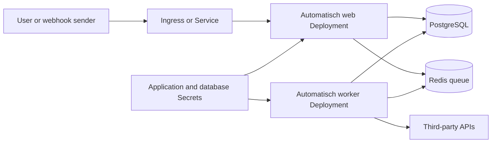

<!-- SPDX-License-Identifier: Apache-2.0 -->
# Automatisch Chart Design

## Scope

This chart deploys Automatisch as the two processes required by the upstream
application: an HTTP web process and a background worker. Both processes use
the same official `automatischio/automatisch` image and the same application,
database, Redis, and cryptographic configuration. PostgreSQL and Redis can be
provided by HelmForge subcharts or by external services.

The chart owns the application Deployments, Service, optional Ingress,
application Secret, optional external-database Secret, optional ServiceAccount,
NetworkPolicy, validation rules, and user-supplied extra manifests. It does not
provision ingress controllers, DNS records, certificates, managed databases,
or backups.

## Architecture

The Service selects only pods labeled `app.kubernetes.io/component: web`.
Worker pods use a separate component selector and therefore never receive HTTP
traffic. The worker sets `WORKER=true`, which makes the upstream entrypoint run
`yarn start:worker`; the web Deployment leaves `WORKER` unset so the entrypoint
runs database migrations, seeds the initial user data, and starts the HTTP
server.

The HTTP listener is controlled by `automatisch.containerPorts.http`. The same
value is used for the container port and the upstream `PORT` environment
variable. `service.port` remains an independent client-facing Kubernetes
Service port and targets the named `http` container port.

## Design Decisions

### Separate web and worker Deployments

Upstream documents main and worker as distinct services. Combining them in one
container would hide failures and prevent independent worker scaling. Separate
Deployments preserve the supported process model, make worker logs explicit,
and allow `worker.replicaCount` to be adjusted without changing the HTTP tier.
The web process intentionally remains a single replica because its upstream
entrypoint performs migrations at startup; concurrent migration execution is
outside this chart's safety guarantees.

### Bundled datastores are convenience defaults

Bundled HelmForge PostgreSQL and Redis make evaluation and small installations
simple. Production operators can disable either subchart and configure
`database.external` and `redis_config.external`. Template validation rejects a
missing external host and rejects missing PostgreSQL credentials before any
Kubernetes resources are applied.

### Stable cryptographic keys

Automatisch uses `ENCRYPTION_KEY`, `APP_SECRET_KEY`, and
`WEBHOOK_SECRET_KEY`. The chart generates them once and preserves them with a
cluster lookup during upgrades. These values must remain stable: replacing the
encryption or webhook key can invalidate stored credentials or webhook
verification. Backup procedures must therefore include the application Secret
as well as PostgreSQL.

### Network policy permits outbound integrations

The default NetworkPolicy limits inbound traffic to the named HTTP port. It
does not restrict egress because Automatisch workflows are specifically meant
to call arbitrary third-party APIs whose address ranges cannot be predicted by
the chart. Operators with a known destination set can replace
`networkPolicy.egress` with DNS, datastore, proxy, and approved endpoint rules.

## Production Boundary

For production, the operator is responsible for all durability and external
service-level objectives. Use managed or highly available PostgreSQL and Redis,
or configure the bundled subcharts with appropriate storage classes and backup
procedures. Preserve the application Secret and test restoration of both the
Secret and PostgreSQL before relying on backups.

Configure a stable HTTPS URL in `automatisch.webAppUrl`, terminate TLS at an
Ingress or another edge proxy, and set resource requests and limits for both
`resources` and `worker.resources`. Review worker concurrency and replica count
against downstream API rate limits. Pin image updates through chart releases
and validate application migrations in a staging environment before production
upgrades.

The default single web replica avoids migration races. High availability of
the HTTP tier requires an upstream-supported migration strategy and is not
enabled by this chart. Worker replicas can be increased independently.

## Security Boundary

The application and worker run as UID/GID 1000 with privilege escalation
disabled, all Linux capabilities dropped, a read-only root filesystem, and the
runtime-default seccomp profile. Kubernetes API tokens are not mounted into
application pods. The official image must continue to support these controls;
the full k3d validation gate detects regressions when the image changes.

The chart stores sensitive material in Kubernetes Secrets, but Kubernetes
Secrets are not encrypted automatically in every cluster. Production clusters
should enable encryption at rest, restrict Secret RBAC, and manage datastore
credentials through an external secret system where required. NetworkPolicy is
not a substitute for application authentication or TLS.

## Observability Boundary

The chart exposes Kubernetes readiness, liveness, and startup probes for the
web listener and relies on Kubernetes pod state and container logs for the
worker. It does not create a ServiceMonitor because Automatisch does not expose
a chart-supported Prometheus metrics contract. Operators should collect web and
worker logs separately and alert on Deployment availability, restart counts,
probe failures, PostgreSQL errors, Redis connection errors, and queue backlog
signals available from their Redis monitoring stack.

The worker has no network listener suitable for a generic probe. Kubernetes
therefore treats the running process as ready; a crashed worker restarts under
the Deployment policy. End-to-end workflow execution remains the strongest
functional health signal.

## Known Gaps and Limitations

- The web Deployment is intentionally fixed at one replica because migrations
  run in the upstream entrypoint.
- The chart has no native Prometheus metrics or ServiceMonitor resource.
- Default egress is unrestricted so workflows can reach arbitrary integration
  APIs; restrictive environments must supply explicit egress rules.
- The generated application Secret is preserved by Helm lookup but is not an
  external backup. Operators must back it up independently.
- Redis authentication and TLS are not currently modeled by the chart's
  external Redis contract.
- The chart does not manage a dead-letter queue or workflow-level retry policy.

## Explicit Non-Goals

- Provisioning or configuring third-party integration accounts.
- Managing TLS certificates, DNS records, or ingress controllers.
- Operating PostgreSQL or Redis backups and restore orchestration.
- Providing horizontal autoscaling for the web process while migrations remain
  coupled to its entrypoint.
- Replacing cluster-level Secret encryption, RBAC, runtime security, logging,
  or alerting systems.

## References

- [Automatisch documentation](https://automatisch.io/docs)
- [Automatisch source](https://github.com/automatisch/automatisch)
- [Chart configuration](docs/configuration.md)
- [Operations guide](docs/operations.md)
- [Security guide](docs/security.md)
