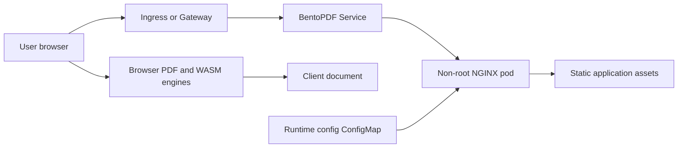
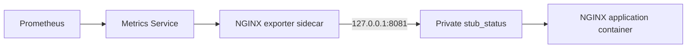

<!-- SPDX-License-Identifier: Apache-2.0 -->

# BentoPDF chart design

## Scope

This chart deploys the official BentoPDF static web application and its NGINX
runtime. It owns the Deployment, Service, ServiceAccount, ConfigMap, optional
Ingress or Gateway API routes, NetworkPolicy, autoscaling and monitoring
resources required to serve the application on Kubernetes.

PDF processing remains in the user's browser. The chart does not add a server
database, document storage, authentication system or backup controller. Edge
authentication, TLS, DNS, browser policy, client backups and any rebuilt
air-gapped image remain operator responsibilities.

## Architecture

The application container serves immutable upstream assets plus a small public
runtime configuration file. Users download the application and process their
documents locally; the tested merge workflow sends no document body back to
the pod.

Optional monitoring adds the official NGINX Prometheus exporter as a sidecar.
It scrapes a loopback-only `stub_status` listener and exposes a separate
metrics Service. A ServiceMonitor and PrometheusRule are rendered only when
explicitly enabled.

## Design decisions

### Preserve the upstream web-server contract

The maintained `files/nginx.conf` is derived from the pinned upstream release
and retains upstream routes, MIME handling, browser-isolation headers, cache
rules and compatibility redirects. HelmForge changes only the listener value,
temporary paths, logging destinations, optional IPv6 listener and private
metrics endpoint. The derived file is attributed under its upstream AGPL-3.0
license in `THIRD_PARTY_NOTICES.md`.

`server.port` changes the real NGINX listener. `service.port` is independent
and targets the named `http` container port. Port 8081 remains reserved for the
loopback status endpoint, and the application listener must differ from the
exporter port.

### Keep runtime configuration public and narrow

The chart writes `config.disabledTools` and
`config.editorDisabledCategories` to `config.json`. These upstream controls
change the visible user interface but are not authorization controls. The file
contains no credentials, and the chart deliberately has no Secret contract.
Branding, `BASE_URL`, CSP and dependency endpoints are build-time concerns and
cannot be safely represented as runtime environment variables for the pinned
image.

### Model a stateless serving tier

Replicas, topology spreading, a disruption budget and CPU autoscaling improve
availability of static asset delivery. They do not distribute PDF processing,
because processing uses client CPU and memory. The HPA therefore measures only
the NGINX application container and may not react to expensive client-side
workflows. The chart rejects a disruption budget for a singleton deployment to
avoid blocking voluntary maintenance.

### Separate browser traffic from pod traffic

NetworkPolicy controls traffic to and from Kubernetes pods. It cannot restrict
CDN, font, OCR or WASM requests made directly by a user's browser. Default pod
egress isolation is still useful because the NGINX runtime does not need
outbound access, but it is not an offline-mode guarantee.

## Production boundary

Production installations should use a dedicated HTTPS origin, preserve the
upstream CSP, Cross-Origin-Opener-Policy and Cross-Origin-Embedder-Policy
headers, and verify required workflows in supported browsers. Plain remote
HTTP is not a secure context and may break SharedArrayBuffer-dependent tools.

Use at least two replicas across failure domains when server availability is
important. A PodDisruptionBudget covers voluntary disruption only, and rolling
updates with `maxUnavailable: 0` need capacity for one surge pod. HPA requires
metrics-server and appropriate CPU requests; it measures static serving rather
than PDF computation.

The chart has no recoverable server-side document dataset. Keep values, edge
configuration and image pins in version control. Recovery recreates the same
stateless serving tier. Users or client-side storage systems must protect the
documents themselves.

## Security boundary

The application runs as upstream UID/GID 101 with RuntimeDefault seccomp, a
read-only root filesystem, all Linux capabilities dropped, no privilege
escalation and no automatically mounted Kubernetes API token. Writable
`emptyDir` volumes are limited to NGINX temporary files and `/tmp`.

The default NetworkPolicy permits application ingress only from same-namespace
pods and denies pod egress. Operators must add explicit edge and monitoring
peers when those components run in other namespaces. NetworkPolicy enforcement
depends on the cluster CNI.

Tool visibility settings are public presentation controls. They do not prevent
a user from invoking equivalent client-side code, changing browser state or
using another BentoPDF deployment. Private installations require authentication
and authorization at the edge.

## Observability boundary

Startup, readiness and liveness probes verify that NGINX serves the application.
The optional exporter exposes NGINX connection and request counters plus
`nginx_up`; it does not observe PDF operations, document contents or browser
errors. The private `stub_status` endpoint is never exposed on the public port.

Behavioral validation launches Chromium, checks isolation and security headers,
loads the runtime configuration, merges deterministic PDFs, parses the
downloaded result and confirms that the application server receives no
document upload. It also checks release-specific redirects and cache behavior.
This proves the selected workflow and serving contract, not every PDF format,
browser extension or upstream tool.

## Upgrade and validation

For every upstream release, verify the official multi-architecture image,
review all skipped release notes and compare the maintained NGINX configuration
with the tagged source. Synchronize `Chart.yaml.appVersion`, `image.tag`,
attribution, tests and site documentation. Browser cache changes and renamed
routes require explicit behavioral coverage.

`make validate-chart CHART=bentopdf` runs dependency checks, strict linting,
all render scenarios, unit tests, kubeconform, Artifact Hub linting and the k3d
browser smoke. Monitoring scenarios additionally prove a real Prometheus scrape.

## Known gaps

- Browser extensions, corporate proxies and TLS interception can break WASM or
  cross-origin isolation independently of Kubernetes health.
- The default image may request third-party assets from the browser and is not
  an air-gapped distribution.
- NGINX metrics do not describe client-side PDF success, latency or failures.
- CPU autoscaling tracks static serving load, not client computation.
- The behavioral smoke covers a representative merge workflow, not every tool
  or input format.
- Edge authentication, certificates and browser support are not operated by the
  chart.

## Non-goals

- Uploading or persisting user documents on the server.
- Adding a database, PVC or backup CronJob to a browser-local application.
- Presenting disabled tools as an authorization mechanism.
- Rewriting upstream CSP, routes or cache policy without versioned evidence.
- Inventing application metrics that BentoPDF does not expose.
- Claiming offline operation without a separately built and validated image.

<!-- @AI-METADATA
 type: guide
 title: BentoPDF design
 description: Product-specific deployment decisions and operational boundaries
 keywords: bentopdf, nginx, browser, architecture
 purpose: Explain implementation tradeoffs and validation scope
 scope: chart
 path: charts/bentopdf/DESIGN.md
 version: 1.1
 date: 2026-10-26
-->
