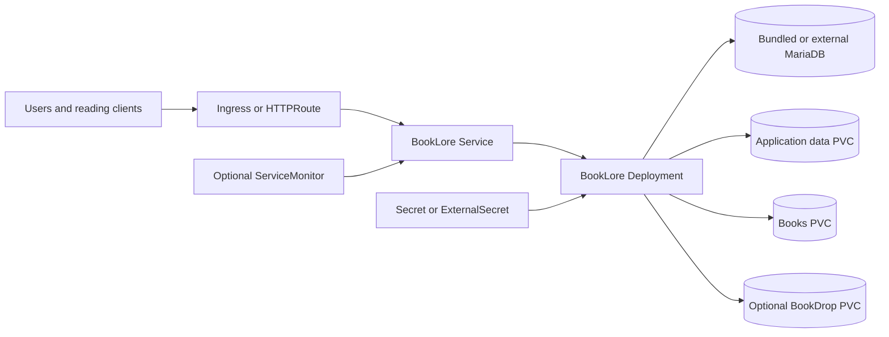

# BookLore Chart Design

## Scope

This chart packages the official BookLore image as a Kubernetes application
backed by MariaDB and three independent filesystem domains. It owns the
Deployment, Service, persistent volume claims, optional routing and policy
resources, database credential wiring, and optional observability resources.

The supported default is one BookLore replica with local persistent storage.
The chart can use an external MariaDB instance and can render Ingress or
Gateway API routes without owning those platform controllers.

## Architecture

The official image contains the Spring Boot API and bundled Angular frontend.
`app.port` configures `BOOKLORE_PORT`, the declared `http` container port, and
all probes. `service.port` remains the independent Kubernetes-facing port and
targets the named container port.

## Design Decisions

- The official `ghcr.io/booklore-app/booklore` image is pinned by default.
- MariaDB is bundled for simple installs and may be replaced by an external
  endpoint and existing Secret.
- `/app/data`, `/books`, and `/bookdrop` have separate persistence contracts so
  operators can size, back up, and restore each data domain independently.
- The Deployment uses `Recreate` by default to avoid overlapping mounts during
  upgrades with `ReadWriteOnce` storage.
- Multiple replicas require `ReadWriteMany` on every enabled persistence
  volume; template validation rejects unsafe combinations.
- `app.diskType=NETWORK` represents the upstream read-safe mode for network
  storage and disables file writes and reorganization.
- Ingress and Gateway API are independent, disabled-by-default exposure paths.

## Production Boundary

The chart owns Kubernetes resources and BookLore runtime wiring. It does not
own DNS, TLS issuers, ingress controllers, Gateway implementations, Storage
Classes, external databases, metadata providers, or backup infrastructure.
Operators must provision and monitor those platform services.

A recoverable deployment requires coordinated backups of MariaDB,
`/app/data`, `/books`, and the optional `/bookdrop` volume. Restores must keep
database and filesystem snapshots consistent. Horizontal scaling remains an
operator-validated topology even when the volumes support `ReadWriteMany`.

## Security Boundary

The pod disables service-account token mounting by default, denies privilege
escalation, applies RuntimeDefault seccomp, and drops all capabilities before
adding only those required by the upstream entrypoint to create and switch to
its runtime user. The main container cannot use a read-only root filesystem
because the pinned upstream entrypoint requires writable runtime paths.

Database credentials come from Kubernetes Secrets or the optional
ExternalSecret integration. Inline passwords are intended for development and
remain visible in Helm release state. TLS policy, external identity-provider
configuration, metadata-provider trust, and cluster-wide admission policy are
operator responsibilities.

## Observability Boundary

Startup, liveness, and readiness probes call the official
`/api/v1/healthcheck` endpoint on the configured application listener. The
chart exposes logs and Kubernetes events as its default operational signals.

The pinned BookLore release does not ship a supported Prometheus endpoint.
ServiceMonitor rendering is therefore opt-in and requires an operator-supplied
image or future upstream endpoint plus the correct
`monitoring.serviceMonitor.path`.

## Known Gaps

- The chart does not create backup or restore jobs.
- Network-attached storage remains subject to upstream limitations even in
  `NETWORK` mode.
- High availability requires application-level concurrency validation beyond
  the PVC access mode checks performed by the chart.
- The writable upstream runtime prevents an immutable-root default.
- ServiceMonitor support cannot be enabled safely with the stock pinned image.

## Non-Goals

- Provisioning DNS, certificates, routing controllers, StorageClasses, or
  external MariaDB services.
- Making `ReadWriteOnce` storage safe for multiple BookLore replicas.
- Managing book-library lifecycle, metadata-provider accounts, OIDC providers,
  or remote-auth proxies.
- Installing operating-system or Java packages during pod startup.
- Claiming disaster recovery without restoring the database and all enabled
  filesystem domains together.

## Validation Focus

The chart validates default and production storage, external and
Secret-provided database credentials, Ingress, Gateway API, External Secrets,
NetworkPolicy, persistence-disabled behavior, and dual-stack Service fields.
Unit tests cover positive rendering and fail-fast validation, including the
multi-replica storage boundary.

## Related Files

- `charts/booklore/README.md`
- `charts/booklore/docs/exposure.md`
- `charts/booklore/docs/storage.md`
- `charts/booklore/docs/production.md`
- `charts/booklore/examples/production.yaml`

---

keywords: booklore, design, mariadb, storage, gateway-api
path: charts/booklore/DESIGN.md
