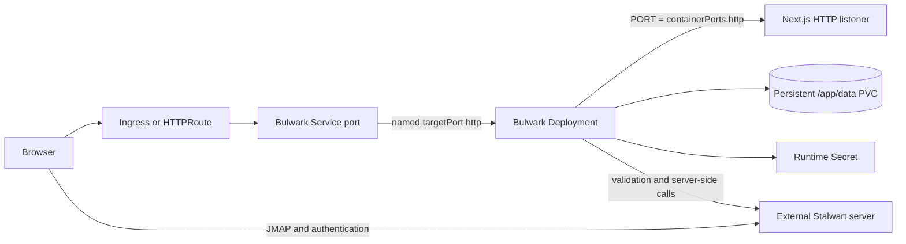

<!-- markdownlint-disable MD013 -->

# Bulwark Mail chart design

## Scope

Provide a secure, reproducible Bulwark 1.15.0 deployment with explicit wizard and declarative modes, durable state, external secret integration, modern HTTP exposure, and behavioral acceptance. The chart owns the Bulwark web application and its local state, not the external mail system.

## Architecture

The browser and Bulwark pod must both reach the configured JMAP origin. The Service port is intentionally independent from the application listener; the Service targets the named `http` container port while `PORT` configures the real Next.js process.

## Design decisions

### Deployment and single-writer strategy

Bulwark is packaged as a Deployment because it has one HTTP identity and no stable network identity requirement. `Recreate` prevents simultaneous attachment and writes against the single RWO data volume during upgrades.

Without a shared store the chart refuses multiple replicas, autoscaling, and a PDB. Bulwark then mutates settings, admin configuration, audit state, telemetry identity, and version-check state on local files, which independent pods cannot share safely.

### Shared store and several replicas

Bulwark images released after 1.19.1 add an upstream multi-instance contract: with `REDIS_URL`, every replica keeps all state in one Redis-protocol store and any number of replicas runs behind a plain Service without sticky sessions or a volume. `sharedStore.enabled` opts into that contract and is the only switch that unlocks `replicaCount` above 1, autoscaling, and the PDB.

The store URL contains the store password, so the chart reads it from a Secret: a dedicated `sharedStore.existingSecret`, or the runtime Secret under `sharedStore.existingSecretKey`. The new values sit outside `secrets` so that the existing `checksum/secret-contract` annotation, and therefore every default rendering, stays unchanged; a separate `checksum/shared-store` annotation is rendered only when the store is enabled.

The chart refuses `persistence.enabled` together with more than one replica or autoscaling. One ReadWriteOnce claim cannot follow pods onto other nodes, and with the store nothing needs it. One replica with the store and its old volume stays allowed because that is the upstream migration path: the first start imports `/app/data` into an empty store. The update strategy follows the volume: `Recreate` while a volume is mounted, `RollingUpdate` without one.

The readiness path defaults to `/api/ready` only when the store is enabled. `/api/ready` reports store reachability, but older images, including the default 1.15.0 tag, answer 404 there, so single-instance installs keep `/api/health` unless `probes.readiness.path` is set. Liveness and startup stay on `/api/health` so a store outage removes pods from the Service without restarting them.

The chart does not install the store. Its lifecycle, persistence, and backup belong to the operator, as with Stalwart; the HelmForge Valkey chart or a managed service can provide it.

### Storage and configuration modes

One volume is mounted once at `/app/data`. Upstream subdirectories remain application-owned. This avoids mounting one claim through duplicate Kubernetes volumes and makes backup and restore atomic across related state. `/tmp` is a separate `emptyDir` so the root filesystem can remain read-only.

Wizard mode follows the upstream installation experience and therefore requires persistence. Declarative mode requires `JMAP_SERVER_URL`, while admin read-only mode is a separate explicit setting. Keeping it writable during bootstrap allows `ADMIN_PASSWORD` to create persisted `admin.json`; operators can enable `config.admin.readOnly` after bootstrap. Both modes retain the PVC for settings and runtime state.

Environment values are not claimed to override existing admin files: upstream precedence deliberately gives saved admin configuration priority. The documentation calls out the migration boundary.

### Secret lifecycle

The session secret is required for remember-me sessions and settings encryption. The default generated Secret uses Helm lookup so upgrades retain the key. Operators may replace it with an existing Secret or an ExternalSecret target.

Admin, OAuth, and JWT master values share one Secret contract but are referenced only by enabled features. JWT impersonation is guarded as a complete tuple because partial configuration is unsafe and non-functional.

### Exposure and network policy

Ingress and Gateway API target the HTTP Service only. They are mutually exclusive to keep ownership and troubleshooting unambiguous. The upstream image bakes base paths during image build, so this chart supports only `/` and fails fast on subpaths.

The default leaves NetworkPolicy disabled for compatibility. The opt-in policy restricts ingress to the named HTTP port and egress to DNS, JMAP ports, and explicit operator additions. The open-by-port default for JMAP avoids pretending the chart can derive an IP selector from a public URL.

## Production boundary

The chart manages the Bulwark Deployment, Service, optional exposure resources, one data PVC, runtime Secret integration, optional NetworkPolicy, and with the shared store an optional HorizontalPodAutoscaler and PodDisruptionBudget. It does not install Stalwart, the shared Redis-protocol store, an ingress or Gateway controller, External Secrets Operator, certificate management, DNS, or storage infrastructure. Operators must provide and operate those dependencies independently.

There are no chart dependencies. Stalwart has an independent lifecycle, storage topology, mail listeners, certificates, DNS, and upgrade risk. Bundling a community Stalwart subchart would weaken both contracts.

## Security boundary

The chart matches upstream UID/GID 1001, drops all capabilities, uses RuntimeDefault seccomp, disables privilege escalation, disables ServiceAccount token mounting, and keeps the root filesystem read-only. Writable paths are intentionally limited to `/app/data` and `/tmp`.

The stable session secret protects remembered sessions and encrypted settings. OAuth client secrets and JWT impersonation credentials remain operator-managed trust roots. NetworkPolicy can reduce traffic reachability but does not authenticate JMAP, OAuth, or administrators. TLS termination and public-route authorization remain outside the chart.

## Observability boundary

Startup, readiness, and liveness probes call `/api/health` on the configured application listener; with the shared store, readiness calls `/api/ready`, which also fails while the store is unreachable. They prove that the Bulwark process responds, not that external JMAP, browser CORS, OAuth, DNS, certificates, or mail delivery work. Bulwark does not expose a chart-supported metrics endpoint; operators should use logs, Kubernetes conditions, and external synthetic login/JMAP checks for production monitoring.

## Known gaps and limitations

- Without the shared store only one replica is supported, so upgrades and node movement cause a short outage.
- The shared store needs a Bulwark image released after 1.19.1; the chart cannot verify the image version.
- The stock image supports root-path hosting only because the base path is a build-time setting.
- Application-level backup orchestration is not provided; consistent recovery requires the complete PVC and matching runtime Secret.
- External JMAP, OAuth, browser CORS, and public TLS behavior cannot be proven by the in-cluster health endpoint.
- Ports below 1024 require the runtime to permit non-root binds for UID 1001.

## Non-goals

- Deploying or operating Stalwart, SMTP, IMAP, DNS, certificates, or mail delivery.
- Claiming horizontal availability without the upstream shared store.
- Installing or operating the shared store.
- Rebuilding Bulwark for arbitrary base paths or custom frontend assets.
- Installing cluster-scoped controllers or CRDs.

## Upgrade and recovery

Recreate upgrades trade a short outage for deterministic single-writer storage. Recovery requires the data PVC and matching session secret, or with the shared store a store backup and the matching session secret. The chart retains newly created PVCs by default to reduce accidental data loss during uninstall.

## Validation

Template tests cover deployment, the real application listener, independent Service ports, storage, secrets, the shared store, autoscaling, PDB, validation failures, HTTP exposure, Gateway API, dual-stack, NetworkPolicy, and External Secrets. Runtime validation checks the exact image, custom and default listeners, Service routing, upstream health, public configuration, session-backed features, and setup-mode behavior.
