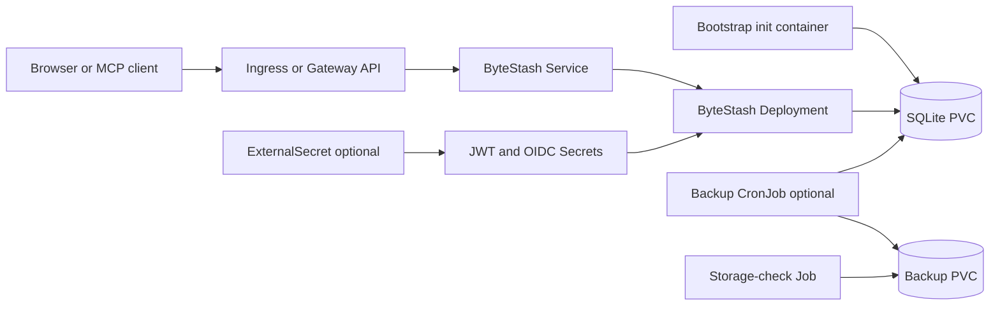

# ByteStash design

## Scope

This chart deploys the official ByteStash image as a private, single-writer
snippet service. It owns the Kubernetes resources needed for protected initial
administrator bootstrap, retained JWT authentication, optional native OIDC,
persistent SQLite storage, HTTP exposure, network isolation, and verified local
snapshots.

The image is used unchanged. The chart imports native database and password
modules in a one-shot init container instead of inventing administrator
environment variables or exposing the upstream first-registration window. It
uses an explicit SQLite transaction around first-user creation and orphan
ownership, then closes the database before the main process starts. Existing
accounts and password hashes are preserved.

## Architecture

The HTTP process uses the fixed upstream port 5000. `BASE_PATH` provides the
native URL prefix, while the Service, Ingress, and HTTPRoute adapt cluster and
public routing. `ALLOWED_HOSTS` is not implemented in the pinned server code, so
the chart does not present it as a security control.

SQLite has one application writer behind a Recreate Deployment. The complete
data directory is mounted at `/data/snippets`; generated claims are retained by
default. Optional snapshot jobs use the image's `better-sqlite3` backup API with
a read-only source connection and publish verified snapshots to a separate PVC.

## Main Design Choices

- Use the pinned official image without a wrapper or patched application build.
- Close first-registration before the listener starts by creating the initial
  administrator through upstream database and password APIs.
- Generate and retain JWT and bootstrap credentials in separate Secrets; mount
  the initial password only in the bootstrap init container.
- Preserve a single replica and Recreate strategy because RWX storage does not
  make SQLite a multi-writer database.
- Keep local authentication available for recovery when native OIDC is enabled.
- Support native OIDC, confidential client credentials, and an additional CA
  bundle without disabling TLS verification.
- Use canonical ExternalSecret items, Ingress, Gateway API, dual-stack Service,
  NetworkPolicy, and explicit scheduling primitives.
- Make backup storage separate from application storage and verify integrity
  before atomic publication.

## Production Boundary

Production operators must provide durable storage, protect the generated or
existing Secrets, configure TLS at the edge, and size CPU, memory, and both PVCs
for the expected user and snapshot volume. Never run two releases against the
same writable database claim. ReadWriteOncePod is rejected when online backup is
enabled because the backup Pod must mount the source claim.

The storage-check Job binds and verifies a generated destination PVC even with
`WaitForFirstConsumer`. A revision-specific name avoids immutable Job template
updates. Backup CronJobs use `Forbid` concurrency, node affinity for RWO source
access, a deadline, integrity verification, retention, and a distinct component
label that cannot become a Service endpoint.

A same-cluster snapshot PVC is not an off-cluster disaster-recovery copy.
Operators must export it through their infrastructure backup system and test the
documented fresh-claim recovery procedure. Helm rollback does not reverse
database migrations.

## Security Boundary

Init, server, and chart-managed backup containers use UID/GID 1000, read-only
root filesystems, dropped capabilities, RuntimeDefault seccomp, restricted
privilege escalation, bounded resources, and no Kubernetes API token. The
default NetworkPolicy permits same-namespace HTTP and DNS; OIDC destinations
require explicit web egress. Backup Pods deny ingress and egress.

Client Secrets remain in Kubernetes Secrets. The main process receives the JWT
key but never the bootstrap password. Existing Secrets and External Secrets are
supported so production credentials can remain under an external lifecycle.
Additional containers, volumes, environment variables, edge configuration, and
Secret access are operator-controlled trust extensions.

Native OIDC validates signed identity tokens and returns the application token
in an HttpOnly cookie, but enrollment policy belongs at the provider. The edge
must overwrite forwarded headers, constrain accepted hostnames, and limit Pod
ingress because the upstream process trusts proxy headers.

## Observability Boundary

Startup and readiness probes use the initialized authentication configuration
endpoint; liveness checks the HTTP application. Kubernetes Deployment, Pod,
PVC, Job, CronJob, event, and log signals cover the workload and snapshot flow.
The runtime smoke validates native authentication, registration policy, Unicode
snippet content, persistence, retained JWT sessions, MCP API keys, and OIDC.

The pinned application exposes no stable native Prometheus endpoint, so the
chart does not deploy an unrelated exporter or ServiceMonitor. Metrics
collection, alerting, log retention, synthetic public checks, certificate
monitoring, and off-cluster backup monitoring belong to the platform.

## Known Gaps and Improvement Candidates

- Native OIDC cannot express chart-level email-domain or group admission; apply
  that policy at the identity provider.
- Session duration and revocation remain controlled by the upstream token
  implementation rather than by chart-level policy.
- Proxy hostname validation depends on the ingress or Gateway implementation.
- The snapshot workflow does not copy data outside the cluster.
- There is no application-native Prometheus endpoint or supported HA topology.

## Explicit Non-Goals

- modifying or rebuilding the official ByteStash image
- multiple application replicas against one SQLite database
- an external SQL database that ByteStash does not support
- installing an ingress controller, Gateway API CRDs, External Secrets Operator,
  cert-manager, an identity provider, or a monitoring stack
- treating the bootstrap Secret as a continuing password reconciler
- provider-specific OIDC claim filtering or automatic account linking
- off-cluster backup transport or storage-system snapshot orchestration

## Validation Strategy

Runtime validation covers protected bootstrap, anonymous denial, enrollment
rejection, Unicode snippet creation, persistence after Pod replacement, JWT
retention, MCP discovery and revocation, trusted HTTPS OIDC, signed identity,
state replay rejection, S256 PKCE, snapshot retention, and fresh-PVC restore.
Every CI values profile is installed sequentially on local k3d by the mandatory
chart gate.

<!-- @AI-METADATA
type: design
title: ByteStash design
description: Native bootstrap, single-writer storage, consistent backups and honest authentication boundaries.
keywords: bytestash, sqlite, design, bootstrap, backup
purpose: Explain architecture choices and validation of production behavior.
scope: charts/bytestash
relations: [README.md, docs/operations.md]
path: charts/bytestash/DESIGN.md
version: 1.1
-->
