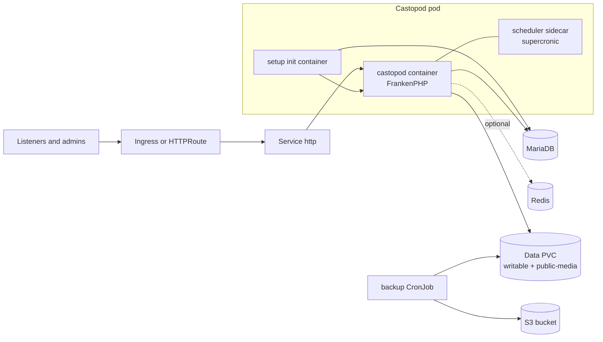

<!-- SPDX-License-Identifier: Apache-2.0 -->
# Castopod: Chart Design

## Scope

The HelmForge `castopod` chart runs [Castopod](https://castopod.org), an
open-source podcast hosting platform (publishing, RSS feeds, web player,
analytics, and ActivityPub federation), from the official
`docker.io/castopod/castopod` image. It covers a single application replica
backed by MariaDB, with optional Redis caching, persistent media storage,
Ingress or Gateway API exposure, and S3 backups of the data volume.

## Architecture

All three containers use the same pinned Castopod image:

1. `setup` waits for MariaDB, seeds the media directory on the volume, runs the
   upstream bootstrap script (writes `.env`, applies migrations, clears the
   cache), copies `.env` to an in-memory volume, and creates the superadmin
   when none exists.
2. `castopod` runs `frankenphp run` with the upstream Caddyfile. The listener
   comes from `CADDY_HTTP_PORT`, set from `castopod.port`.
3. `scheduler` runs `supercronic` with the upstream crontab (`spark tasks:run`
   every minute) for scheduled publishing, WebSub, and federation tasks.

## Design Choices

- **No s6-overlay supervisor.** The upstream `/init` relies on a setuid
  `s6-overlay-suexec` binary, which fails under `allowPrivilegeEscalation:
  false` and `drop: [ALL]`. The chart runs the two long-lived processes the
  supervisor would start (FrankenPHP and supercronic) as separate containers
  and moves the one-shot bootstrap into the setup init container. This keeps
  upstream scripts and configuration unchanged while allowing a non-root,
  no-escalation pod.
- **Schema and superadmin without the web wizard.** Migrations run on every
  pod start through the upstream bootstrap. The superadmin is created with
  `spark install:create-superadmin` from a Secret, so a fresh instance is never
  exposed with an open `/cp-install` page. Set `castopod.admin.create=false`
  to use the wizard instead.
- **Stable secrets.** The analytics salt and generated superadmin password are
  read back from their Secrets on upgrade. A changing salt would split the
  analytics history.
- **One volume, two mounts.** The volume root stays mounted at
  `/var/www/html/writable` (compatible with earlier releases) and the
  `public-media` subPath holds `/var/www/html/public/media`, where Castopod
  stores uploaded audio and images.
- **Database port in `.env`.** The upstream bootstrap does not write the
  database port into `.env`, so the setup container runs a copy of the
  bootstrap script that adds `database.default.port` and fails if the
  upstream script layout changes.
- **Base URL derivation.** `castopod.baseURL` falls back to the first Ingress
  host, then the first HTTPRoute hostname, then `http://localhost:8080`.
  HTTPS redirection is disabled only for `http://` URLs.

## Production Boundary

- Single replica. Media lives on a `ReadWriteOnce` volume and Castopod does
  not coordinate several writers. For horizontal scale, configure S3 media
  (`CP_MEDIA_FILE_MANAGER=s3` through `castopod.extraEnv`) and an external
  MariaDB first.
- Set `castopod.baseURL` to the public HTTPS URL before publishing feeds; feed
  and federation URLs embed it.
- The backup CronJob archives the data volume only. Back up MariaDB with the
  MariaDB chart or the managed database provider.

## Security Boundary

- Pod runs as `www-data` (uid 33) with `runAsNonRoot`, `RuntimeDefault`
  seccomp, no ServiceAccount token, no privilege escalation, and every
  capability dropped except `NET_BIND_SERVICE`. The FrankenPHP binary carries
  that file capability, so the kernel refuses to execute it when the
  capability is missing from the bounding set. Ports below 1024 are rejected
  by the schema because the capability is not effective without escalation.
- The root filesystem stays writable: Caddy writes to `/config` and `/data`,
  and the bootstrap writes `.env` in the image tree.
- Database, Redis, analytics, and superadmin credentials come from Secrets.
  The rendered `.env` lives in a memory-backed `emptyDir`. The setup container
  hides the `.env` dump that the upstream bootstrap prints.
- Castopod refuses Redis without a password, so the chart requires Redis
  authentication.

## Observability Boundary

- Probes call `/healthcheck`, answered by the FrankenPHP server. They confirm
  the web server is serving, not that MariaDB is reachable.
- Application logs go to stdout and stderr of the `castopod` container; setup
  and scheduler logs are separate containers.
- The chart does not ship metrics, ServiceMonitors, or dashboards; Castopod
  exposes no Prometheus endpoint.

## Current Gaps and Improvement Candidates

- No NetworkPolicy or PodDisruptionBudget templates.
- No ExternalSecret integration; credentials use Kubernetes Secrets or
  existing Secrets.
- The backup CronJob does not apply the pod hardening used by the application
  pod and does not dump MariaDB.
- No external Redis option; only the Redis subchart is wired.

## Explicit Non-Goals

- Multi-replica or active-active Castopod.
- Managing DNS, TLS certificates, or the Gateway itself.
- Running the upstream s6-overlay supervisor.
- Transcoding or CDN configuration beyond what Castopod supports through
  environment variables.
