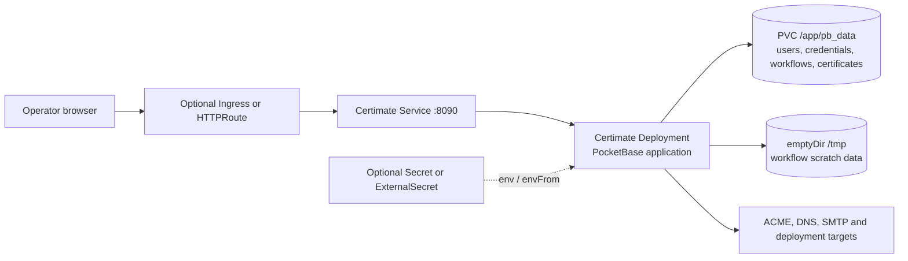

# Certimate chart design

## Scope

Certimate is packaged as a single web application container. The upstream Docker deployment exposes HTTP on port `8090` and persists all runtime state in `/app/pb_data`.

The chart owns one Certimate OSS workload, its HTTP Service, durable storage and
optional Kubernetes exposure and policy resources. It does not manage external
DNS providers, ACME accounts, target systems or certificate consumers.

## Architecture

### Workload model

The chart uses a Deployment with `Recreate` strategy and defaults to
`replicaCount: 1`. This avoids concurrent writers against the same PocketBase
data directory. Operators that need more than one replica must provide storage
semantics that are safe for their environment and set
`persistence.existingClaim`. A Recreate update intentionally interrupts the UI
and workflow execution so two PocketBase writers do not overlap.

### Storage

The generated PVC is mounted at `/app/pb_data`. This directory contains
application data, user accounts, provider credentials, ACME state, workflows,
and issued certificate material. Backup and restore procedures should treat the
whole directory as sensitive.

Certimate is PocketBase-backed in the upstream container. The chart deliberately
does not add PostgreSQL, MySQL, or Redis subcharts because there is no official
external database contract to wire those dependencies safely. A database subchart
would create a false production signal without moving Certimate state out of
`/app/pb_data`.

Disabling persistence is a breaking, explicit choice: users must set
`persistence.ephemeral=true` together with `persistence.enabled=false`. This
keeps disposable CI and demo installs available while preventing accidental loss
of certificates, ACME accounts, provider credentials, and workflow state.

Certificate workflows create temporary processing files under `/tmp`. The chart
mounts a dedicated ephemeral `emptyDir` there so these workflows remain
functional while `securityContext.readOnlyRootFilesystem` stays enabled. Operators
can set `tmpStorage.sizeLimit` to bound the volume and apply the same value as the
container's ephemeral-storage request and limit.

### Exposure

The chart supports Kubernetes Ingress and Gateway API HTTPRoute. TLS termination is expected at the ingress controller or gateway. Certimate itself remains an internal HTTP service.

### Secrets

Certimate manages most user and provider secrets inside PocketBase. The chart
does not invent a separate configuration file. `app.env`, `app.envFrom`, and
`externalSecrets.items` are available for deployment-specific environment
variables.

### Network policy

NetworkPolicy is optional because certificate workflows vary widely. Production
installs should enable it and model required egress explicitly: DNS provider
APIs, ACME endpoints, SMTP, webhook receivers, SSH/API targets, and Kubernetes
services used by deployment tasks.

## Design decisions

The chart uses the official pinned image without a wrapper or sidecar. PocketBase
state remains on one volume because upstream does not expose a supported external
database contract. The root filesystem is read-only while `/tmp` receives a
dedicated ephemeral volume for certificate processing. The application listener
is configured separately from `service.port`, and probes address the named
container port. Optional integration objects are rendered only when operators
enable them; the chart does not install ingress, Gateway API or ESO controllers.

## Production boundary

Operators own PVC snapshots, restore testing, public DNS, TLS termination,
NetworkPolicy egress destinations and credentials for ACME, DNS, SMTP, webhooks
and certificate deployment targets. Upgrades may run PocketBase migrations and
must start from a tested backup. Recreate strategy means planned downtime, and
active workflows should be quiesced before application-version changes.

## Security boundary

The default container runs as UID/GID 1000, drops Linux capabilities, prevents
privilege escalation, uses RuntimeDefault seccomp, mounts no Kubernetes API token
and keeps its root filesystem read-only. The PVC contains provider credentials,
account data, private keys and issued certificates, so storage encryption and
backup access are security controls. External Secrets can inject environment
credentials, but provider policy and rotation remain outside the chart.

## Observability boundary

HTTP startup, readiness and liveness probes verify `/api/health`. Kubernetes Pod
status, events, restart counts, resource metrics and Certimate logs are available
to operators. These signals do not prove successful ACME issuance, DNS propagation
or deployment to every target. Production acceptance must monitor certificate
expiry and execute representative workflows against configured providers.

## Known gaps and limitations

- PocketBase is a single-writer availability boundary; the chart is not HA.
- Recreate upgrades interrupt the UI and workflow execution.
- Strict NetworkPolicy egress cannot be inferred because workflows use arbitrary
  external providers and deployment targets.
- The chart cannot validate external DNS propagation, SMTP delivery or target
  system authorization.

## Non-goals

The chart does not add PostgreSQL, MySQL, Redis, certificate-manager integration,
provider-specific credentials, DNS records, external controllers or a backup
service. It does not replace Certimate's workflow engine or promise zero-downtime
PocketBase migrations.

## Validation

The chart includes unit tests for rendering, storage, exposure, Gateway API,
NetworkPolicy, ExternalSecret, and validation failures. Runtime readiness is
verified through the HelmForge `make validate-chart CHART=certimate` gate.
