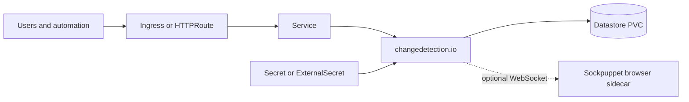
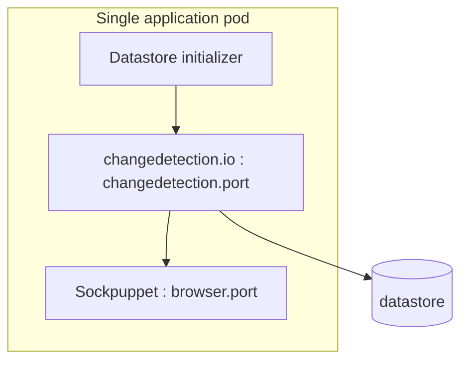

# changedetection.io Chart Design

## Scope

This chart packages changedetection.io as a single-instance Kubernetes
workload for website change monitoring. It owns the application Deployment,
Service, datastore PVC, optional routing resources, optional ExternalSecret,
and an optional Sockpuppet browser sidecar for JavaScript-rendered targets.

The chart preserves the upstream file-based datastore model. It provides
production-oriented security defaults, explicit listener contracts, and
behavioral validation without pretending that a file-backed application can
be horizontally scaled safely.

## Architecture

The Service selects only the application pod and targets the named `http`
port. `changedetection.port` configures both the container declaration and the
upstream `PORT` environment variable. When browser rendering is enabled,
`browser.port` is passed to Sockpuppet through its `--port` argument, while
`--host 127.0.0.1` constrains the WebSocket listener to loopback. The same
address is used in `PLAYWRIGHT_DRIVER_URL`; the browser listener is never
exposed by a Service.

## Design Decisions

- The Deployment uses one replica with the `Recreate` strategy because the
  upstream JSON datastore and snapshots are not safe for concurrent writers.
- Persistence is enabled by default. Watches, history, screenshots, settings,
  and optional Python user packages all live below `/datastore`.
- A datastore initializer disables upstream sample watches on a fresh volume
  unless `changedetection.defaultWatches.enabled=true` is explicit.
- The browser runs as a same-pod sidecar and is explicitly bound to loopback.
  This avoids a remotely reachable browser-control endpoint.
- The browser image is pinned by digest. Its real listener is configurable
  through the supported Sockpuppet `--port` command-line option.
- The browser has its own restricted container security context: non-root,
  privilege escalation disabled, and all Linux capabilities dropped.
- Ingress and Gateway API are independent, disabled-by-default routing
  choices. Operators are responsible for selecting one coherent edge path.
- External Secrets support materializes generic environment variables rather
  than inventing chart-specific copies of upstream notification settings.
- `service.port` is the Kubernetes-facing port and remains independent from
  the application listener in `changedetection.port`.

## Production Boundary

The chart owns Kubernetes resources and the wiring between them. It does not
own DNS, TLS issuers, ingress controllers, Gateway implementations, Storage
Classes, backup controllers, external secret stores, or notification
providers. Production operators must provide those platform capabilities.

A complete backup contains the entire `/datastore` tree. Restoring only
`changedetection.json` can omit watch directories, snapshots, or installed
packages. Rollback should restore a backup made with the matching application
image because upstream storage changes are not reversed by changing an image
tag.

Browser mode needs substantially more memory and CPU than plain HTTP fetching.
Operators should lower `changedetection.fetchWorkers`, set explicit browser
resources, and measure target-page behavior before increasing concurrency.

## Security Boundary

The default pod runs the application as a non-root UID/GID, drops all Linux
capabilities, disables privilege escalation, and uses RuntimeDefault seccomp.
The Kubernetes API token is not mounted by default. The root filesystem stays
writable because the upstream runtime expects it; durable state is isolated on
`/datastore`.

The browser-control port is loopback-only at the architecture level: no
Service selects it. Exposing that port through an extra manifest or sidecar
proxy expands the trust boundary and is the operator's responsibility.
The browser security context is separate from the application context so
operators can adjust image-specific requirements without weakening the main
container.

changedetection.io blocks private and reserved target addresses by default.
Setting `ALLOW_IANA_RESTRICTED_ADDRESSES=true` permits server-side requests to
internal networks and should be treated as an SSRF boundary change. Keep the
application authenticated and restrict its users before enabling it.

Secrets should enter through a Kubernetes Secret, `changedetection.envFrom`,
or the optional ExternalSecret. Plain values and rendered manifests are not a
secret store.

## Observability Boundary

Startup, liveness, and readiness TCP probes verify that the configured
application listener accepts connections. The behavioral gate additionally
checks the web UI, persisted watch workflow, image version, and optional
browser listener wiring.

The chart does not create a ServiceMonitor because the pinned application does
not expose a stable Prometheus metrics contract. Operators should use pod
logs, Kubernetes events, probe status, application notifications, and
synthetic checks through the Service. Browser-sidecar logs are required when
JavaScript fetches fail while plain HTTP fetches succeed.

## Known Gaps

- The upstream datastore prevents safe active-active replicas and rolling
  updates.
- The browser sidecar has no chart-managed NetworkPolicy because this chart
  does not currently render NetworkPolicy resources.
- Probe success confirms the listener, not successful access to every remote
  target or notification provider.
- The browser statistics listener is not exposed or scraped by the chart.
- Writable-root requirements prevent enabling
  `readOnlyRootFilesystem=true` by default without upstream changes.

## Non-Goals

- Providing a distributed database or shared-state scaling layer.
- Managing notification-provider accounts or credentials.
- Exposing the Sockpuppet WebSocket or statistics listeners outside the pod.
- Installing arbitrary operating-system packages during container startup.
- Managing cluster-wide routing, certificate, storage, backup, or secret-store
  controllers.

## Validation Focus

The chart validates default persistence, browser rendering with a non-default
listener, Ingress, Gateway API, External Secrets, dual-stack Service fields,
and a real create-change-detect workflow on k3d. Unit tests cover rendered
resources and fail-fast value validation; the full release gate also runs
strict linting, kubeconform with real schemas, Artifact Hub linting, and
behavioral installs.

## Related Files

- `charts/changedetection/README.md`
- `charts/changedetection/docs/production.md`
- `charts/changedetection/examples/production.yaml`

---

keywords: changedetection, monitoring, website-monitoring, design
path: charts/changedetection/DESIGN.md
