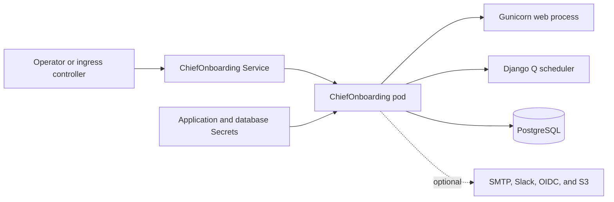

<!-- SPDX-License-Identifier: Apache-2.0 -->

# ChiefOnboarding Chart Design

## Scope

The `chiefonboarding` chart deploys the official ChiefOnboarding employee
onboarding application as one Kubernetes Deployment. It provides a stable
contract for the Django secret key, PostgreSQL connectivity, process and
Service ports, health probes, optional Ingress, scheduling, and additional
manifests. The default topology includes the maintained HelmForge PostgreSQL
subchart. A managed PostgreSQL endpoint can replace it without changing the
application workload.

The chart owns Kubernetes orchestration and the supported environment-variable
bridge. ChiefOnboarding owns application migrations, static asset collection,
the Gunicorn process, and its Django Q scheduler through the official image's
Supervisor configuration.

## Architecture

One pod contains the upstream Supervisor process, Gunicorn web server, and
Django Q scheduler. A `wait-for-db` init container checks the selected
PostgreSQL endpoint before Supervisor starts. The Service always targets the
named `http` container port, so `service.port` remains a client-facing contract
that is independent from `chiefonboarding.port`.

ChiefOnboarding 2.5.0 hard-codes `0.0.0.0:8000` in its packaged Supervisor
configuration. On a new database, Supervisor also starts Django Q concurrently
with migrations in the web command, which can make the scheduler query tables
that do not exist yet. The chart first applies the idempotent migrations, then
copies the Supervisor configuration to `/tmp`, replaces only the Gunicorn bind
literal with the validated `chiefonboarding.port`, and starts Supervisor from
the copy. The upstream web command safely repeats migrations. This preserves
the process topology while preventing first-boot scheduler tracebacks and making
the advertised listener value real. The runtime smoke test performs an HTTP
request against the configured port and tests a Django Q task.

## Design decisions

### Official immutable image

The default image is the official
`docker.io/chiefonboarding/chiefonboarding:v2.5.0` artifact, pinned to its
verified manifest digest. The tag communicates the upstream release and the
digest prevents registry tag replacement from changing deployed bytes. Users
can override both fields for controlled testing, but floating tags are outside
the supported production path.

### Database modes

Bundled mode uses the HelmForge PostgreSQL dependency and its stable auth
Secret contract. External mode requires an explicit host plus either an inline
password or an existing Secret. Inline passwords exist for disposable tests;
production deployments should use `database.external.existingSecret`.

The application receives the password through a Secret reference and a
`DATABASE_URL` containing the shell-style `$(DATABASE_PASSWORD)` token. The
Kubernetes environment expansion resolves that token without exposing the
literal password in the Deployment manifest.

### Stable application identity

When no application Secret is supplied, the chart creates a random Django
secret key and uses `lookup` to retain the existing value on upgrade. The
generated Secret has Helm's keep policy so an uninstall does not silently
invalidate sessions, password-reset links, and CSRF tokens. Operators remain
responsible for backing it up and deliberately deleting it when retiring an
installation. A configured value or existing Secret is preferred for
production recovery workflows.

### Rollout behavior

A checksum derived from application and external database values rolls the pod
when Helm-managed configuration or Secret references change. Kubernetes and
Helm cannot observe data-only changes inside an externally managed Secret;
operations guidance therefore requires an explicit rollout restart after such
rotation.

## Production boundary

The chart defaults to one application replica because the official container
co-locates the web process and Django Q scheduler. Horizontal scaling could
duplicate scheduled work unless upstream behavior and queue locking are tested
for that topology, so replica and autoscaling controls are intentionally not
exposed. Availability depends on Kubernetes rescheduling and PostgreSQL
recovery, not active-active application pods.

The bundled PostgreSQL mode is convenient for evaluation and small
installations. Production platforms should choose storage classes, backup and
restore tooling, encryption, high availability, and maintenance policies based
on their recovery objectives. The chart does not create backups or validate
external database TLS.

Resources remain unset because workload size depends on employee count,
integrations, document traffic, and background jobs. Production values must set
requests and limits after measuring the real workload. Internet-facing
installations must configure TLS, the public base URL, ingress policy peers,
and any proxy upload limits.

## Security boundary

The application pod disables service-account token mounting, uses
`RuntimeDefault` seccomp, forbids privilege escalation, and drops all Linux
capabilities. The official image explicitly runs Supervisor and both child
processes as root and writes static files plus Supervisor state at startup;
therefore `runAsNonRoot` and a read-only root filesystem are documented
upstream compatibility exceptions rather than misleading defaults.

Ingress isolation is enabled by default. The NetworkPolicy permits same-release
pods and additional peers supplied through `networkPolicy.ingressFrom`; it does
not restrict egress because ChiefOnboarding commonly needs operator-specific
SMTP, Slack, OIDC, S3, and other integration destinations. Clusters must run a
NetworkPolicy-capable CNI for enforcement. Ingress controllers outside the
release namespace require an explicit namespace or pod selector.

Kubernetes Secrets protect delivery, not source control. Operators must use a
secret manager or encrypted delivery path, apply least-privilege access to
Secrets, rotate credentials, and audit integration tokens. The chart never
prints secret data in NOTES.

## Observability boundary

Startup, readiness, and liveness probes perform HTTP checks against the named
application listener. Supervisor sends application and scheduler output to the
container streams. The behavioral gate additionally verifies migrations,
network HTTP behavior, Django Q task execution, the image digest, the Service
target, and optional server-side S3 operations.

The chart does not create a ServiceMonitor, dashboards, alerts, or a structured
logging pipeline because the upstream application does not publish a stable
Prometheus metrics endpoint. Platform operators should collect container logs,
Kubernetes events, restart counts, HTTP availability, PostgreSQL health,
background task failures, and integration delivery failures.

## Known gaps

- The upstream image requires root and writable image paths.
- One pod owns both web and scheduled background work.
- There is no upstream Prometheus endpoint or chart-managed metrics exporter.
- NetworkPolicy cannot express DNS names for external integrations.
- The chart does not automate PostgreSQL backup, restore, or schema rollback.
- External Secret data changes require an explicit application rollout.

These gaps are documented constraints, not promises deferred to templates that
cannot implement them safely.

## Non-goals

The chart does not configure ChiefOnboarding workflows, create application
users, provision Slack or identity-provider applications, manage SMTP or S3
accounts, operate PostgreSQL backups, install an ingress controller, or choose
cluster-wide security policy. It also does not replace the upstream Supervisor
topology, compile application dependencies at startup, or claim horizontal
scaling guarantees that have not been behaviorally validated.
