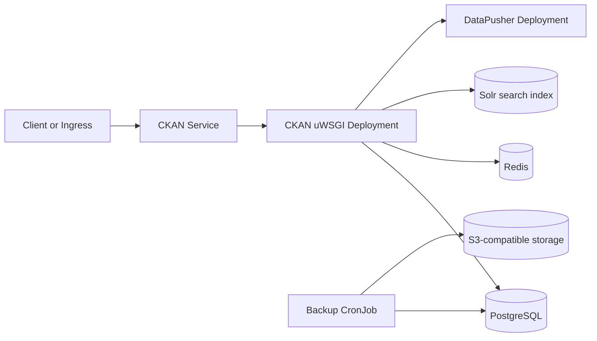

<!-- SPDX-License-Identifier: Apache-2.0 -->
# CKAN chart design

## Scope

This chart runs CKAN, DataPusher, and a CKAN-configured Solr instance. It owns
application secrets, file-storage persistence, Services, optional Ingress,
NetworkPolicy, and an optional PostgreSQL backup CronJob. PostgreSQL and Redis
may come from HelmForge subcharts or operator-managed services; Solr may be
bundled or external.

CKAN catalog state belongs in PostgreSQL, uploaded resources belong on the CKAN
storage volume, and the Solr index is rebuildable search state. Redis is an
operational cache. Application pods are otherwise replaceable.

## Architecture

The CKAN process runs the official uWSGI application and binds to
`ckan.containerPort`. The Service targets the named `http` port, keeping the
cluster-facing `service.port` independent. DataPusher and Solr also receive
their configured ports at process startup; their values do not merely rename
container ports.

CKAN waits for PostgreSQL, Redis, and bundled Solr before starting. The official
image then initializes or upgrades the CKAN database, updates configuration,
and creates the sysadmin idempotently. Startup, liveness, and readiness probes
cover the public CKAN process.

## Decisions

### Use official application initialization

The official CKAN image implements database initialization, schema upgrades,
plugin configuration, dependency checks, and idempotent sysadmin creation in
`prerun.py`. The chart prepares Secret-backed connection settings and delegates
those application-specific operations to that version-matched implementation.

### Build connection URLs inside the container

PostgreSQL and Redis passwords remain Secret-backed environment variables.
Python URL-encodes usernames, passwords, database names, and SSL settings before
creating connection URLs. Rendered ConfigMaps and workload arguments never
contain credential values.

### Preserve generated application secrets

When no existing Secret is supplied, Helm generates the sysadmin password,
session secret, and JWT secret once and preserves their encoded values with
`lookup` during upgrades. Reinstalling the release cannot recover a deleted
Secret, so production installations should supply an operator-managed Secret
that is included in the recovery plan.

### Explicit datastore modes

Exactly one PostgreSQL mode and one Redis mode must be active. The chart rejects
a disabled subchart in `subchart` mode and an enabled subchart in `external`
mode. External services require a host and Secret-backed or inline credentials.
Replication topology connects CKAN to the writable primary Service.

## Production boundary

The chart provides Kubernetes wiring but does not create a complete high-
availability platform:

- Use managed or replicated PostgreSQL and Redis when recovery objectives
  require them.
- Back up PostgreSQL, the CKAN file volume, and operator-managed Secrets from a
  consistent recovery point.
- Treat the Solr index as rebuildable state, while still planning the time and
  capacity required for a reindex.
- Test every CKAN extension against the pinned CKAN release before upgrading.
- Supply realistic resources, disruption controls, and topology constraints.
- Keep external DataStore databases and roles provisioned according to the
  upstream least-privilege model when the `datastore` plugin is enabled.

Bundled PostgreSQL, Redis, and Solr are persistent standalone instances. They
are appropriate for evaluation and modest workloads, not automatic HA.

## Security boundary

CKAN runs as UID/GID 503/502, DataPusher as 92/92, and Solr as 8983/8983, matching
the official images. Each workload disables privilege escalation, drops Linux
capabilities, uses `RuntimeDefault` seccomp, and avoids the Kubernetes API token
by default. CKAN keeps a writable root filesystem because the official startup
script updates `/srv/app/ckan.ini`; this exception is explicit rather than
claiming unsupported read-only-root operation.

NetworkPolicy exposes only the CKAN listener to configured cluster sources and
allows CKAN pods to reach the internal DataPusher and Solr ports. Egress is open
by default because CKAN downloads user-selected resources and can call external
extensions. Replace `networkPolicy.egress` with environment-specific DNS,
datastore, and remote-source rules where practical.

Inline passwords are compatibility options. Production installations should
use existing Secrets or an external secret controller and must include the
session and JWT keys in encrypted backup and rotation procedures.

## Observability boundary

Kubernetes probes call CKAN's `status_show` action or verify the listener. They
do not prove that a search query, DataPusher job, extension, remote resource,
backup, or restore is healthy. Operators should collect CKAN, DataPusher, Solr,
PostgreSQL, and Redis logs and metrics, monitor backup Job completion, alert on
probe failures and restart loops, and test user-level API requests.

The chart provides standard labels for collection but does not create a
ServiceMonitor because CKAN metrics integrations and monitoring stacks vary.
Add environment-specific exporters and monitors through `extraManifests`.

## Known gaps

- DataStore databases and least-privilege roles are not provisioned by the
  chart; operators must prepare them before enabling DataStore plugins.
- CKAN file storage uses a single PVC and does not provide object-storage
  replication.
- The built-in backup covers one PostgreSQL database, not file storage, Redis,
  Solr, or application Secrets.
- The chart does not automate CKAN extension installation.
- NetworkPolicy cannot infer every remote resource or extension destination.

## Non-goals

- Provisioning datasets, organizations, users, API tokens, or extension data.
- Building custom CKAN images or packaging third-party extensions.
- Managing external PostgreSQL, Redis, Solr, object storage, DNS, or TLS
  infrastructure.
- Replacing provider-native backup, restore, replication, and disaster-recovery
  controls.
- Automatically scaling stateful components or validating extension-specific
  health endpoints.

## References

- [CKAN documentation](https://docs.ckan.org/en/2.12/)
- [CKAN DataStore](https://docs.ckan.org/en/2.12/maintaining/datastore.html)
- [CKAN source](https://github.com/ckan/ckan)
- [Chart configuration](docs/configuration.md)
- [External datastore example](examples/external-datastores.yaml)
