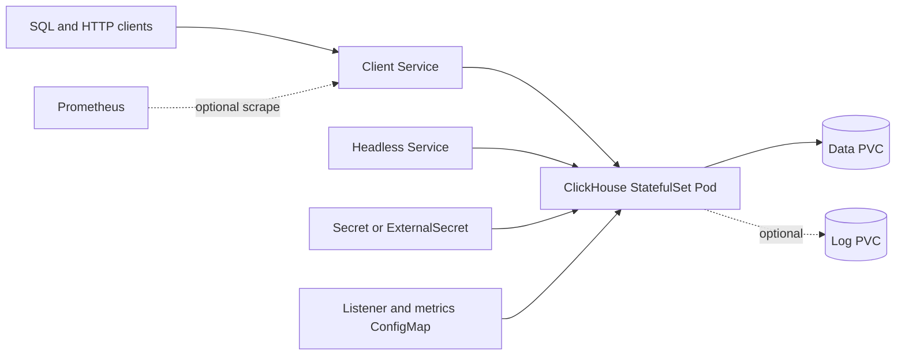
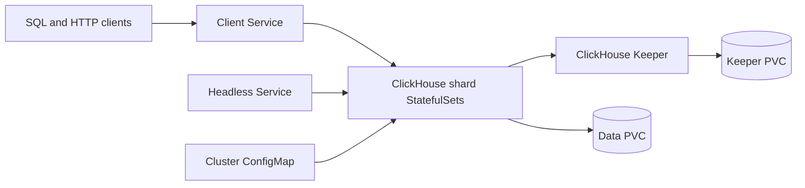

# ClickHouse Chart Design

## Scope

This chart deploys the official ClickHouse server image as either a
**standalone** StatefulSet or a **replicated** multi-node topology with optional
in-chart ClickHouse Keeper (or external ZooKeeper/Keeper endpoints).

## Architecture

### Standalone (default)

### Replicated

Replicated mode renders one StatefulSet per shard (`{release}-clickhouse-shardN`)
with `replicasPerShard` pods, a shared headless Service for stable DNS, cluster
XML (`remote_servers`, `zookeeper`/`keeper` nodes, macros via init container),
and optionally a Keeper StatefulSet (`{release}-clickhouse-keeper`).

## Design Decisions

- Default `architecture=standalone` preserves the previous single-replica chart
  behavior and fails rendering for `replicaCount > 1`.
- `architecture=replicated` is the supported path for multi-node clusters; it
  requires in-chart Keeper or `replicated.externalZookeeper.servers`.
- Use official `clickhouse/clickhouse-server` and `clickhouse/clickhouse-keeper`
  images (no Bitnami paths).
- Generate per-pod `macros` and `interserver_http_host` with an init container so
  each replica has a unique identity under Keeper.
- Keeper `server_id` is injected per ordinal (`ordinal + 1`) into the shared raft
  configuration.
- Keep External Secrets, ServiceMonitor, and NetworkPolicy opt-in.

## Production Boundary

Production operators must supply authenticated credentials, size and monitor
storage, set resources from measured query load, take tested backups, and plan
database upgrades before a new server version writes persisted data. A rolling
StatefulSet update reuses the same data PVC; Kubernetes rollback does not undo
on-disk format or metadata changes.

Standalone has planned downtime during restart. Replicated mode provides
replica redundancy for Replicated* table engines and `ON CLUSTER` DDL when
applications use the configured `replicated.clusterName` (default `default`).

## Security Boundary

By default, the server runs as UID/GID `101`, drops Linux capabilities,
disables privilege escalation, and does not mount a ServiceAccount token. The
empty password default is only for isolated evaluation. Production users must
provide an existing Secret or ExternalSecret.

## Observability Boundary

Startup, readiness, and liveness probes use the configured HTTP listener for
ClickHouse and TCP probes for Keeper. The optional native Prometheus endpoint
and ServiceMonitor expose server metrics.

## Known Gaps And Operational Risks

- TLS for server/Keeper is not yet first-class (use `extraConfig` / external
  cert management until a dedicated values surface lands).
- Backup creation, off-cluster retention, and restore remain operator
  responsibilities.
- Migrating from Bitnami charts requires path, metrics-port, and auth value
  remapping (`/bitnami/clickhouse` → `/var/lib/clickhouse`, metrics `8001` →
  `9363`).
- Custom XML can conflict with chart-managed listener and cluster settings.

## Differentiation

- Official images with both standalone and replicated+Keeper topologies.
- Backward-compatible standalone default.
- Built-in Prometheus metrics without sidecars.
- Separate data and logs persistence for ClickHouse servers.

## Non-goals

- The chart does not render ClickHouse Operator CRDs.
- It does not automate cluster backup/restore.
- It does not implement Keeper-in-server (embedded) mode yet.

<!-- @AI-METADATA
type: chart-design
title: ClickHouse Chart Design
description: Design decisions for the ClickHouse HelmForge chart
keywords: clickhouse, design, statefulset, keeper, replicated
purpose: Capture chart scope and trade-offs
scope: Chart
relations:
  - charts/clickhouse/values.yaml
path: charts/clickhouse/DESIGN.md
version: 1.1
date: 2026-11-26
-->
