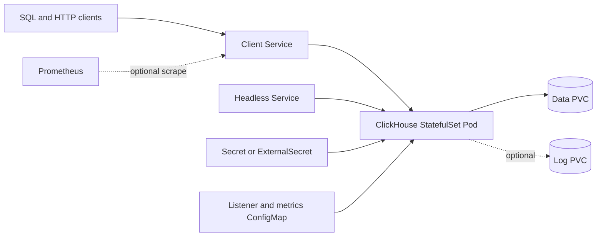

# ClickHouse Chart Design

## Scope

This chart deploys the official ClickHouse server image as a single StatefulSet
with persistent data, headless and client Services, optional Prometheus metrics,
External Secrets support, NetworkPolicy, and Helm test coverage.

## Architecture

The chart renders one StatefulSet replica, a client Service, and a headless
Service. The ConfigMap controls the HTTP, native TCP, interserver, and optional
Prometheus listeners. Named container and Service ports use the same values.
The official image initializes the configured database and user only when the
data directory is empty. A data PVC therefore represents both durable data and
the initialized identity boundary.

## Design Decisions

- Keep the topology standalone and fail rendering for `replicaCount > 1`;
  scaling a StatefulSet does not create a valid replicated ClickHouse cluster.
- Use the official full-version image and expose only ClickHouse-native
  listeners, without a proxy or metrics sidecar.
- Configure real listeners from `service.ports.*` so Pod declarations, probes,
  NetworkPolicy, Services, and the process cannot drift.
- Separate data and log persistence so operators can retain durable data while
  choosing whether high-volume logs need their own storage lifecycle.
- Keep External Secrets, ServiceMonitor, and NetworkPolicy opt-in because their
  controllers and network requirements are cluster-specific.

## Production Boundary

Production operators must supply authenticated credentials, size and monitor
storage, set resources from measured query load, take tested backups, and plan
database upgrades before a new server version writes persisted data. A rolling
StatefulSet update reuses the same data PVC; Kubernetes rollback does not undo
on-disk format or metadata changes. The chart does not validate application
queries, restore procedures, capacity forecasts, or upstream compatibility for
custom XML supplied through `extraConfig` and `extraUsersConfig`.

The single replica has planned downtime during restart, rescheduling, storage
reattachment, and node maintenance. The default PDB does not render for one
replica because it could block voluntary maintenance without providing high
availability. Use an operator when recovery objectives require replication or
automated failover.

## Security Boundary

The server runs as UID/GID `101`, drops Linux capabilities, disables privilege
escalation, and does not mount a ServiceAccount token. Its root filesystem
remains writable because the official image and ClickHouse runtime write
outside the mounted data path. NetworkPolicy is opt-in and must explicitly
allow every required client, DNS, monitoring, and external dependency path.

The empty password default is only for isolated evaluation. Production users
must provide an existing Secret or ExternalSecret. Credentials passed to the
official entrypoint initialize an empty data directory; changing the Kubernetes
Secret does not rotate an already persisted ClickHouse user. Extra environment
variables, XML fragments, containers, volumes, and manifests are trusted
operator input and can weaken this boundary.

## Observability Boundary

Startup, readiness, and liveness probes use the configured HTTP listener.
Runtime validation authenticates to the native TCP listener, writes and reads a
MergeTree fixture, exercises its text index, and checks the HTTP endpoint. The
optional native Prometheus endpoint and ServiceMonitor expose server metrics,
but the chart does not install Prometheus, alert rules, dashboards, log
aggregation, or query-level synthetic monitoring.

Operators should alert on readiness, restarts, disk capacity, failed merges,
replication errors in operator-managed environments, rejected queries, memory
pressure, background task backlog, backup freshness, and authentication
failures. A healthy `/ping` response does not prove representative queries or
restore procedures work.

## Known Gaps And Operational Risks

- There is no in-chart sharding, replication, Keeper, ZooKeeper, failover, or
  topology migration.
- Secret updates do not rotate users already stored on the data PVC.
- Backup creation, off-cluster retention, restore testing, and point-in-time
  recovery remain operator responsibilities.
- NetworkPolicy cannot infer client, monitoring, DNS, object storage, or remote
  dictionary destinations.
- Custom XML can conflict with chart-managed listener and metrics settings and
  must be reviewed before rollout.
- Separate log persistence can grow without bound unless operators configure
  ClickHouse retention and storage monitoring.

## Differentiation

- Uses official `clickhouse/clickhouse-server` full-version tags.
- Blocks unsafe `replicaCount > 1` and directs users to the ClickHouse Operator
  for replicated topologies.
- Enables built-in Prometheus metrics without sidecar images.
- Keeps data and logs persistence separate.
- Includes ESO, dual-stack Service fields, NetworkPolicy, and k3d validation.

## Non-goals

- The chart does not implement shards, replicas, Keeper, or ZooKeeper.
- It does not render ClickHouse Operator CRDs.
- It does not automate cluster backup/restore because full backups require
  filesystem-local access and topology-specific restore procedures.

<!-- @AI-METADATA
type: chart-design
title: ClickHouse Chart Design
description: Design decisions for the ClickHouse HelmForge chart
keywords: clickhouse, design, statefulset
purpose: Capture chart scope and trade-offs
scope: Chart
relations:
  - charts/clickhouse/values.yaml
path: charts/clickhouse/DESIGN.md
version: 1.0
date: 2026-07-06
-->
