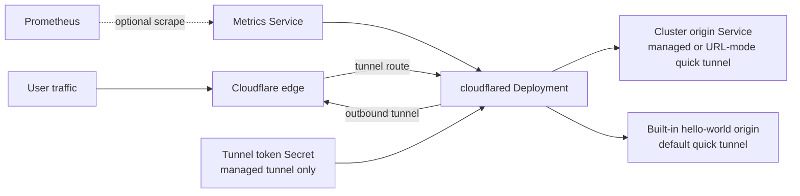

# Cloudflare Tunnel Chart Design

This chart packages `cloudflared` as a fixed-replica, outbound-only tunnel
client for Kubernetes workloads that are exposed through Cloudflare Zero Trust.

## Scope

The chart owns the cloudflared Deployment, token Secret integration, metrics
Service, optional ServiceMonitor and PodDisruptionBudget, and related scheduling
and security settings. Cloudflare owns the edge network. Operators own tunnel,
hostname, route, origin service, DNS, and account configuration.

## Architecture

The chart does not render Kubernetes Ingress resources. Public hostnames,
service routing, and private network routes are managed through the Cloudflare
dashboard for remotely managed tunnels.

## Design Choices

- The default workload runs a single quick tunnel so `helm install` and k3d
  smoke tests start without requiring a real Cloudflare token.
- Managed tunnels are explicit: production deployments set
  `tunnel.quickTunnel.enabled=false`, configure `tunnel.token` or
  `tunnel.existingSecret`, use 2+ replicas, and enable a PodDisruptionBudget.
- The tunnel token can be provided inline for quick starts, through an existing
  Kubernetes Secret for production, or through External Secrets Operator.
- Metrics are exposed on the cloudflared `/ready` endpoint and can be scraped
  through a Service or optional ServiceMonitor.
- Service IP family fields are optional and preserve cluster defaults unless
  explicitly set.
- Quick tunnel mode is the default for smoke tests and demos, but it is not a
  production deployment model.

## Production boundary

Production support begins with a remotely managed tunnel, an operator-owned or
External Secrets-managed token, at least two fixed replicas, a disruption
budget, and explicit resource and topology settings. The chart does not create
the Cloudflare tunnel, publish hostnames, validate origin reachability, rotate
tokens, or provide an availability SLA for the Cloudflare edge.

## Security boundary

The default container runs as a non-root user, drops Linux capabilities, blocks
privilege escalation, uses a read-only root filesystem, and relies on the
runtime default seccomp profile. The chart does not request RBAC permissions by
default because cloudflared does not need Kubernetes API access for remotely
managed tunnels.

Tunnel tokens are sensitive credentials. Production deployments should prefer
`tunnel.existingSecret` or `externalSecrets.enabled=true` over inline
`tunnel.token`, because inline values are visible in Helm release history.

NetworkPolicy is not rendered because tunnel origins and Cloudflare edge
addresses vary by deployment. Cluster operators must enforce outbound and
origin-access policy at the platform boundary without blocking DNS or the
selected HTTP/2 or QUIC transport.

## Observability boundary

Cloudflared exposes `/ready` and `/metrics` on the configured metrics port. The
chart can publish that port through a Service and create a ServiceMonitor, but
it does not install Prometheus, dashboards, recording rules, alerts, or log
aggregation. Readiness proves an active tunnel, not end-to-end hostname or
origin health.

## Known gaps and limitations

- Quick tunnels are ephemeral, receive random hostnames, and are not a
  production availability model.
- Scaling down fixed replicas terminates active connections; HPA is unsupported.
- Routing and origin correctness cannot be validated without Cloudflare account
  state outside the cluster.
- The chart does not render NetworkPolicy because required destinations are
  environment-specific.
- ServiceMonitor support requires Prometheus Operator CRDs.

## Non-Goals

- The chart does not configure Cloudflare Public Hostnames or private network
  routes.
- The chart does not manage Cloudflare API tokens.
- The chart does not use HPA. Scaling down cloudflared pods terminates active
  tunnel connections.

## Validation Focus

- Default quick tunnel deployment for CI.
- Managed tunnel deployment with an inline token for CI.
- Existing Secret consumption.
- ExternalSecret rendering with drift guard.
- Quick tunnel mode without a tunnel token.
- ServiceMonitor rendering.
- Service IP family rendering.

## Related Files

- `charts/cloudflared/README.md`
- `charts/cloudflared/docs/architecture.md`
- `charts/cloudflared/examples/production/values.yaml`
- `charts/cloudflared/examples/simple/values.yaml`
