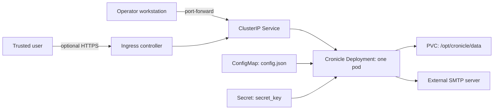

<!-- SPDX-License-Identifier: Apache-2.0 -->

# Cronicle Chart Design

## Scope

This chart packages Cronicle as a single writable scheduler node with a web UI,
filesystem-backed state, and optional Kubernetes ingress. It owns the
Deployment, Service, configuration, session Secret, persistent volume claim,
optional Ingress, optional NetworkPolicy, and optional ServiceAccount.

The chart deliberately keeps one replica. Cronicle can coordinate multiple
servers upstream, but this chart's default filesystem storage is a
single-writer PVC mounted at `/opt/cronicle/data`.

## Goals

- Install a useful private scheduler without an external database.
- Preserve schedules, queue state, history, and job logs across pod restarts.
- Expose the public URL, SMTP identity, job memory ceiling, concurrency,
  persistence, ingress, and advanced environment settings.
- Make the single-writer and root-image boundaries explicit.
- Preserve the established rendered security contract during upgrades while
  offering an opt-in Kubernetes hardening profile.

## Architecture

The Deployment uses `strategy.type: Recreate`, so an upgrade stops the old
scheduler before starting the replacement. This avoids two scheduler
processes concurrently writing to the default ReadWriteOnce volume.

The ConfigMap checksum is part of the pod template. A Helm change to rendered
configuration therefore recreates the pod. Editing the ConfigMap directly does
not change that checksum and does not refresh the `subPath` mount; operators
must restart the Deployment after a direct edit.

## Key Design Decisions

### Keep the existing root image contract

The pinned community image declares no non-root user and initializes files
under `/opt/cronicle`. Applying `runAsNonRoot` or a read-only root filesystem by
default would make valid existing installations fail during upgrade. The chart
therefore leaves `podSecurityContext` and `securityContext` empty by default,
exactly as previous releases did.

`securityProfile.enabled=true` is an explicit opt-in. It disables automatic
ServiceAccount token mounting, applies `RuntimeDefault` seccomp, prevents
privilege escalation, and drops Linux capabilities. It does not claim that the
community image is non-root or compatible with a read-only root filesystem.
User-supplied security-context keys take precedence over profile defaults.

### Keep application and Service ports separate

`cronicle.port` changes the real Cronicle HTTP listener and the container port.
`service.port` changes only the Kubernetes Service-facing port. The Service
uses the named `http` target port, so changing either value independently is
safe.

### Keep persistent state single-writer

Cronicle stores event definitions, server metadata, queue state, history, and
job logs below `/opt/cronicle/data`. The chart does not expose a replica count
because scaling a filesystem-backed scheduler can duplicate jobs or corrupt
state. An existing claim is accepted as operator-owned storage; the operator
is responsible for its access mode, retention, backup, and restore behavior.

### Keep session keys operator-controllable

`secret.create=true` is convenient for small installations. Production
operators should provide `secret.existingSecret` with a `secret_key` key when
stable sessions and deliberate rotation are required. Rotating this value
invalidates existing sessions but does not remove scheduler data.

## Production Boundary

The chart provides Kubernetes resources and sane single-node mechanics. The
platform operator remains responsible for:

- PVC snapshots, restores, capacity monitoring, and retention;
- an Ingress controller, TLS certificates, DNS, and external authentication;
- SMTP availability and credentials;
- CPU and memory sizing for both Cronicle and the jobs it launches;
- limiting `cronicle.maxJobs` to avoid node saturation;
- testing every application job after enabling the optional security profile;
- validating any upstream multi-server topology independently.

The default NetworkPolicy is disabled to preserve connectivity used by
existing scheduled jobs. When enabled with no custom rules, ingress remains
allowed and egress remains unrestricted. Operators can supply explicit rules
only after inventorying job destinations, SMTP, DNS, and other dependencies.

## Security Boundary

Cronicle executes operator-defined commands inside its own container. Anyone
who can administer Cronicle jobs effectively controls code execution in that
pod. Kubernetes RBAC around the Helm release does not replace Cronicle access
control.

The default ServiceAccount behavior is intentionally unchanged for upgrade
compatibility. The opt-in security profile disables token automount. If jobs
must call the Kubernetes API, operators should instead use a dedicated
least-privilege ServiceAccount and explicit token behavior.

Public deployments should use TLS and place Cronicle behind a trusted network,
VPN, SSO proxy, or equivalent control. Default upstream credentials must be
changed immediately. SMTP credentials belong in a Secret referenced through
`cronicle.extraEnv`, never inline in a values file committed to source control.

## Observability Boundary

Startup, readiness, and liveness probes call
`/api/app/get_master_state/v1`. Kubernetes events and container logs cover pod
health. Cronicle's UI and state contain scheduler-specific history and job
logs. The chart does not install a metrics exporter, ServiceMonitor, alert
rules, or log collector. Operators must monitor PVC usage, pod restarts,
failed jobs, SMTP delivery, and scheduler backlog through their platform.

## Known Gaps

- The community image runs as root and is not compatible with the strongest
  restricted-pod defaults without an upstream image change.
- Cronicle job execution is in-process; the chart does not create a Kubernetes
  Job for each event.
- There is no supported HA preset for filesystem-backed state.
- The chart does not provide application metrics or automated backups.
- Direct ConfigMap edits require a manual Deployment restart.

## Non-Goals

- Installing an external database, SMTP server, cert-manager, or Ingress
  controller.
- Managing Cronicle events, plugins, or user accounts.
- Advertising multi-replica safety for the default storage engine.
- Silently changing the runtime identity or security behavior of an existing
  installation during a chart upgrade.

## Validation

`make validate-chart CHART=cronicle` is the required gate. It includes strict
linting, template scenarios, unit tests, kubeconform, Artifact Hub linting, and
behavioral k3d validation. Upgrade validation additionally installs the last
published chart and upgrades it with normal stored values and with
`--reuse-values` before the chart is eligible for merge.
