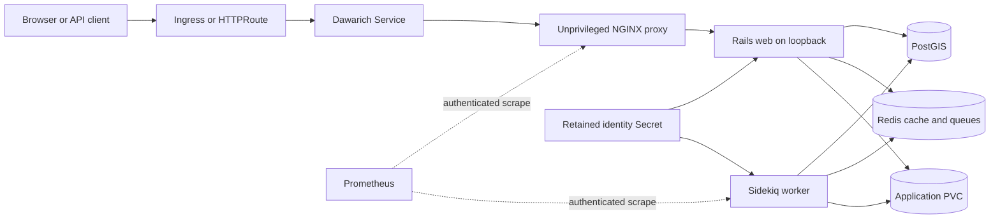

# Dawarich design

## Scope

The chart packages the official Rails/Sidekiq image, an official unprivileged NGINX
proxy, HelmForge PostgreSQL with official PostGIS, and HelmForge Redis. Each database
can instead be external. There is no custom application build or Bitnami dependency.

## Architecture

The web, worker, and proxy containers share one Recreate Pod and one application
PVC. Bundled PostGIS and Redis remain separate stateful workloads. External
dependency mode replaces either subchart without changing the application Pod.

## Main Design Decisions

A singleton Recreate Pod keeps Rails, Sidekiq and local files together. Separate
Deployments with RWO storage would permit incompatible scheduling, and multiple web
replicas would require a different file/queue/initialization contract. Replica counts
other than one are rejected. No HPA or disruption budget implies nonexistent HA.

The first init prepares writable paths and shipped public assets without credentials.
The second checks dependency availability, extension presence and retained identity,
then runs native schema/data migrations, creates a native administrator before seeds,
and completes before regular containers start. Password material is mounted only in
that bootstrap init. Rails and Sidekiq retain only their required connection and
identity credentials. The proxy receives configuration without those credentials.

UID/GID 1000, read-only image filesystems, dropped capabilities, RuntimeDefault seccomp
and no application API token are defaults. Temporary directories are bounded and
separate from durable state. Ruby's temporary-directory safety check requires a
private 0700 child directory, rather than using the emptyDir root directly.

## Native behavior and explicit adapters

Rails' supported bind option restricts the native server to loopback. The proxy denies
the native open enrollment endpoints. A small initializer uses the public Rails
middleware extension point after Rack method override to distinguish registration
from native HTML profile updates/deletion. This explicit local-account policy closes
paths not covered by a single upstream signup flag; no native auth bundle is patched.

Identity and OTP encryption keys are retained together with a PVC fingerprint.
Existing data must pass identity checks before migrations. An affected historical
import backfill is blocked for review because its upstream migration rescues a SQL
error; the chart does not rewrite migration history or silently repair native rows.

## Security Boundary

The application Pod runs as UID/GID 1000 with read-only image filesystems,
RuntimeDefault seccomp, dropped capabilities, and no Kubernetes API token.
Password material is limited to the bootstrap init; runtime containers receive
only the connection and identity credentials they require. Public registration
and OAuth enrollment routes are denied by the local-account proxy policy.

Cluster administrators, node access, Pod exec, and Secret readers remain trusted.
NetworkPolicy requires an enforcing CNI and review of every policy selecting the
same Pods. External TLS terminators, storage systems, and secret controllers are
outside the chart trust boundary.

## Observability Boundary

Bundled PostGIS 18.6 uses its official amd64 manifest with an architecture selector.
Extensions are installed as DBA; the application migrates its own objects as an
ordinary role. Redis is authenticated, persistent and uses noeviction. External
PostGIS uses libpq verify-full; external Redis uses native verified TLS. CA scopes
are documented, including Ruby/OpenSSL's process-wide Redis CA augmentation.

Native metrics retain Basic authentication at both exporters. A private proxy exposes
the aggregate web endpoint, while a separate worker target prevents an aggregate
HTTP 200 from hiding worker loss. NetworkPolicy limits both ports. Readiness checks
native dependency access and the current Sidekiq heartbeat; behavior tests complete
an actual queued import and verify its coordinates.

## Production Boundary

Recovery quiesces both writers and restores PostGIS plus complete local storage into
new destinations, preserving custom SRIDs, identity, OTP login and attachment bytes.
S3 uses only the native ActiveStorage/AWS SDK configuration. It does not imply HA,
live consistent backups, arbitrary S3 addressing options or ambient IAM support.

Cluster administrators, node access, exec and Secret readers are trusted operators.
NetworkPolicy requires an enforcing CNI and reviewed namespace policies. Ingress TLS,
off-cluster retention, bucket controls and image vulnerability management remain
deployment responsibilities. The chart makes no claim of independent application
security certification.

## Known Gaps

- The singleton Recreate topology has an intentional maintenance interruption and
  does not provide horizontal scaling or zero-downtime rollout.
- The bundled official PostGIS image is pinned to amd64; other architectures need
  an externally operated compatible PostGIS service.
- Native S3 storage does not remove the local PVC or provide coordinated backups.
- Recovery remains an operator-run quiesce, database dump, filesystem snapshot,
  identity-secret retention, and restore workflow.

## Non-Goals

- installing Ingress, Gateway API, External Secrets, Prometheus, or storage controllers
- managing external PostGIS, Redis, S3 bucket, DNS, or TLS lifecycle
- supporting Redis Cluster as a replacement for distinct logical databases
- automating Rails/OTP encryption-key rotation or repairing unsafe historical data
- claiming application security certification from manifest hardening alone
