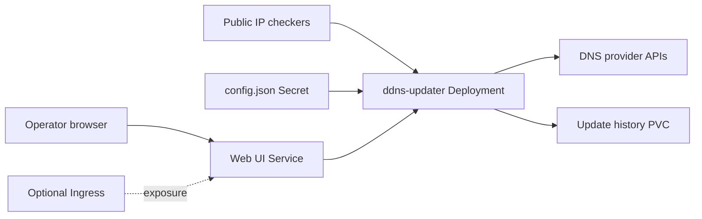

# DDNS Updater Chart Design

This chart packages `ddns-updater` as a single-replica dynamic DNS controller
with a web status UI and optional persistent update history.

## Scope

The chart owns the Deployment, configuration Secret reference, PVC, Service,
optional Ingress, and pod security settings. Operators own DNS provider
accounts, API credentials, public DNS zones, ingress controllers, certificates,
and namespace egress policy.

## Architecture

The application is intentionally deployed with `Recreate` strategy and one
replica. Multiple replicas can race provider API updates and write conflicting
history. Availability comes from quick restarts and persistent state, not
horizontal scaling.

## Design Choices

- DNS provider credentials are rendered into a chart-managed Secret only for
  simple starts. Production deployments should prefer `config.existingSecret`
  with a pre-created `config.json`.
- Persistence is enabled by default because `updates.json` is small and useful
  for debugging provider update history.
- The web UI is private by default. Operators can use port-forwarding or enable
  Ingress explicitly.
- Default resources are intentionally small, matching the lightweight polling
  workload while satisfying resource governance.
- The pod runs as the upstream image user `1000:1000`, disables service account
  token automount, drops Linux capabilities, blocks privilege escalation, uses a
  read-only root filesystem, and relies on `RuntimeDefault` seccomp.

## Security Model

The workload does not need Kubernetes API access after its Secret and PVC are
mounted, so `serviceAccount.automountServiceAccountToken=false` is the default.
Provider API tokens are sensitive credentials. Use `config.existingSecret` for
production so tokens are not exposed in Helm release values.

NetworkPolicy is not rendered by this chart because DNS provider access and
public IP detection endpoints vary by deployment. Platform policy should define
egress boundaries for the namespaces where this chart runs.

## Production Boundary

Production operators must provide a restorable `config.json`, protect provider
credentials, retain the PVC when update history matters, and verify that public
IP detection plus provider API endpoints are reachable. The chart does not make
the single-writer controller highly available.

## Security Boundary

The chart supplies non-root, read-only, capability-free container defaults and
disables ServiceAccount token automount. Operators control Secret creation and
rotation, web UI authentication or private exposure, TLS, and provider-scoped
API permissions. Inline settings remain visible in Helm release history.

## Observability Boundary

Kubernetes probes validate the web listener, while the UI and container logs
report provider update results. The chart does not install metrics collection,
log retention, or provider-specific alerts; operators must monitor failed or
stale DNS updates externally.

## Known Gaps

- Provider-specific settings are intentionally not schema-validated.
- The chart has no built-in NetworkPolicy because required egress varies.
- The application is a single writer and does not support horizontal replicas.
- Web UI authentication and public exposure policy are environment-owned.

## Non-Goals

- The chart does not create DNS provider API tokens.
- The chart does not validate provider-specific `config.settings` schemas.
- The chart does not scale beyond one replica by default.
- The chart does not render NetworkPolicy because required egress differs by
  provider and IP detection strategy.

## Validation Focus

- Default chart-managed empty settings Secret.
- Cloudflare settings rendering.
- Existing Secret consumption for `config.json`.
- Persistence and no-persistence runtime paths.
- Ingress rendering for web UI exposure.
- Restricted pod and ServiceAccount token defaults.

## Related Files

- `charts/ddns-updater/README.md`
- `charts/ddns-updater/docs/providers.md`
- `charts/ddns-updater/examples/simple/values.yaml`
- `charts/ddns-updater/examples/production/values.yaml`
- `charts/ddns-updater/examples/multi-provider/values.yaml`
