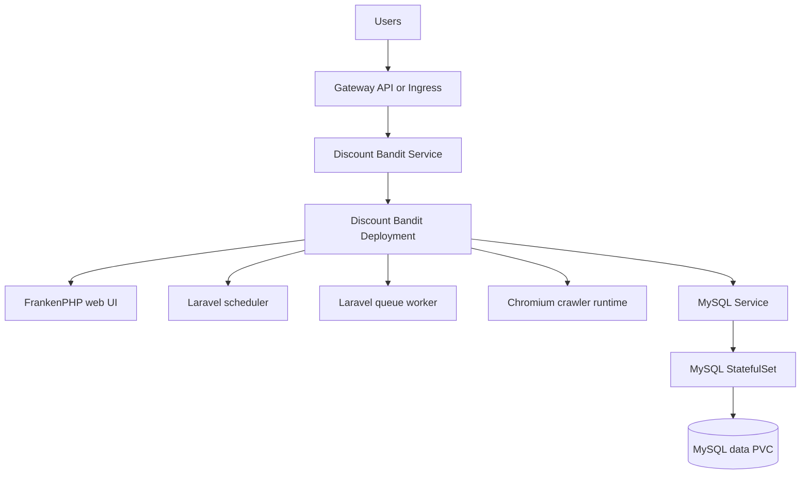
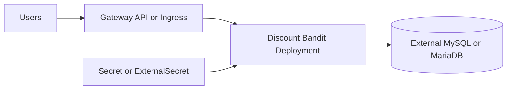
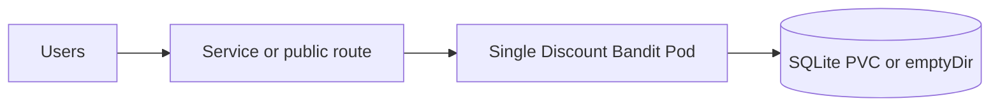

# Discount Bandit Chart Design

## Scope

This chart packages Discount Bandit for Kubernetes and owns the application
Deployment, Service, optional routing, Secrets, SQLite storage, NetworkPolicy,
PodDisruptionBudget, and External Secrets resources. It can deploy the
HelmForge MySQL subchart or connect the application to an external MySQL or
MariaDB service.

Discount Bandit is a Laravel application running on FrankenPHP. The upstream
container starts Supervisor, which manages the web UI, Laravel scheduler,
queue worker, and Chromium/Xvfb crawler processes.

## Architecture

### Primary MySQL topology



This is the default topology. The MySQL subchart owns database credentials,
persistence, and lifecycle controls.

### External database topology



This topology is intended for a database operated by a platform team. The
MySQL subchart is disabled and the chart requires an external host and a
password source.

### SQLite development topology



SQLite is limited to development and small personal installations. It remains
single replica because SQLite is single-writer and its PVC normally uses
`ReadWriteOnce`.

### Supervisor configuration flow

```mermaid
flowchart LR
  config[Supervisor ConfigMap] --> base[/app/docker/base_supervisord.conf]
  base --> generator[Laravel worker config generator]
  generator --> runtime[/etc/supervisor/conf.d/supervisord.conf]
  runtime --> processes[Web, scheduler, queue, and crawler processes]
```

The mounted base configuration removes the upstream unauthenticated
Supervisor HTTP endpoint without changing the required worker topology.

## Design Decisions

- MySQL is the default database path; SQLite is an explicit development mode.
- `containerPorts.http` configures Laravel Octane's real FrankenPHP `--port`
  option in the Supervisor configuration. `service.port` is independent and
  targets the named `http` container port.
- `discountBandit.extraEnv` cannot set `SERVER_NAME`; Laravel Octane's CLI
  option is authoritative, so accepting that environment variable would imply
  a listener override that the upstream entrypoint does not honor.
- The Deployment uses `Recreate` because SQLite and log volumes may be
  `ReadWriteOnce` and must not be mounted by overlapping pods.
- Ingress and Gateway API attach to platform-owned controllers and Gateways.
- NetworkPolicy is opt-in because crawlers and notification integrations have
  deployment-specific internet destinations.
- The chart mounts a sanitized Supervisor base configuration by default.
- A custom listener requires that Supervisor ConfigMap; disabling it retains
  the upstream fixed port 80 command.

## Storage and Database Model

MySQL data is owned by the dependency chart. SQLite data uses
`persistence.database` and mounts only `/app/database/sqlite`, preserving
upstream migrations and seeders under `/app/database`. Application logs use
`persistence.logs`; the default is container-local storage because Kubernetes
log collection should consume stdout and stderr first.

## Production Boundary

For production, use the bundled MySQL subchart or an external MySQL/MariaDB
service, persistent database storage, stable application secrets, TLS at the
edge, and explicit resource sizing. Operators own database backups, restore
testing, database upgrades, ingress or Gateway controllers, DNS, certificates,
and the availability of External Secrets infrastructure.

The chart does not make SQLite highly available and does not turn the bundled
standalone MySQL profile into a multi-node database service.

## Security Boundary

The chart disables service account token mounting, applies RuntimeDefault
seccomp, disables privilege escalation, supports Kubernetes Secrets and
External Secrets, and removes the unauthenticated Supervisor HTTP endpoint.

The upstream image currently runs Supervisor and worker processes as root and
requires a writable application filesystem. The chart therefore does not force
`runAsNonRoot`, `readOnlyRootFilesystem`, or dropped capabilities. Operators
must protect application and database Secrets, terminate TLS at a trusted edge,
and restrict ingress and egress for their environment.

## Observability Boundary

Startup, readiness, and liveness probes verify the configured FrankenPHP TCP
listener. The chart-specific runtime smoke test performs an HTTP request
through the Service and verifies that Discount Bandit returns HTML. Application
logs expose scheduler, queue, crawler, and web failures.

The chart does not install a metrics exporter, dashboards, alert rules, or a
log collector. Operators own those integrations and should monitor database
health, queue progress, crawler failures, notification delivery, pod restarts,
and storage consumption.

## Known Gaps and Limitations

- SQLite is not suitable for multiple replicas or high write concurrency.
- The upstream root runtime limits default pod hardening.
- TCP probes prove listener availability but not database-backed application
  behavior; the runtime smoke provides the HTTP-level deployment check.
- Store-specific crawling can require Chromium and outbound HTTP or HTTPS
  destinations that cannot be predicted by the chart.
- The chart does not provide application-aware backup or restore jobs.

## Explicit Non-Goals

- Operating a highly available MySQL or MariaDB cluster.
- Managing Gateway, Ingress controller, DNS, or certificate lifecycles.
- Discovering crawler destinations and generating environment-specific egress
  allowlists.
- Managing Discount Bandit users, products, notification providers, or
  application migrations outside the upstream container lifecycle.
- Rebuilding or patching the official upstream application image.
