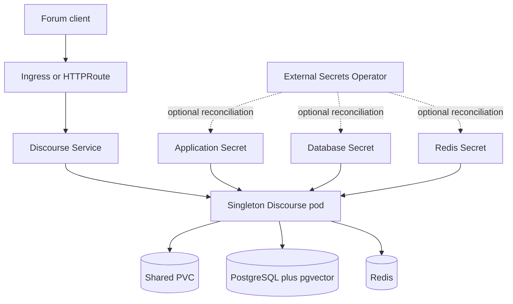

<!-- SPDX-License-Identifier: Apache-2.0 -->

# Discourse Chart Design

## Scope

This beta chart packages the official experimental Discourse ESR container as a
single Kubernetes Deployment. It owns Service exposure, `/shared` persistence,
credentials, and optional routing/policy resources. It can deploy HelmForge
PostgreSQL and Redis dependencies or connect to existing services.

## Architecture

## Main Design Decisions

The chart enforces one replica and `Recreate`. The upstream boot path performs
migrations and asset precompilation, so concurrent starts would create an
unvalidated coordination and storage contract. `/shared` is mandatory because
it contains uploads and runtime state.

The official Nginx listener remains port 80. `service.port` is independently
configurable and targets the named `http` port. The numeric upstream image tag
is fixed by OCI digest because upstream can rebuild tags.

Bundled PostgreSQL uses the official pgvector image. An init script transfers
database ownership to the application user and creates `pg_trgm`, `unaccent`,
and `vector` before Discourse migrations.

## Production Boundary

Upstream explicitly treats this container and Kubernetes deployment method as
unsupported for production. The chart is therefore beta regardless of passing
HelmForge tests. Operators own acceptance of this risk, capacity, durable storage,
managed database/Redis availability, SMTP, TLS, DNS, backups, restore tests,
monitoring, and recovery objectives.

The chart does not provide application high availability. A PDB on one replica
cannot preserve service during disruption, so it is disabled by default and may
only use `maxUnavailable: 1`.

## Security Boundary

Upstream boot requires root, ownership changes, privileged-port binding, and a
writable root filesystem. Privilege escalation remains disabled and all
capabilities are dropped before the minimum reviewed set is added. Kubernetes API
credentials are not mounted. Secret generation uses a preserved 128-character
hexadecimal value.

NetworkPolicy is opt-in because external databases, Redis, SMTP, identity
providers, webhooks, object stores, and plugin integrations vary. Enabling the
default policy permits DNS, same-namespace dependencies, and HTTPS; operators
must add their exact external destinations.

## Observability Boundary

Kubernetes probes use upstream `/srv/status` through Nginx. Logs are written to
container output and `/shared/log`; the cluster logging stack owns collection.
The chart exposes no validated Prometheus metrics contract and therefore does not
render a ServiceMonitor or alert rules.

Monitor pod restarts, probe latency, PostgreSQL/Redis health, PVC usage, HTTP
availability, migration duration, and backup freshness. First boot and image pull
can take many minutes because the expanded image is approximately 5.2 GB.

## Known Gaps and Limitations

- Unsupported upstream Kubernetes runtime and root security exception.
- Single replica and `Recreate` updates only.
- No automated PostgreSQL, Redis, or `/shared` backup Jobs.
- No automatic external database extension installation.
- No runtime plugin compilation or custom-image build pipeline.
- No native metrics endpoint, ServiceMonitor, or built-in alerting.
- No automatic migration from existing launcher-based Discourse installations.

## Non-Goals

- Claiming upstream production support or high availability.
- Splitting web and Sidekiq into independent workloads.
- Installing ingress controllers, Gateways, ESO, DNS, TLS issuers, SMTP, or stores.
- Managing database major-version upgrades or recovery policies.
- Building or publishing a HelmForge Discourse application image.
