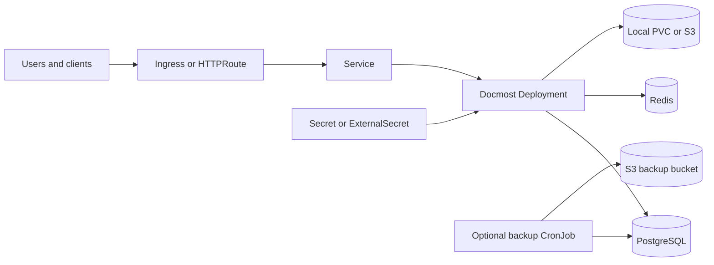
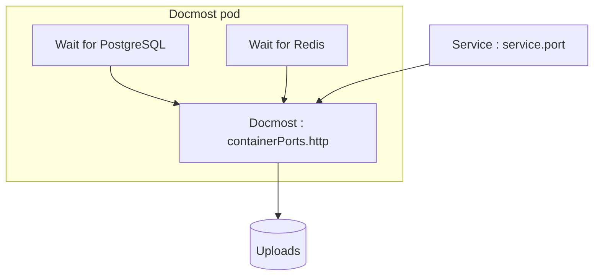

# Docmost Chart Design

## Scope

This chart packages Docmost as a Kubernetes application backed by PostgreSQL,
Redis, and either local persistent storage or an S3-compatible object store. It
owns the application Deployment, Service, storage claim, optional routing
resources, optional ExternalSecret, and an optional PostgreSQL backup CronJob.

The chart supports a practical single-replica local-storage installation and a
multi-replica S3 deployment. It exposes the upstream runtime listener through
an explicit values contract and keeps platform services outside the chart
boundary.

## Architecture

The Service targets the named `http` port. `containerPorts.http` configures
both the declared container port and the upstream `PORT` environment variable,
while `service.port` remains the independent Kubernetes-facing port.

## Design Decisions

- Local uploads use a `ReadWriteOnce` PVC and default the Deployment strategy
  to `Recreate` so an upgrade cannot deadlock on a second pod waiting for the
  same volume.
- Multiple replicas require `storage.mode=s3`; validation rejects a replicated
  local-filesystem deployment.
- PostgreSQL and Redis are bundled by default but may be replaced independently
  with external services and existing Secrets.
- Application secrets are generated once for connected Helm installs or read
  from `docmost.existingSecret` for GitOps and externally managed lifecycles.
- The pod does not mount a Kubernetes API token by default. Operators can opt
  in through `serviceAccount.automountServiceAccountToken` for a concrete
  integration that requires it.
- Ingress and Gateway API are independent, disabled-by-default routing choices.
- Backups are opt-in and contain a PostgreSQL dump only; uploaded files require
  a separate storage-aware backup.
- `service.port` is not an application listener setting. The runtime listener
  is controlled only through `containerPorts.http`.

## Production Boundary

The chart owns Kubernetes resources and application wiring. It does not own
DNS, TLS issuers, ingress controllers, Gateway implementations, Storage
Classes, external databases, Redis services, object stores, backup retention,
or External Secrets providers. Operators must provision and monitor those
platform capabilities.

Production deployments should manage `APP_SECRET` in a durable external
Secret, use S3-compatible storage when more than one application replica is
required, and back up both PostgreSQL and uploaded files before upgrades.
Restores must preserve the application secret because encrypted application
data is derived from it.

## Security Boundary

The default pod drops all Linux capabilities, denies privilege escalation, and
uses the RuntimeDefault seccomp profile. Service-account token mounting is
disabled by default. The application root filesystem remains writable because
the pinned upstream image and package-manager runtime are not compatible with
`readOnlyRootFilesystem=true` without additional writable mounts.

Secrets enter the application through Kubernetes Secret references or the
optional ExternalSecret. Inline password values are supported for development
but are visible in Helm release state. Network encryption, database TLS, Redis
TLS, NetworkPolicy, authentication policy, and object-store policy remain
operator responsibilities.

## Observability Boundary

Startup, liveness, and readiness probes call the upstream `/api/health`
endpoint through the configured listener. The behavioral gate additionally
checks the actual listener contract, health response, application-secret
encryption, and upload/read/delete behavior for local and S3 storage modes.

The chart does not create a ServiceMonitor because the pinned Docmost release
does not expose a chart-supported Prometheus metrics contract. Operators should
use pod logs, Kubernetes events, probe status, database and Redis telemetry,
backup job status, and an external synthetic check through the Service.

## Known Gaps

- The backup CronJob protects PostgreSQL only; it does not copy local uploads
  or version an S3 uploads bucket.
- The chart does not configure NetworkPolicy resources.
- Database, Redis, and S3 transport security depend on operator-supplied
  endpoints and credentials.
- Probe success verifies application health but not outbound mail, S3 policy,
  or every collaborative editing workflow.
- The writable upstream filesystem prevents stricter immutable-root defaults.

## Non-Goals

- Provisioning external databases, Redis, S3, DNS, certificates, or routing
  controllers.
- Making local file storage safe for active-active replicas.
- Managing object-store lifecycle, replication, or disaster recovery.
- Installing operating-system or Node.js packages during pod startup.
- Defining organization-specific mail, identity, or network policies.

## Validation Focus

The chart validates default local storage, a non-default application listener,
S3-backed replicas, external PostgreSQL and Redis, Ingress, Gateway API,
External Secrets, backup rendering, and dual-stack Service fields. The k3d gate
executes the health endpoint and performs real encryption and storage
roundtrips against the pinned application image.

## Related Files

- `charts/docmost/README.md`
- `charts/docmost/docs/architecture.md`
- `charts/docmost/examples/simple.yaml`
- `charts/docmost/examples/external-services.yaml`

---

keywords: docmost, design, postgresql, redis, s3, gateway-api
path: charts/docmost/DESIGN.md
