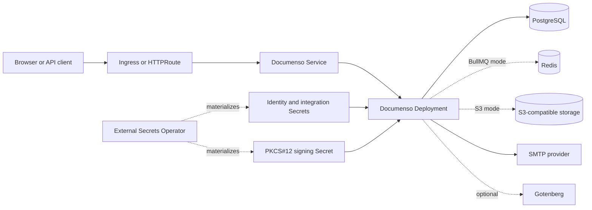

<!-- SPDX-License-Identifier: Apache-2.0 -->

# Documenso chart design

## Scope

This chart deploys the official Documenso application with the state services,
identity material, document storage, signing certificate, exposure resources,
and network controls required for a production-oriented Kubernetes deployment.
It supports bundled or external PostgreSQL, local or BullMQ background jobs,
database or S3-compatible document storage, Ingress or Gateway API exposure,
and native External Secrets resources.

The chart owns Kubernetes orchestration and validates safe topology
combinations. Documenso remains responsible for application migrations,
authentication, document workflows, email delivery, and digital signatures.

## Architecture

One Deployment runs the official Documenso image. A ClusterIP Service exposes
the application and optional Ingress or HTTPRoute resources publish it.
PostgreSQL is provided by the maintained HelmForge dependency or by complete
connection URLs stored in a Secret. Redis is rendered only for BullMQ mode.
Documents remain in PostgreSQL by default or move to shared S3-compatible
storage when configured.

## Main design decisions

- The official entrypoint remains intact so the supported `prisma migrate
  deploy` startup sequence is not reimplemented by the chart.
- An init container waits for PostgreSQL before the application starts, while
  readiness uses the native `/api/health` endpoint.
- TCP liveness is deliberately independent of PostgreSQL to avoid restart
  storms during a database outage.
- Single-replica installations use `Recreate`. Horizontal scaling is accepted
  only with BullMQ and S3 because jobs and documents must be shared.
- Server-side Helm upgrades can preserve generated NextAuth and encryption keys
  through `lookup`. Client-side GitOps rendering cannot perform that lookup, so
  GitOps users must configure a stable `documenso.existingSecret`, including
  when External Secrets materializes the Secret.
- A signing certificate is optional for initial rollout because upstream starts
  without one, but production signing requires the PKCS#12 Secret.

## Production boundary

The chart provides schedulable resources, disruption protection, topology
spread controls, an optional HPA, and bundled standalone dependencies for a
working baseline. Operators own capacity planning, highly available managed
PostgreSQL and Redis, S3 durability, SMTP delivery, TLS termination, certificate
issuance, DNS, backup scheduling, and disaster-recovery exercises.

The local job provider is appropriate only for development or small
installations. Production throughput should use BullMQ with Redis or an
operator-supplied Inngest configuration. Multi-replica mode additionally
requires S3-compatible storage, and PostgreSQL connection limits must account
for every application replica.

## Security boundary

The container runs as UID/GID 1001 with runtime-default seccomp, no Linux
capabilities, no service-account token, and a read-only root filesystem.
Writable `emptyDir` mounts are limited to temporary and npm-cache paths. The
optional certificate is mounted read-only from a Secret, while database, Redis,
SMTP, S3, Gotenberg, and identity credentials are referenced from Secrets.

The NetworkPolicy is additive and requires an enforcing CNI. It permits
namespace-local application ingress, DNS, selected state services, and public
HTTP/HTTPS while excluding private address ranges. Operators must review every
policy in the namespace and add explicit peers for private SMTP, object storage,
Gotenberg, identity-provider, webhook, and other integration endpoints. When an
Ingress or Gateway controller runs in another namespace, its Pod or namespace
selector must be included in `networkPolicy.ingressFrom`.

## Observability boundary

Startup and readiness call `/api/health`; TCP liveness verifies that the process
still accepts connections. `/api/certificate-status` provides signing
diagnostics, and the BullMQ dashboard is available to upstream-authorized
administrators when that provider is enabled. The chart-owned runtime smoke
script verifies the native health response, UID 1001, and a non-empty identity
Secret. The k3d wrapper separately verifies rollout readiness, warning or
failure events, restart state, and selected crash or error signatures in Pod
logs; it does not prove Secret retention across independent renders.

Documenso does not document a native Prometheus endpoint, so the chart does not
create a misleading ServiceMonitor. Cluster-level metrics, centralized logs,
synthetic signing checks, mail-delivery alerts, and external dependency
monitoring remain operator responsibilities.

## Recovery

PostgreSQL, the S3 bucket when used, the signing certificate, and application
identity Secrets form one recovery set. Redis contains in-flight BullMQ jobs and
should also be protected when job loss is unacceptable. Restore the same
application version in isolation, validate health, login, document access,
email delivery, and signing, then perform an upgrade. An image rollback does not
reverse a Prisma database migration.

## Known gaps

- Upstream runs migrations in every application process; coordinated rollouts
  and verified backups are required around schema-changing upgrades.
- The chart does not provision a signing certificate, SMTP service, object
  store, Gotenberg instance, TLS certificate, or managed database.
- Dynamic webhook and integration destinations cannot be inferred into a
  static NetworkPolicy and may need installation-specific egress rules.
- The application has no documented native Prometheus metrics endpoint.

## Non-goals

- Replacing Documenso's entrypoint, Prisma migration flow, or job processor.
- Generating or rotating signing, identity, database, or integration secrets.
- Providing application-level user, organization, template, or document
  lifecycle management.
- Claiming high availability from standalone bundled PostgreSQL or Redis.
- Treating TCP reachability as proof that signing or external integrations work.
