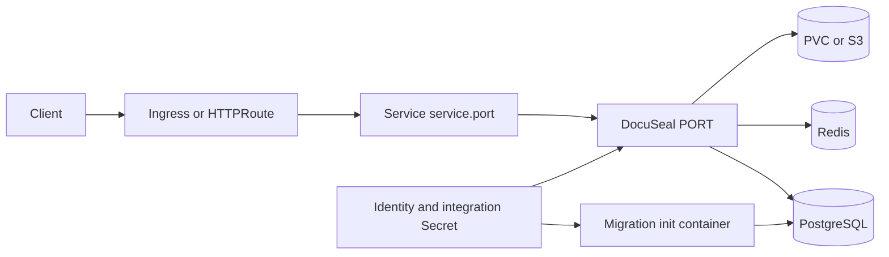

# DocuSeal chart design

## Scope

This chart provides a conservative production deployment of DocuSeal 3.3.3.
It owns the application Deployment, Service, attachment storage, identity
Secret, exposure resources, policy controls, and the optional HelmForge
PostgreSQL and Redis dependencies. The chart uses only the official DocuSeal
image, pinned by immutable manifest digest.

## Architecture

One Deployment runs the web application and embedded background processing. A
Pod init container executes `rails db:prepare` before the application starts,
making schema readiness part of Pod readiness. Puma listens on
`containerPorts.http` through DocuSeal's upstream `PORT` environment variable;
the Service independently exposes `service.port` and targets the named `http`
container port.

The default `Recreate` strategy prevents two single-node instances from
competing for local ReadWriteOnce storage. A validated shared-state topology
switches to rolling updates.

## Design decisions

- PostgreSQL and Redis are bundled by default for a reproducible installation;
  each can be replaced only by a complete external-service contract.
- `containerPorts.http` and `service.port` are separate so operators can change
  the application listener without coupling it to the cluster-facing port.
- Migrations run in an init container instead of a Helm hook, so a failed
  migration is visible in Pod status and blocks application startup.
- Local attachments use a retained PVC. S3-compatible storage is mandatory for
  multiple replicas because every replica must observe the same documents.
- Stable identity values are generated with cluster lookup or supplied through
  an existing Secret; credentials never appear in rendered environment values.

## Production boundary

The chart manages Kubernetes resources and, when enabled, the packaged
PostgreSQL and Redis releases. Operators remain responsible for DNS, TLS
issuance, ingress or Gateway controllers, external database and object-storage
availability, backups, disaster recovery, and capacity planning. Horizontal
scaling requires external PostgreSQL, external Redis, S3-compatible storage,
and a pre-provisioned identity Secret.

## Security boundary

The Pod runs as the official image UID/GID 2000 with RuntimeDefault seccomp,
all Linux capabilities dropped, no privilege escalation, no service-account
token, and a read-only root filesystem. Bounded `emptyDir` volumes provide the
writable runtime paths. Default NetworkPolicy restricts ingress and dependency
egress, but operators must define peers for private external services and must
manage Secret access, encryption at rest, TLS policy, and image admission.

## Observability boundary

Startup, readiness, liveness, and runtime smoke checks use DocuSeal's upstream
`/up` endpoint on the configured listener. Kubernetes events, Pod logs, init
container logs, and dependency health are the supported operational signals.
Upstream does not document a native Prometheus endpoint, so the chart does not
create a ServiceMonitor or invent application metrics.

## Upgrade and rollback

Database migrations are forward-moving. Back up PostgreSQL, attachments,
Redis queues where required, and identity Secrets before upgrading. An image
rollback is safe only when the migrated schema remains backward compatible;
otherwise restore the matching recovery set. Validate restoration in an
isolated namespace before changing the production release.

## Known gaps and limitations

- Local ReadWriteOnce attachment storage supports only one replica.
- The embedded background processor cannot be scaled independently.
- Private SMTP, S3, PostgreSQL, and Redis endpoints can require
  installation-specific NetworkPolicy egress rules.
- The chart exposes health status but no application-native metrics contract.

## Non-goals

The chart does not provision DNS, certificates, external databases, Redis,
S3 buckets, SMTP services, or backup infrastructure. It does not automate
DocuSeal tenant or administrator creation, rotate encryption identity, or
promise database downgrade compatibility.
