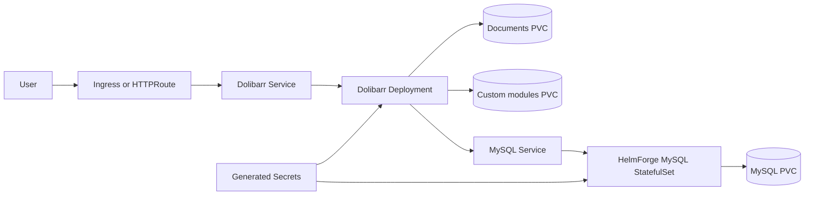
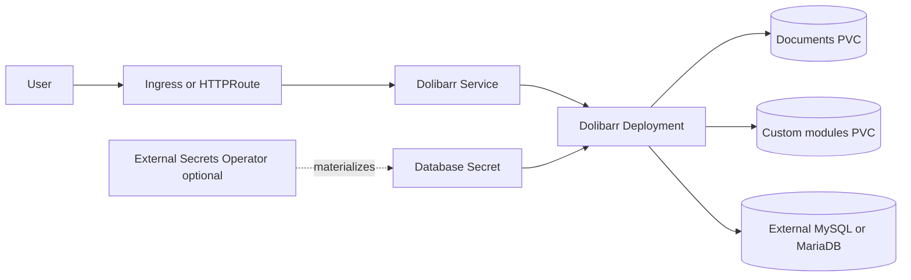

# Dolibarr Chart Design

## Scope

This chart deploys Dolibarr ERP/CRM on Kubernetes using the official `dolibarr/dolibarr` image and the HelmForge MySQL subchart by default.

Supported database modes:

- `mysql`: bundled HelmForge MySQL dependency for a self-contained release
- `external`: externally managed MySQL or MariaDB endpoint
- `auto`: select the bundled dependency unless an external database is configured

The chart intentionally targets the official container's unattended MySQL/MariaDB workflow.
PostgreSQL is not enabled as a default chart path because the official image does not
expose the same non-interactive setup contract for this chart's Kubernetes automation.

## Architecture: Bundled MySQL

This mode is appropriate for development, internal tools, and small deployments where the application and database lifecycle can be managed together.

## Architecture: External Database

External database mode is recommended when operators already provide backup, restore, replication, failover, and patching through a managed database platform.

## Operational Design

- `initContainers.wait-for-db` blocks application startup until TCP connectivity to the selected database is available.
- The default startup probe delay accounts for the official container's first-run database import before Apache starts accepting traffic.
- The bundled MySQL startup probe is delayed slightly from the subchart default to avoid false-positive probe warnings during first-run database initialization.
- Generated admin, database, and runtime secrets are preserved across upgrades with Helm `lookup`.
- Documents and custom modules use separate PVCs so generated files and locally installed modules can be sized and restored independently.
- `DOLI_CRON` is disabled by default. Scheduled jobs should be modeled explicitly once their runtime behavior is validated for Kubernetes.
- Gateway API and Ingress are both opt-in and use the chart's single HTTP service backend.
- Backup is opt-in and uses `mysqldump` plus the HelmForge `mc` image to upload compressed dumps to S3-compatible storage.

## Design Decisions

- The official image entrypoint remains authoritative for first-run Dolibarr
  initialization. The chart supplies an argument wrapper that changes both
  Apache port declarations, verifies them, and then executes
  `apache2-foreground`.
- `service.port` and `containerPorts.http` are deliberately separate: the first
  is a cluster-facing Service contract; the second is the real process listener.
- The Deployment uses `Recreate` and a single replica because the default
  documents and custom volumes are `ReadWriteOnce` and Dolibarr does not provide
  a chart-owned shared-filesystem coordination contract.
- NetworkPolicy restricts ingress only. Egress remains unrestricted because
  Dolibarr integrations and external database destinations are deployment-specific.
- A pod-template checksum covers chart-rendered Secrets. Existing or
  ExternalSecret-managed credential rotation still requires an operator rollout.

## Security Boundary

The chart disables ServiceAccount token automounting and selects only the
Dolibarr pod in its NetworkPolicy, excluding hooks and validation pods. Secret
values are consumed through Secret references rather than command arguments.
TLS termination, Secret-store authorization, database server policy, egress
allowlists, image admission, and storage encryption are outside the chart boundary.

The official image performs bootstrap work as root and writes beneath its Apache
and application directories. The chart therefore does not claim a non-root or
read-only-root-filesystem posture. Operators using a hardened derivative image
must validate ownership, entrypoint behavior, and persistent-volume permissions.

## Observability Boundary

Startup, readiness, and liveness probes verify the application through the named
HTTP port. The chart-owned runtime smoke additionally checks a real Dolibarr HTTP
response and the effective Apache listener configuration. Kubernetes events,
container logs, database metrics, application audit logs, and backup monitoring
remain the operator's responsibility. The official image does not expose a
stable Prometheus endpoint, so this chart does not create a ServiceMonitor.

## Production Boundary

For production, operators should provide explicit values for:

- admin and database credentials through existing Secrets or External Secrets
- persistent storage classes and sizes
- resource requests and limits
- ingress or Gateway API TLS
- backup destination and retention policy
- database lifecycle ownership
- network boundaries outside this chart when required by the cluster baseline

## Explicit Non-Goals

- automated major Dolibarr upgrades or database migrations beyond the official image entrypoint behavior
- PostgreSQL automation
- bundled high availability database topology
- application cron orchestration before a stable Kubernetes validation path exists
- installing Dolibarr marketplace modules automatically

## Known Gaps

- Secret changes made outside Helm are not observable through a deterministic
  checksum; restart the Deployment after external credential rotation.
- The default NetworkPolicy does not restrict egress because destinations vary
  across email, payment, webhook, API, and external-database integrations.
- Horizontal scaling is not offered while the supported storage contract uses
  single-writer PVCs.
- Application-aware restore automation is not yet included; backups cover the
  database while documents and custom-module volumes require a coordinated
  storage backup.

<!-- @AI-METADATA
type: design
title: Dolibarr Chart Design
description: Design document for the Dolibarr Helm chart with database modes, persistence, ingress, Gateway API, and backup boundaries

keywords: dolibarr, design, architecture, mysql, mariadb, gateway-api, backup, helm, kubernetes

purpose: Document Dolibarr chart architecture, operational choices, production boundaries, and non-goals
scope: Chart Design

relations:
  - charts/dolibarr/README.md
  - charts/dolibarr/docs/database.md
path: charts/dolibarr/DESIGN.md
version: 1.0
date: 2026-06-02
-->
