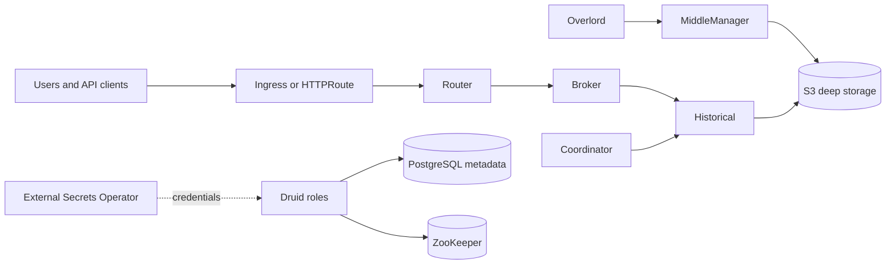

<!-- SPDX-License-Identifier: Apache-2.0 -->

# Apache Druid chart design

## Scope

This chart packages the official Apache Druid image as a distributed analytics
system rather than treating Druid as a single-process database. It owns the
Kubernetes resources for Coordinator, Overlord, Broker, Router, Historical,
MiddleManager, a bundled ZooKeeper ensemble, and an optional HelmForge
PostgreSQL dependency. Operators may replace PostgreSQL and ZooKeeper with
platform-managed services and may replace development-only local deep storage
with S3-compatible storage.

The default topology is intentionally small enough for validation and lab use:
Coordinator, Broker, Router, one ZooKeeper replica, and PostgreSQL. Overlord,
Historical, and MiddleManager are opt-in because they add the ingestion and
segment-serving data plane. A production installation must enable those roles
as required by its ingestion model and use shared deep storage.

## Architecture

Broker and Router are Deployments because they are query-facing and do not
require stable identities. Coordinator, Overlord, Historical, and
MiddleManager are StatefulSets. Historical and MiddleManager can receive PVCs
for segment cache and task working data. Other Druid roles use an `emptyDir`
for writable runtime state. The bundled ZooKeeper is a separate StatefulSet
with persistent data and transaction-log volumes.

The Router is the only intended public entry point. Internal Services expose
each enabled component to the other Druid roles. The public Service, Ingress,
and HTTPRoute always target the Router by its named `http` port.

## Design decisions and trade-offs

Each Druid role has an explicit values block for enablement, replica count,
listener port, JVM options, resources, labels, annotations, and additional
runtime properties. This produces a larger values contract, but it keeps
scaling and failure domains visible and prevents one generic workload template
from hiding role-specific state and ports.

PostgreSQL is a chart dependency while ZooKeeper is rendered directly. The
PostgreSQL dependency supplies password generation and lifecycle behavior used
across HelmForge. The local ZooKeeper templates keep Druid-specific ensemble
addresses, ports, and probe commands explicit. Contract validation rejects
mixed internal/external modes so Helm cannot silently deploy an unused bundled
dependency or point Druid at an empty endpoint.

Local deep storage remains the default only for a self-contained first install.
S3 mode requires a bucket plus either an existing Secret or explicit access
and secret keys. This chart currently models static Secret credentials; it does
not claim workload-identity support while the templates inject both S3
credential environment variables.

The official image writes configuration overlays and runtime data below
`/opt/druid`, so the application filesystem is not declared read-only. An init
container creates and changes ownership of writable paths using only `CHOWN`,
`DAC_OVERRIDE`, and `FOWNER`; the long-running Druid containers remain
non-root, drop all capabilities, and disallow privilege escalation.

## Production boundary

Production operators are responsible for enabling the complete Druid roles
needed by their ingestion and query workloads, sizing JVM heaps and Kubernetes
resources together, configuring disruption-aware scheduling, and choosing
replica counts compatible with the surrounding failure domains. Historical
PVCs are caches, not the authoritative segment store. Shared S3-compatible
deep storage is the durable authority for multi-node deployments.

The chart does not create S3 buckets, external databases, external ZooKeeper
ensembles, TLS issuers, Gateways, DNS records, or SecretStore resources. It does
not manage PostgreSQL or ZooKeeper backups beyond the lifecycle of the bundled
dependencies. Operators must back up metadata storage, protect deep-storage
objects, and test recovery as a coordinated procedure.

Bundled PostgreSQL and single-replica ZooKeeper make the default install useful
for evaluation, not highly available. Production environments should either
configure appropriate persistence, replica counts, placement, and backup for
those dependencies or use managed external services.

## Security boundary

Druid and ZooKeeper Pods do not require Kubernetes API access, so service
account token automounting is disabled by default at both ServiceAccount and Pod
level. Operators can explicitly opt in for an integration that genuinely needs
API credentials. Druid containers run as UID/GID 1000 with RuntimeDefault
seccomp, no privilege escalation, and all capabilities dropped. Secret data is
consumed through Secret references and is not written into ConfigMaps.

NetworkPolicy is opt-in because a correct egress policy depends on the selected
metadata database, ZooKeeper topology, S3 endpoint, DNS service, and extension
destinations. Once enabled, operators must explicitly permit controllers from
other namespaces through `networkPolicy.ingress.extraFrom` and model external
destinations with `extraTo` or complete `extraEgress` rules.

External Secrets support only renders `ExternalSecret` objects. The chart does
not create or authorize a SecretStore. The target Secret names and keys must
match `metadata.external.existingSecret` and
`deepStorage.s3.existingSecret`; validation rejects configurations that would
otherwise create credential drift.

## Observability boundary

Every Druid role exposes native startup and liveness checks plus a
self-discovery readiness probe. ZooKeeper has TCP startup, liveness, and
readiness checks on its client port. Kubernetes events, Pod restarts, component
logs, and Service endpoints are covered by the behavioral validation gate.

The chart does not install a metrics exporter, ServiceMonitor, dashboards, or
alerts. Druid exposes operational APIs and metrics integrations, but the
monitoring backend and authentication policy vary by platform. Operators must
configure their chosen Druid emitter and observability stack through runtime
properties and platform-owned resources.

## Known gaps and limitations

- PodDisruptionBudgets and autoscaling resources are not generated. Druid role
  scaling requires topology-aware capacity planning and cannot be inferred from
  one generic CPU threshold.
- The chart supports local and S3 deep storage, but not HDFS, Azure, or Google
  Cloud deep-storage templates.
- Static S3 keys are modeled directly; cloud workload identity is not exposed
  as a first-class contract.
- Local deep storage is not shared across Pods and is unsuitable for production
  ingestion or horizontally scaled Historical nodes.
- The chart validates deployment health and dependency reachability but does
  not ingest a dataset and execute an analytical query in every CI scenario.

## Non-goals

- Operating a hosted Druid service or choosing ingestion specifications.
- Creating or migrating external PostgreSQL/MySQL schemas outside Druid's own
  startup behavior.
- Provisioning object storage, certificates, DNS, Gateways, or secret backends.
- Hiding Druid roles behind a single replica or resource setting.
- Claiming high availability from the lightweight default topology.

## Validation strategy

The chart gate builds dependencies, runs strict lint, renders every CI scenario,
executes unit tests, validates resources with kubeconform and real CRD schemas,
runs Artifact Hub lint, and installs each scenario on k3d. Scenarios cover the
default and minimal topologies, dual-stack Services, external metadata and
ZooKeeper, S3 storage, External Secrets, Gateway API, and NetworkPolicy.
Negative unit tests enforce fail-fast relationships between bundled and
external dependencies, storage credentials, and public routing resources.
