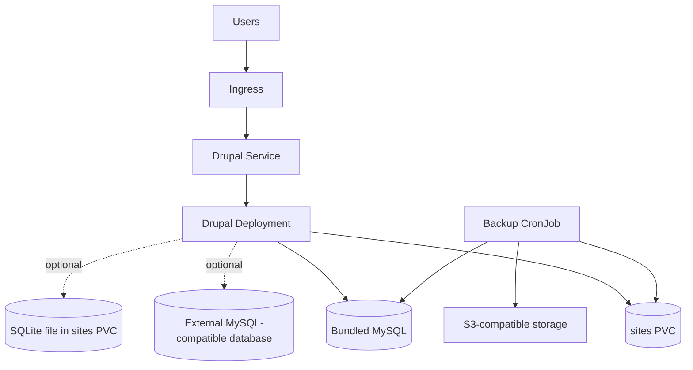

<!-- SPDX-License-Identifier: Apache-2.0 -->

# Drupal Chart Design

## Scope

This chart deploys Drupal with an Apache PHP runtime, installer-aware database
configuration, persistence for `sites/`, optional ingress, optional autoscaling
guardrails, and scheduled S3-compatible backups.

The chart targets teams that want a production-oriented Drupal deployment with
explicit image pinning, predictable persistence, and database paths that match
Drupal's web installer.

## Architecture

## Main Design Choices

- Pin the Docker Official Drupal Apache image to the Drupal, PHP, and Debian
  release tuple instead of using a floating tag.
- Persist only `/var/www/html/sites` so installed site state, uploads, and
  SQLite data survive restarts without masking Drupal core files from the image.
- Keep MySQL enabled by default for a guided first install while also supporting
  external MySQL-compatible databases and SQLite for single-replica use.
- Keep one replica by default and require compatible storage/database choices
  before autoscaling or multi-replica operation.
- Keep backup automation opt-in and focused on the mutable `sites/` directory
  plus the selected database backend.
- Keep `service.port` independent from `containerPorts.http`. For the official
  image, a non-default container port causes an init container to copy and
  rewrite Apache configuration before the application starts. Custom images
  must explicitly opt into that known filesystem contract.

## Security Boundary

- The pod does not receive a Kubernetes API token by default, privilege
  escalation is disabled, and the runtime uses the `RuntimeDefault` seccomp
  profile.
- The Docker Official Drupal Apache image starts its master process as root so
  it can bind port 80 and then delegates requests to unprivileged workers. The
  chart does not claim a fully non-root or read-only-root-filesystem boundary.
- The optional NetworkPolicy can restrict ingress to same-namespace or
  explicitly selected sources. Egress restrictions are separately opt-in so
  they do not silently block package downloads, mail, or external services.
- Application administrators, Drupal roles, TLS policy, database grants, and
  S3 bucket policy remain outside the chart's security boundary.

## Observability Boundary

The chart provides startup, readiness, and liveness probes plus container and
backup job logs through Kubernetes. It does not install a metrics exporter,
ServiceMonitor, dashboards, distributed tracing, or alerting rules. Operators
must connect their preferred telemetry stack and monitor HTTP availability,
PHP/Apache errors, database health, PVC capacity, and backup job outcomes.

## Known Gaps and Limitations

- Drupal installation, updates, modules, themes, and configuration import are
  deliberately not automated.
- The optional NetworkPolicy requires a CNI that enforces Kubernetes network
  policy. Ingress controllers outside the release namespace need an explicit
  `networkPolicy.ingress.extraFrom` selector.
- A custom image can use non-default ports only when it is compatible with the
  official image's `/etc/apache2` layout and opts in with
  `image.configureApachePort=true`.
- Multi-replica deployments require externally provided ReadWriteMany storage
  and a MySQL-compatible database. The chart cannot prove storage semantics.
- Backups are created and uploaded, but restore orchestration and retention in
  the destination object store remain operator responsibilities.

## Production Boundary

Production users should set explicit values for:

- `ingress.hosts` and TLS configuration
- `persistence.size`, `persistence.storageClass`, and ReadWriteMany storage when
  running multiple replicas
- `database.mode` and external database credentials when not using the bundled
  MySQL subchart
- `resources`
- `autoscaling` and `pdb` only after storage and database choices are compatible
- `backup.s3` credentials and retention policy
- `networkPolicy` ingress and egress selectors for the cluster topology

## Non-Goals

- Running Drupal's web installer automatically
- Managing Drupal modules, themes, or configuration synchronization
- Provisioning external databases, object stores, or cloud load balancers
- Supporting multi-replica SQLite deployments

<!-- @AI-METADATA
type: design
title: Drupal Chart Design
description: Design document for the Drupal Helm chart

keywords: drupal, cms, apache, php, mysql, sqlite, backup, design

purpose: Document architecture, chart boundaries, and production choices for Drupal
scope: Chart Design

relations:
  - charts/drupal/README.md
  - charts/drupal/docs/database.md
  - charts/drupal/docs/backup.md
  - charts/drupal/docs/persistence.md
  - charts/drupal/docs/scaling.md
path: charts/drupal/DESIGN.md
version: 1.0
date: 2026-06-09
-->
