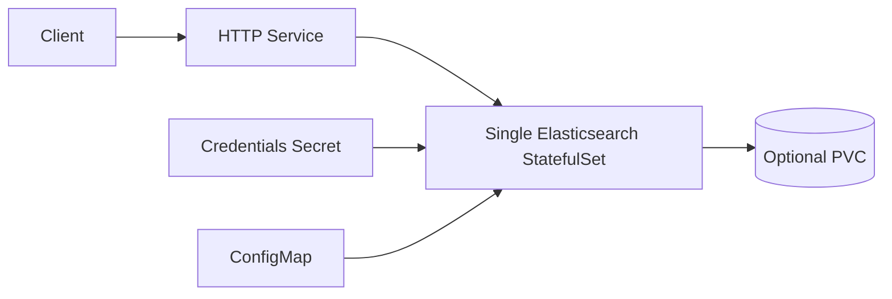
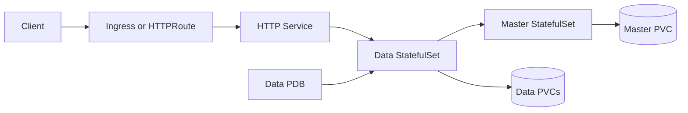
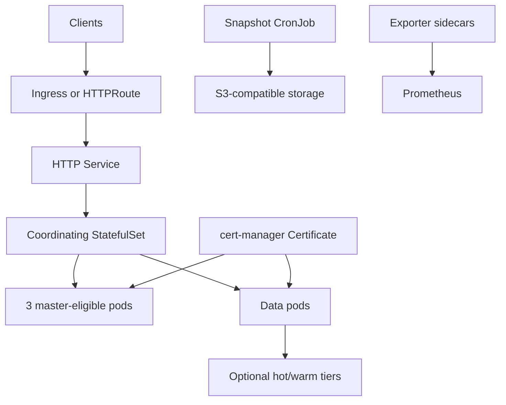

# Elasticsearch Chart Design

## Scope

This chart deploys Elasticsearch using the official `docker.io/library/elasticsearch` image.
It is built around profile-driven Kubernetes topologies instead of requiring users to assemble every role manually.

Supported profiles:

- `dev`: single-node development profile with lightweight defaults
- `staging`: representative multi-node profile for validation and integration environments
- `production-ha`: multi-role high availability profile with master, data, and coordinating nodes

Optional capabilities include S3 snapshots, ILM policies, hot/warm data tiers, cert-manager TLS, External Secrets,
Gateway API, Prometheus monitoring, Grafana dashboards, and a colocated Kibana deployment.

## Architecture: Dev

The dev profile keeps the deployment small for local clusters and chart validation. It is not intended for production data.

## Architecture: Staging

The staging profile validates shard placement, persistence, PDB behavior, and operational settings without the full
resource footprint of production HA.

## Architecture: Production HA

Production HA separates roles, enables disruption budgets, and provides opt-in TLS, backups, monitoring, and tiered storage.
Operators should still own capacity planning, shard strategy, snapshots, restore drills, and version upgrade sequencing.

## Main Design Choices

- Use the official Elasticsearch and Kibana images.
- Keep chart defaults lightweight while exposing production profiles through `clusterProfile`.
- Generate role-specific StatefulSets instead of using a single generic pod template.
- Generate one authoritative `elasticsearch.yml`, mount it into every node role, and reserve cluster, discovery,
  security, and listener keys for the chart.
- Separate process listener ports from Kubernetes Service ports. Services always use named target ports.
- Route client traffic to coordinating nodes when present, then data nodes, then an enabled data tier, and only use
  master nodes for the all-in-one development topology.
- Expose transport only through role-specific headless Services used for cluster communication.
- Keep Kibana optional and version-aligned with Elasticsearch.
- Render Gateway API and External Secrets only when explicitly enabled.
- Use cert-manager integration when TLS is managed by the cluster, and self-signed hook jobs for clusters without it.
- Provide S3 snapshots as an explicit scheduled backup path, not as a replacement for restore testing.

## Production Boundary

Before production use, operators should define:

- credentials through existing Secrets or External Secrets
- TLS issuer and certificate lifecycle
- PVC sizes and storage classes per role or tier
- resource requests, JVM heap, and shard allocation strategy
- backup bucket, retention, and restore runbooks
- monitoring, alert routing, and dashboard ownership
- upgrade sequencing for Elasticsearch, Kibana, plugins, index templates, and ILM policies
- node-level `vm.max_map_count=262144`; the privileged init container is an explicit compatibility fallback

## Security Boundary

By default, Elasticsearch pods run as a non-root user, drop all Linux capabilities, prevent privilege escalation, and
use the runtime-default seccomp profile. Explicit `podSecurityContext` and `securityContext` overrides can change these
settings. The development and staging profiles leave X-Pack security disabled; production HA enables it, but operators
remain responsible for trusted credentials, TLS issuer policy, certificate rotation, and restricting client access.
Credentials can be provided through an existing Secret or External Secrets.

The chart does not create a NetworkPolicy. Cluster operators must enforce the required client, transport, DNS, backup,
and monitoring paths with their network controls. `sysctlInit.enabled` is an opt-in compatibility fallback that runs a
privileged init container; configuring `vm.max_map_count` on Kubernetes nodes is the preferred production approach.

## Observability Boundary

When enabled, exporter sidecars expose Elasticsearch metrics through a dedicated Service. The chart can also create a
ServiceMonitor, PrometheusRule, and Grafana dashboard ConfigMaps. It does not install Prometheus or Grafana, route
alerts, collect logs or traces, or prove that snapshots can be restored. Operators own those systems and their
retention, availability, and access controls.

## Known Gaps

- no chart-managed NetworkPolicy
- no automatic snapshot restore or restore verification
- no automatic major-version migration or plugin compatibility validation
- no cross-cluster replication or remote-cluster orchestration
- privileged `vm.max_map_count` initialization is available only as an explicit opt-in fallback

## Explicit Non-Goals

- Elasticsearch operator behavior
- automatic major version migrations
- automatic shard rebalancing policy decisions beyond Elasticsearch defaults
- plugin installation and lifecycle management
- cross-cluster replication or remote cluster orchestration
- replacing Elastic Cloud Enterprise, ECK, or managed Elasticsearch platforms
