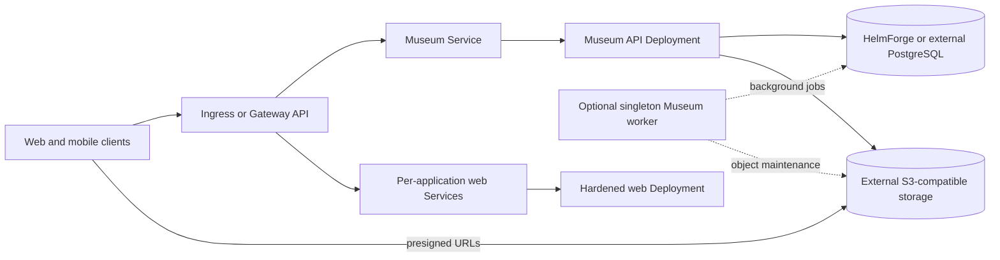

# Ente Chart Design

This chart packages Ente's Museum API and official web applications with a
HelmForge PostgreSQL dependency or an external PostgreSQL service. Object data
is always stored in an external S3-compatible service.

## Scope

The supported product boundary is Ente Photos: Museum, the Photos supporting
web applications, PostgreSQL metadata, and externally managed S3-compatible
object storage. The chart owns Kubernetes resources and safe runtime wiring; it
does not provision object storage, DNS, certificates, or external databases.

## Architecture

## Design Choices

- The chart uses immutable official Museum and web image tags. Ente does not
  publish server semantic releases, so the Museum tag follows the exact commit
  deployed by the upstream production service and the web tag follows the
  official weekly build.
- S3-compatible object storage is external and mandatory. Ente clients upload
  and download through presigned URLs, so the endpoint must be reachable by
  clients and configured with the required CORS policy. Bundling a test object
  store would obscure this production requirement.
- The default is one Museum API replica with background jobs enabled. Scaling
  the API requires disabling its background jobs and enabling exactly one
  singleton worker Deployment. This prevents duplicate cron and cleanup work.
- A single web Deployment exposes the enabled applications on their upstream
  ports. Separate Services and routes retain independent public hostnames
  without duplicating the same image and static assets across Deployments.
- PostgreSQL can be installed through the HelmForge dependency or supplied by
  a managed service or operator. Museum performs database migrations during
  startup. HA pods use a PostgreSQL advisory-lock sidecar that polls without an
  active transaction and releases the next Museum only after the configured
  HTTP listener opens.
  The sidecar follows `museum.containerPorts.http` when the listener changes.
  This is required because concurrent upstream startup can leave migrations
  dirty, including migrations that create indexes concurrently.
- `museum.containerPorts.http` configures the real Museum `http.port` listener.
  `museum.service.port` is an independent Kubernetes Service contract and the
  Service targets the named `http` port. Upstream Museum hard-codes its
  Prometheus listener on port 2112; only the metrics Service port is
  configurable, and its named target continues to reach that fixed listener.
- Encryption, hash, and JWT keys are generated only on first installation and
  retained with Helm `lookup`, or supplied through an existing Secret. They are
  never intentionally regenerated during an upgrade.
- External Secrets support follows the generic `items[]` contract. It creates
  Secrets but does not bypass the chart's explicit `existingSecret` wiring.

## Production Boundary

Production operators must supply durable S3, PostgreSQL, cryptographic Secret,
TLS, DNS, SMTP, monitoring, and backup policies appropriate to their
environment. The bundled PostgreSQL mode is durable when persistence remains
enabled, but it is not automatic database failover. Application HA requires API
replicas with background jobs disabled and exactly one worker with jobs enabled.

## Security Boundary

Museum runs as an arbitrary non-root user with a read-only root filesystem.
The web image requires a writable copy of its static output for upstream
runtime origin replacement, so an init container copies the assets into an
`emptyDir`; the serving container remains non-root and read-only outside the
declared writable mounts. Both workloads disable privilege escalation, drop
Linux capabilities, and do not mount service account tokens.

The Museum readiness and startup probes use `/ping`, which verifies PostgreSQL.
The liveness probe uses TCP so a database outage does not cause restart loops.
Upstream `/ping` does not verify S3, so production monitoring must include an
object upload and download check in addition to pod readiness.

NetworkPolicy, PodDisruptionBudget, autoscaling, ServiceMonitor,
PrometheusRule, Ingress, Gateway API, dual-stack Services, backup, and
scheduling controls are opt-in. Their defaults do not assume cluster CRDs or a
specific network environment.

## Observability Boundary

Museum exposes `/metrics` on the upstream-fixed port 2112. The chart can expose
that endpoint through a Service and ServiceMonitor and can create baseline
Prometheus rules. `/ping` verifies PostgreSQL but not S3, so readiness is not an
end-to-end availability signal. Operators must monitor real object upload and
download flows and collect Museum and PostgreSQL logs outside the chart.

## Durability Model

An Ente recovery set consists of the Museum keys and configuration, PostgreSQL
data, and all object-storage data. The optional backup CronJob creates
PostgreSQL dumps in separate S3-compatible storage. It does not copy the photo
objects or Secret material, so operators must back up all three parts and run
complete restore drills.

Ente's object replication feature is disabled by default. Replication is not a
backup and its workers can run in every Museum process. This chart does not
claim a safe general-purpose replication topology until upstream exposes a
dedicated worker lifecycle.

## Known Gaps And Limitations

- Museum has no semantic server releases; HelmForge pins the immutable commit
  published by Ente's official production-image workflow.
- The Prometheus listener is fixed at 2112 in the upstream binary.
- Low Museum listener ports require the container runtime's
  `net.ipv4.ip_unprivileged_port_start` policy to permit non-root binds; the
  independent Service port remains the portable way to expose a low port.
- `/ping` cannot detect object-storage or client-side CORS failures.
- The backup CronJob covers PostgreSQL only, not live objects or Secrets.
- Application-level replication is intentionally outside the supported HA
  contract because its workers are not independently lifecycle-managed.

## Non-Goals

- Provisioning or managing an S3-compatible object store
- Treating an embedded database replica as automatic PostgreSQL failover
- Making the web applications available without a public Museum origin
- Claiming that Kubernetes readiness proves object-storage availability
- Backing up object data or external Secret provider contents
- Enabling upstream object replication by default

## Validation Focus

- Default Museum, web, and HelmForge PostgreSQL rendering
- External PostgreSQL and existing Secret wiring
- Generated key stability across Helm upgrades
- External Secrets Operator resources using `items[]`
- Safe multi-replica API plus singleton worker topology
- Serialized first install and upgrade migrations across all Museum pods
- Ingress and Gateway API routing for Museum and individual web apps
- Non-root, read-only runtime behavior for Museum and web
- Dual-stack Services, NetworkPolicy, PDB, HPA, and metrics resources
- PostgreSQL dump upload to external S3-compatible backup storage
- Real Museum `/ping`, web HTTP, and S3 object operations in k3d

## Related Files

- `charts/ente/README.md`
- `charts/ente/docs/architecture.md`
- `charts/ente/docs/object-storage.md`
- `charts/ente/docs/high-availability.md`
- `charts/ente/docs/backup-restore.md`
- `charts/ente/examples/production.yaml`
- `charts/ente/examples/production-ha.yaml`

---

keywords: ente, museum, photos, postgresql, s3, gateway-api, external-secrets
path: charts/ente/DESIGN.md
