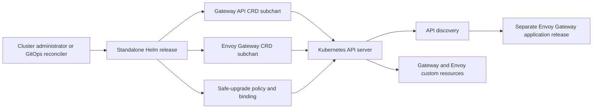

# Envoy Gateway CRDs Design

## Scope

This chart owns the installation boundary for the cluster-scoped Gateway API
v1.6.1 Experimental CRDs, Envoy Gateway v1.9.0 extension CRDs, and the optional
Gateway API safe-upgrade admission policy. It deliberately does not install a
controller or create custom resources. Its purpose is to make API discovery and
forward-only schema lifecycle explicit before an Envoy Gateway application
release is rendered or upgraded.

## Purpose

`envoy-gateway-crds` separates cluster API lifecycle from the Envoy Gateway
controller release. This solves first-install discovery failures in Helm diff
workflows and makes CRD upgrade ordering explicit.

## Architecture

The two conditional internal subcharts are packaging boundaries rather than
independent products. Helm installs their `crds/` objects before normal
templates. The policy and binding are the only Helm-tracked Kubernetes objects;
CRDs and all custom resources remain outside the release manifest. The separate
application release consumes the APIs only after discovery reports them.

## Design Decisions

### CRDs remain in `crds/`

The chart does not template CRDs. Helm installs objects from `crds/` before
normal templates, excludes them from the release manifest, skips existing
objects, and never deletes them. This prevents both the Helm release Secret size
failure and accidental cluster-wide data loss.

The consequence is intentional: `helm upgrade` does not update schemas. Every
CRD upgrade uses an explicit server-side apply step before the controller
upgrade.

### Conditional internal subcharts

Helm does not template files in `crds/`, so individual documents cannot be
selected with values. Two internal subcharts provide the required selection
boundary:

- `gateway-api-crds`: 10 Gateway API v1.6.1 Experimental CRDs.
- `envoy-gateway-extension-crds`: 8 Envoy Gateway v1.9.0 CRDs.

Helm removes disabled dependencies before recursively collecting CRD objects.
This supports a provider-managed Gateway API without moving CRDs into
templates.

### No application dependency

The Envoy Gateway application chart must not depend on this chart. A dependency
would render CRDs and custom resources inside the same Helm operation and would
not create a discovery boundary for `helm-diff`.

### Explicit policy management

The safe-upgrade policy has three modes. `managed` gives Helm real ownership of
the policy and binding. `external` declares a different owner. `disabled` is
reserved for bootstrap, CRD-only rendering, and migration. The chart never
silently suppresses ownership conflicts.

The chart applies `commonAnnotations` only to the Helm-tracked policy and
binding. Static CRDs under dependency `crds/` directories remain untemplated by
design. Required lifecycle annotations, including `helm.sh/resource-policy`,
take precedence over user-provided common annotations.

### Forward-only CRD lifecycle

CRD downgrade is unsupported. A Helm rollback changes release metadata and
policy templates but cannot and must not roll schemas backwards. Application
rollback is supported only when the live CRD bundle remains compatible with the
target controller version.

## Production Boundary

Production operation requires a single identified cluster-level CRD owner,
bundle compatibility review, a server-side dry-run, explicit server-side apply,
and an Established wait before the controller upgrade. Operators must inventory
CRD UIDs, stored versions, custom-resource counts, policy ownership, and field
managers before migration. Recovery is forward-only because Helm rollback does
not restore CRD schemas and Kubernetes does not provide transactional rollback
for CRD conversions or stored custom resources.

The chart validates its small values contract and preserves resources during
uninstall, but it cannot prove that existing custom resources conform to a new
schema, that conversion between stored versions is safe, or that a target
controller supports the live bundle. Provider-managed Gateway API installations
must be reconciled with that provider rather than overwritten by this release.

## Security Boundary

CRDs and admission policies are cluster-scoped and require cluster-admin level
authority. The release contains no pods, containers, credentials, Services, or
network endpoints.

The policy uses `failurePolicy: Fail` and the upstream Gateway API CEL rules.
Both policy resources are retained on uninstall. Their ownership must be
audited before adoption from an existing application release.

The policy constrains the Gateway API CRD channel and accepts incoming bundle
versions `v1.5+`; it does not compare the incoming bundle version with
`oldObject`. It therefore does not prevent a same-channel downgrade, which must
remain blocked by the operator's forward-only release process unless the policy
is extended with version comparison. It is not a general admission security
policy and does not validate Envoy extension CRDs or custom-resource content.
Disabling or externally managing it transfers that responsibility to the
declared cluster owner. The chart never enables server-side apply conflict
forcing automatically.

## Observability Boundary

There is no workload, Service, metrics endpoint, log stream, or health probe.
Operational evidence comes from Kubernetes API state: CRD `Established` and
`NamesAccepted` conditions, stored versions, bundle annotations, `managedFields`,
policy and binding presence, API discovery, admission denials in API-server
audit logs, and the health of the separately installed controller.

Operators should alert on failed reconciliation, non-Established CRDs,
unexpected field managers, admission-policy removal, discovery failures, and
controller errors after a schema change. A successful Helm release alone does
not prove that pre-existing custom resources remain semantically compatible.

## Known Gaps And Operational Risks

- Helm installs missing `crds/` objects but does not upgrade or delete them.
- A values change that disables a bundle cannot remove CRDs already installed.
- CRD downgrade and automatic schema rollback are unsupported.
- The admission policy covers Gateway API upgrade rules, not Envoy extension
  schemas or application-level compatibility.
- Multiple charts or providers can contend for the same cluster-scoped fields;
  conflicts require an explicit ownership decision.
- Deleting a CRD manually deletes every custom resource of that kind.
- Stored-version migration and conversion safety remain operator-managed.
- Client discovery caches can remain stale briefly after an API is established.

## Non-Goals

- Installing the Envoy Gateway controller.
- Creating GatewayClass, Gateway, Route, or Envoy extension custom resources.
- Automatically forcing server-side apply conflicts.
- Supporting CRD downgrades.
- Deleting CRDs or custom resources during uninstall.
- Claiming Helm ownership metadata on CRDs that Helm does not track.

## Release Contract

Chart major versions may change the supported Envoy Gateway or Gateway API
compatibility set. Minor and patch releases may correct documentation,
validation, or metadata without changing the pinned bundle unexpectedly.

Application controller upgrades always occur after the matching CRD release is
installed and its APIs are discoverable.
