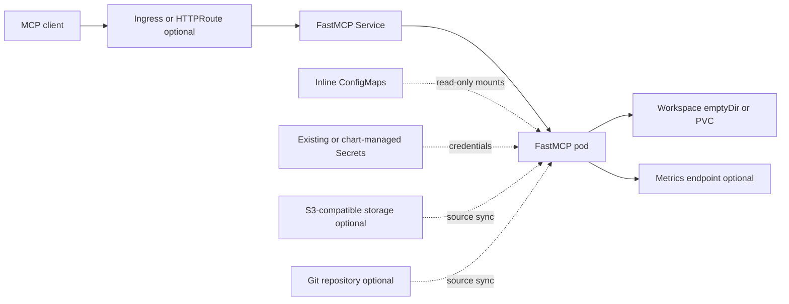

<!-- SPDX-License-Identifier: Apache-2.0 -->

# FastMCP Server Chart Design

## Scope

The `fastmcp-server` chart deploys a single FastMCP HTTP server that exposes
tools, resources, prompts, and knowledge files through the MCP endpoint. The
chart is optimized for platform-owned MCP servers where the runtime image stays
pinned and the deployer supplies MCP content from one or more controlled
sources. It owns the Kubernetes resources required to run that server, but it
does not own the external systems from which content or credentials are read.

## Architecture

The main workload is one Deployment and one ClusterIP Service. Ingress and
Gateway API routes, persistent storage, source synchronization, authentication,
monitoring, autoscaling, disruption protection, and network policy are opt-in.

## Main Design Choices

The chart renders one `Deployment` by default. Autoscaling can delegate replica
count to an HPA, but the deployment strategy remains `Recreate` because the
workspace can be backed by a ReadWriteOnce PVC and source synchronization should
not race across rolling pods that share the same release identity.

The server container always mounts `/app/workspace`. That mount is an
`emptyDir` by default and becomes a PVC when `persistence.enabled=true`.
Inline sources are mounted read-only from separate ConfigMaps:

- `sources.inline.tools` -> `/app/inline/tools`
- `sources.inline.resources` -> `/app/inline/resources`
- `sources.inline.prompts` -> `/app/inline/prompts`
- `sources.inline.knowledge` -> `/app/inline/knowledge`

The pod receives checksum annotations for inline source maps so ConfigMap
changes trigger a rollout.

The chart uses `Recreate` because a ReadWriteOnce workspace must not be mounted
by overlapping old and new pods. An `emptyDir` keeps the default deployment
stateless, while a chart-created or existing PVC makes the workspace durable.

## Source Loading Contract

The chart exposes the application source contract without trying to parse or
validate user Python modules:

- Inline content is rendered into Kubernetes ConfigMaps.
- S3-compatible sources are enabled with `sources.s3.enabled=true`.
- Git sources are enabled with `sources.git.enabled=true`.
- `initSync.enabled=true` runs `/app/sync_only.py` before the main container.

Merge precedence is documented as inline content first, then S3, then Git. That
precedence is an application contract; the chart's responsibility is to mount
and pass the source locations and credentials consistently.

## Security Boundary

The chart can either reference existing secrets or create release-scoped
secrets from values:

- bearer auth uses `<fullname>-auth` unless `auth.bearer.existingSecret` is set;
- S3 credentials use `<fullname>-s3` unless `sources.s3.existingSecret` is set;
- Git tokens use `<fullname>-git` unless `sources.git.existingSecret` is set.

Production deployments should prefer existing secrets from a secret manager or
External Secrets workflow. Inline credentials are mainly for CI and local
evaluation.

The container defaults to non-root UID/GID `1000`, drops all capabilities,
disables privilege escalation and service-account token automount, and uses the
runtime default seccomp profile. The root filesystem remains writable because
the application can install `extraPipPackages` and populate the workspace.
User-supplied Python and packages execute inside the server process and must be
treated as trusted code; this chart does not provide a sandbox boundary.

## Network Exposure

The Service exposes the configured HTTP port and defaults to ClusterIP.
Ingress and Gateway API are both opt-in. The Gateway API template requires at
least one `parentRef` when enabled because the chart intentionally references a
platform-owned Gateway instead of creating one.

The chart supports dual-stack Service fields through `service.ipFamilyPolicy`
and `service.ipFamilies`. These fields are empty by default so clusters keep
their own Service IP-family policy.

## Production Boundary

The chart owns the Deployment, Service, inline ConfigMaps, optionally generated
Secrets, and the optional routing, policy, storage, autoscaling, disruption,
and monitoring resources. The platform owns DNS, TLS termination, ingress or
Gateway controllers, Prometheus Operator, metrics-server, storage classes,
external Secrets, and the availability and access policy of Git, S3, JWKS, and
Python package endpoints.

NetworkPolicy is opt-in. When enabled, it constrains ingress to the configured
server port. Egress remains unrestricted when `networkPolicy.extraEgress` is
empty. Supplying rules enables the Egress policy type and restricts traffic to
those rules, so operators must include DNS and every required Git, S3, JWKS,
package-index, and downstream-tool destination.

Production operators should use existing Secrets, authenticate every externally
reachable endpoint, pin controlled source revisions, set resource limits, and
decide explicitly whether workspace data must survive restarts. Multiple
replicas are safe only when the configured source and workspace modes support
concurrent pods.

## Observability Boundary

The application exposes startup, health, debug, and optional Prometheus metrics
endpoints. The chart wires the health endpoints into Kubernetes probes and can
render a ServiceMonitor when metrics and ServiceMonitor support are both
enabled. A Prometheus Operator and matching CRD must already exist and select
the ServiceMonitor.

Structured JSON logging is available through `server.logFormat=json`, but log
collection, retention, dashboards, alerts, external availability probes, and
source-system telemetry remain platform responsibilities. A ready pod proves
that the server health endpoint responds; it does not prove every loaded tool,
remote source, or downstream API is functioning.

## Validation Strategy

The chart carries CI scenarios for the default install, bearer auth, inline
content, S3, Git, Gateway API, and full production-style values. Unit tests
cover rendered objects, source ConfigMaps, secrets, probes, security context,
ServiceMonitor, HTTPRoute, ingress, HPA, PDB, and NOTES behavior.

## Known Gaps And Operational Risks

- User-provided Python, Git content, and extra packages are trusted executable
  inputs and can access the pod's network and mounted credentials.
- `Recreate` avoids overlapping PVC mounts but introduces downtime during pod
  replacement.
- A ReadWriteOnce PVC and multiple replicas may be incompatible, depending on
  the storage provider and pod placement.
- NetworkPolicy egress rules are entirely operator-supplied; an incomplete rule
  set can block DNS, source synchronization, authentication, or tool calls.
- Inline credentials become Helm release data; existing Secrets are preferred
  for production.
- Source synchronization depends on external Git or S3 availability and can
  delay startup or fail strict-loading deployments.
- Installing packages at startup is mutable and requires package-index egress;
  production images should pre-bake critical dependencies.

## Explicit Non-Goals

- validating or sandboxing user-provided Python code
- creating S3 buckets, Git repositories, JWKS providers, or package mirrors
- installing an ingress controller, Gateway implementation, metrics-server, or
  Prometheus Operator
- issuing TLS certificates or managing DNS
- guaranteeing high availability for external source systems
- backing up or migrating persistent workspace content
