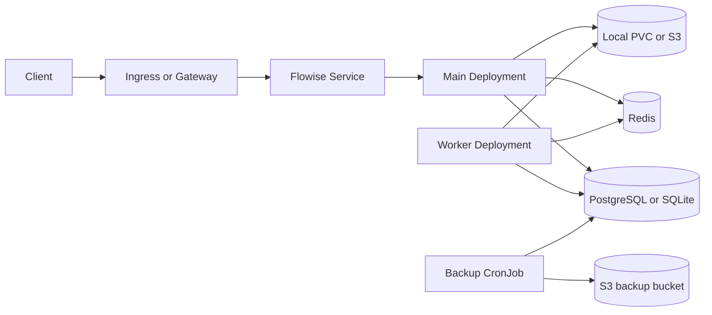

<!-- SPDX-License-Identifier: Apache-2.0 -->
# Flowise chart design

This document records the boundaries and deliberate choices of the HelmForge
Flowise chart. It complements the user-facing README and operational guides.

## Scope

The chart deploys Flowise 3.1.3 from the official `flowiseai/flowise` image in
either a single-server standalone topology or a queue topology with separate
main and worker Deployments. It owns the Kubernetes resources required to run
Flowise, optional PostgreSQL and Redis dependencies, local or S3-compatible
blob storage integration, and scheduled PostgreSQL backups.

## Architecture

Standalone mode runs one Flowise server with SQLite and local blob storage on a
PVC by default. The PVC is mounted at `/home/node/.flowise`, matching the
official image's `node` user. Queue mode runs one or more main servers plus a
worker Deployment. Queue mode requires PostgreSQL, Redis, S3-compatible shared
storage, and disabled local persistence.

The Service selects only main pods and routes its `http` targetPort to
`flowise.containerPort`. Ingress and Gateway API resources target that Service.
Component-specific NetworkPolicies allow the public listener only on main pods;
workers accept no inbound connections.

The Service deliberately excludes workers. Redis coordinates queue work, while
the main and worker components share the database and object storage only in
queue mode. The backup CronJob has no dependency on the public request path.

## Design decisions

- The application listener is separate from `service.port`; changing the former
  updates both the container port and Flowise's `PORT` environment variable.
- Standalone remains the default because it installs without external services.
- Queue mode fails fast unless database, Redis, and shared storage requirements
  are satisfied.
- The official image is run as UID/GID 1000 with a read-only root filesystem.
  Writable data and `/tmp` are explicit volumes.
- Authentication, database, Redis, and S3 credentials use Secrets. Inline
  values remain available for development, but existing Secrets are preferred.
- PostgreSQL backup arguments are an array and are passed as process arguments,
  never evaluated by a shell.

## Production boundary

Production installations should use queue mode, managed or resilient
PostgreSQL and Redis, S3-compatible storage, explicit resource requests and
limits, multiple main and worker replicas, TLS ingress, and off-cluster backup
retention. The bundled dependencies are convenient defaults, not a substitute
for a database availability design. SQLite and a ReadWriteOnce PVC intentionally
limit the default topology to one replica.

## Security boundary

The chart disables Kubernetes API token mounting, drops all Linux capabilities,
prevents privilege escalation, uses RuntimeDefault seccomp, and enables a
read-only root filesystem. NetworkPolicy restricts inbound access by component
while leaving egress open by default because Flowise integrations contact
operator-selected model providers and tools. Operators with known destinations
should replace the default egress rule.

Flowise can execute user-configured tools and custom MCP commands. Kubernetes
hardening does not make untrusted Flowise users safe. Restrict administrative
access, retain upstream security checks, and avoid granting the pod cloud or
cluster credentials.

## Observability boundary

Startup, readiness, and liveness probes use `/api/v1/ping`. Logs are written to
`flowise.logPath` and container stdout. The chart does not deploy a metrics
collector or dashboard; operators can add environment variables and monitoring
resources through `flowise.extraEnv` and `extraManifests`.

## Known gaps

- No built-in HPA or PodDisruptionBudget is rendered.
- NetworkPolicy egress cannot infer model-provider destinations.
- Backup automation covers PostgreSQL only; S3 object versioning and retention
  remain provider responsibilities.
- Restoring a backup is an operator-run procedure by design.

## Non-goals

- Building custom Flowise images or installing extra system packages.
- Operating PostgreSQL, Redis, or S3 as managed services.
- Providing model-provider credentials or an identity-provider configuration.
- Making SQLite horizontally scalable.
- Automatically restoring backups during install or upgrade.

## Upgrade and migration notes

The previous `/root/.flowise` mount and the new `/home/node/.flowise` mount both
map the root of the same PVC, so existing SQLite and blob files remain at the
same volume-relative paths. Operators overriding database or storage paths must
update those values explicitly. Back up PostgreSQL or the standalone PVC before
upgrades and validate queue workers after rollout.

## References

- [Flowise documentation](https://docs.flowiseai.com/)
- [Flowise source](https://github.com/FlowiseAI/Flowise)
- [Architecture guide](docs/architecture.md)
- [Security guide](docs/security.md)
