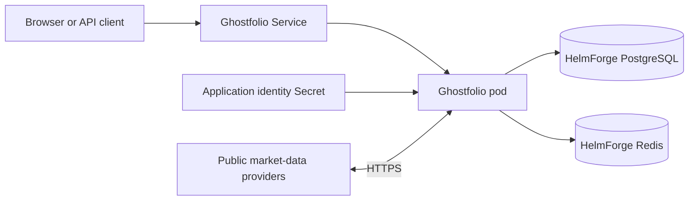
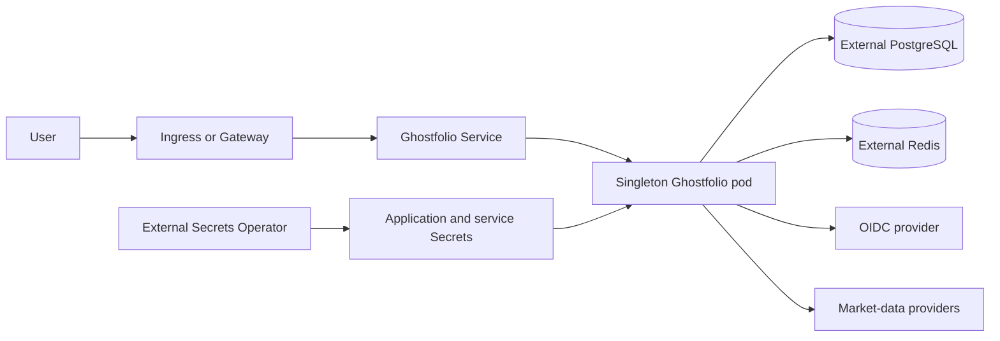

<!-- SPDX-License-Identifier: Apache-2.0 -->

# Ghostfolio chart design

## Scope

This chart deploys the official Ghostfolio wealth-management application with
the state services, Secrets, exposure and network controls needed for a
repeatable Kubernetes installation. It owns one Ghostfolio Deployment, its
Service, optional Ingress or Gateway API HTTPRoutes, application identity
Secret, ExternalSecret resources, ServiceAccount and NetworkPolicy.

PostgreSQL and Redis can be HelmForge dependencies or externally managed
services. The chart does not operate external databases, identity providers,
ingress or Gateway controllers, DNS, certificates, backup systems or market
data providers.

## Architecture

The default topology is intentionally complete and single-instance. One
Ghostfolio pod runs Prisma migrations, seed work, the NestJS HTTP server and
scheduled portfolio tasks. PostgreSQL is the system of record and Redis holds
operational cache state.

Production installations can replace either dependency with an external
service. Complete database URLs and passwords enter the pod only through
Secrets. Optional Ingress or HTTPRoutes expose the Service, while OIDC delegates
authentication to a separately operated identity provider.

`containerPorts.http` configures the actual process through the official
`PORT` environment variable. `service.port` is an independent
Kubernetes-facing port that targets the named `http` container port. Probes and
NetworkPolicy follow the name, so a listener override reaches every consumer.

## Design decisions

### The application remains a singleton

The upstream entrypoint applies Prisma migrations and seeds before every server
start. The application also enables scheduled work by default. Upstream does
not document a distributed lock or leader election for either responsibility.
The chart therefore constrains `replicaCount` to one, renders one replica even
during upgrades and uses a `Recreate` strategy to prevent overlap between old
and new processes.

### Upstream health semantics are preserved

Startup and liveness use `/api/v1/health/liveness`, which reports process
health without coupling restarts to PostgreSQL or Redis outages. Readiness uses
`/api/v1/health` and withdraws traffic when a state service is unavailable. Two
non-root BusyBox init containers wait for dependency TCP listeners before the
official entrypoint runs, but TCP checks are not presented as application
readiness or migration evidence.

### Application identity is retained

`ACCESS_TOKEN_SALT` and `JWT_SECRET_KEY` form durable application identity.
The chart-created Secret uses `lookup` so values survive ordinary Helm
upgrades. An existing Secret is the deterministic production and GitOps
contract because an offline renderer cannot retrieve live values. OIDC,
external PostgreSQL, Redis and provider credentials are referenced from
Secrets and never copied into ConfigMaps.

### Listener and Service ports are separate

Ghostfolio officially supports the `PORT` environment variable, so the chart
exposes `containerPorts.http` as the application listener. The Service may use
a different `service.port`. The listener is restricted to ports 1024 through
65535 because the container runs as UID 1000 with all capabilities dropped.

## Production boundary

Availability comes from Kubernetes process recovery and durable state services,
not multiple Ghostfolio replicas. PostgreSQL requires tested backups,
restoration, capacity planning and high availability appropriate to the
installation. Redis persistence can improve cache continuity but does not
replace the PostgreSQL backup. Bundled standalone dependencies are convenient
defaults, not managed-service or multi-zone guarantees.

The chart supplies startup budgets, scheduling controls, topology spreading
and graceful termination. It deliberately omits HPA and PodDisruptionBudget
because the singleton invariant would make them misleading. Upgrade plans must
account for a controlled outage while `Recreate` applies migrations and starts
the new server.

Ingress controllers, Gateway implementations, DNS, certificates, OIDC
providers, External Secrets Operator and backup controllers remain platform
responsibilities. The first registered user becomes administrator, so public
exposure must remain protected until onboarding is complete.

## Security boundary

The official application runs as UID/GID 1000 with RuntimeDefault seccomp, a
read-only root filesystem, no privilege escalation, every Linux capability
dropped and no automatically mounted Kubernetes API token. Writable paths are
limited to bounded `emptyDir` volumes for `/tmp` and the upstream npm cache.
Dependency-wait init containers use UID/GID 65534 with the same privilege
restrictions.

NetworkPolicy permits namespace-local application ingress, DNS, the selected
PostgreSQL and Redis peers, and public HTTP/HTTPS access needed by market-data
providers. Broad public egress excludes private and special-use address ranges.
Operators must explicitly authorize private external services and any extra
provider destination. NetworkPolicy cannot validate a remote provider's
identity or TLS correctness.

The chart controls Secret references but does not encrypt Kubernetes Secrets at
rest or rotate external credentials. Operators must restrict namespace access,
enable envelope encryption or an external secret provider, and preserve
application identity alongside database backups.

## Observability boundary

The upstream health endpoints provide process and dependency status. The
chart-specific smoke test verifies both endpoints, migration and seed log
markers, the official image, singleton runtime and nonempty Secret-backed
identity. These checks demonstrate startup behavior but do not validate
portfolio calculations, provider correctness or a user's complete workflow.

Ghostfolio exposes no documented Prometheus endpoint in this release, so the
chart does not create a misleading metrics Service or ServiceMonitor.
Operators should collect structured logs, Kubernetes events and state-service
metrics, then add an authenticated synthetic check for login, holdings and
provider refresh where required.

## Upgrade and rollback

Before every image or chart upgrade, create a transactionally consistent
PostgreSQL backup, preserve the application identity Secret and external
credentials, and record the deployed versions. Restore into an isolated
namespace and verify login, account history, holdings and a provider refresh.

The official entrypoint runs migrations before starting the server. A Helm
rollback restores Kubernetes manifests but cannot reverse an incompatible
database migration. Database recovery is a separate procedure. The Recreate
strategy avoids overlapping migration and cron owners, at the cost of an
intentional application outage during rollout.

## Validation strategy

Static validation covers strict Helm linting, all CI values, unit tests,
kubeconform with real CRD schemas and Artifact Hub linting. Negative tests
reject extra replicas, ambiguous bundled/external service combinations,
incomplete OIDC, unsafe readiness timeouts and simultaneous Ingress and Gateway
exposure.

Behavioral k3d validation installs the default, external-service, OIDC,
External Secrets, dual-stack, Ingress, Gateway API and custom-port scenarios.
It waits for all workloads, checks Service endpoints, restarts, logs and events,
and runs the product smoke script. The custom-port scenario proves that the
configured `PORT` changes the real Ghostfolio listener rather than Kubernetes
metadata alone.

## Known gaps

- Ghostfolio migration and scheduled-job leadership are not distributed, so
  the application remains a singleton.
- OIDC and health endpoints are marked experimental upstream.
- There is no documented native Prometheus endpoint.
- Public market-data provider availability and correctness cannot be validated
  by the chart.
- Bundled PostgreSQL and Redis use standalone topologies.
- A Helm rollback cannot undo an incompatible Prisma database migration.

## Non-goals

- Horizontally scaling Ghostfolio before upstream documents safe migration and
  scheduled-job coordination.
- Operating PostgreSQL, Redis, OIDC, ingress, Gateway, DNS, certificates or
  External Secrets infrastructure.
- Adding an application PVC when upstream stores durable portfolio data in
  PostgreSQL.
- Treating Redis persistence as a database backup.
- Publishing an undocumented metrics endpoint or false ServiceMonitor.
- Storing credentials directly in values, ConfigMaps or rendered command
  arguments.
