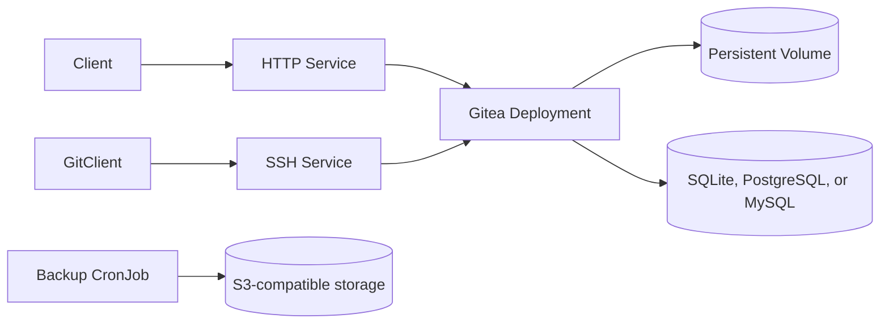

<!-- SPDX-License-Identifier: Apache-2.0 -->

# Gitea Chart Design

This chart deploys Gitea as a rootless, single-writer Git service with explicit
storage, database, HTTP, SSH, backup, and admin-bootstrap contracts. The default
profile is intentionally small: a single Gitea pod, SQLite on a persistent volume,
ClusterIP HTTP and SSH services, and restricted-compatible pod defaults.

## Scope

The chart owns the Kubernetes resources required to run one rootless Gitea
instance, expose its HTTP and SSH protocols, connect one supported database,
bootstrap an optional administrator, and schedule S3-compatible backups.

### Goals

- Run the official `docker.io/gitea/gitea:28.2.0-rootless` image without Bitnami
  or third-party runtime substitutions.
- Keep the default install zero-config through SQLite while making PostgreSQL,
  MySQL, and external database modes explicit.
- Preserve Git HTTP and Git SSH as separate Kubernetes Services so operators can
  expose each protocol with the right network policy, ingress, or NodePort.
- Provide database-aware S3-compatible backups without coupling the chart to one
  object storage vendor.
- Keep admin bootstrap optional and secret-backed, with External Secrets support
  guarded against credential drift.

## Non-goals

- Multi-replica write scaling. The default queues, indexes, repositories, and
  configuration are single-writer state even when the SQL database is external.
- Managing repository mirroring, runners, OAuth providers, mailers, or app.ini
  sections beyond environment-variable passthrough.
- Running privileged maintenance containers by default. PVC ownership repair is
  available only through the explicit `volumePermissions.enabled` opt-in.

## Architecture

The deployment mounts one data PVC in two subPaths:

- `/var/lib/gitea` for repositories, LFS objects, attachments, logs, and SQLite
  data.
- `/etc/gitea` for the rootless `app.ini` path expected by the upstream image.

The main container initializes the `GITEA_APP_INI` path if it does not exist and
then delegates to the upstream image entrypoint. Security context defaults run as
UID/GID `1000`, drop Linux capabilities, disable privilege escalation, and use
`RuntimeDefault` seccomp. The database wait init container inherits the same
container security context.

The HTTP listener is configured by `containerPorts.http` and applied to the
Gitea process through `GITEA__server__HTTP_PORT`. `service.http.port` is the
independent Kubernetes Service port and always targets the named `http` port.

## Design decisions

### Database selection

`database.mode: auto` resolves in this order:

1. `database.external.host` or `database.external.existingSecret`.
2. `postgresql.enabled`.
3. `mysql.enabled`.
4. SQLite.

The helpers fail template rendering when multiple database sources are configured
or when an explicit mode is missing the matching settings. This makes the chart
fail early rather than starting Gitea with ambiguous database values.

### Rollout safety

The Deployment defaults to `strategy.type: Recreate` in every database mode.
An external PostgreSQL or MySQL database does not externalize Gitea's LevelDB
queues, Bleve indexes, repositories, or configuration from the data volume.
Recreate preserves the single-writer contract during upgrades and avoids
multi-attach failures with the default `ReadWriteOnce` PVC. Advanced operators
may override `strategy`, but only after externalizing all shared state and
selecting storage that supports the resulting access pattern.

`podAnnotations` are copied to the pod template so controllers such as secret
reloaders can trigger a rollout without post-render patches.

### Network surfaces

The chart renders one HTTP Service named `<release>-gitea-http` and, when enabled,
one SSH Service named `<release>-gitea-ssh`. Ingress and Gateway API HTTPRoute only
target the HTTP service. SSH exposure is configured separately through
`service.ssh.type`, including optional NodePort.

An optional ingress-only NetworkPolicy limits HTTP and SSH sources. It is off by
default because ingress controllers commonly run in a different namespace;
operators must declare the appropriate peers before enabling it. The chart adds
a dedicated HTTP allowance for the admin-bootstrap Job when that Job exists, so
restricting external ingress cannot deadlock a Helm post-install hook.

### Secrets

The chart can create these secrets:

- `<release>-gitea-admin` for admin bootstrap credentials.
- `<release>-gitea-database` for managed database passwords.
- `<release>-gitea-backup-s3` for S3-compatible backup credentials.
- `<release>-gitea-backup-db` for backup-specific database credentials.

Existing secrets can replace admin, external database, S3, and backup database
credentials. When `externalSecrets.enabled=true`, `admin.existingSecret` is
required so the ExternalSecret owns the target admin secret and the chart does not
create a competing secret.

### Backup model

When `backup.enabled=true`, a CronJob runs one database-aware dump step and one S3
upload step:

- SQLite archives the mounted Gitea data directory.
- PostgreSQL uses `pg_dump`.
- MySQL uses `mysqldump`.

The upload container uses the HelmForge MinIO client image and writes to the
configured S3-compatible endpoint, bucket, and prefix. The chart does not run the
backup CronJob during Helm validation; operators should smoke-test object storage
credentials in a staging namespace before relying on production schedules.

## Production boundary

The chart provides workload, storage, database wiring, ingress resources,
credentials integration, and backup jobs. Operators remain responsible for TLS
issuance, highly available storage and databases, externally reachable DNS,
capacity planning, backup retention, restore testing, and disaster recovery.

SQLite is a single-writer default for evaluation and small installations. Use a
managed or bundled PostgreSQL/MySQL deployment for production concurrency and
plan database maintenance outside this chart's lifecycle.

## Security boundary

The rootless workload drops all capabilities, disables privilege escalation,
uses RuntimeDefault seccomp, and does not mount Kubernetes API tokens by default.
The root filesystem stays writable because the upstream rootless entrypoint owns
runtime initialization; persistent application data and configuration are kept
on the PVC. The chart does not issue TLS certificates or define cluster-wide
network trust.

Credentials can be sourced from existing Secrets or External Secrets. Users who
provide inline values are responsible for protecting Helm release history.

## Observability boundary

Startup, readiness, and liveness probes verify the Gitea health endpoint. The
chart exposes container logs and Kubernetes events but does not create a
ServiceMonitor, PrometheusRule, log pipeline, or dashboard. Platform operators
must integrate those facilities and alert on availability, storage capacity,
database health, and backup failures.

## Known gaps and limitations

- No built-in restore Job; restore procedures are intentionally operator-driven.
- No default egress isolation because Gitea may need arbitrary Git, webhook,
  package, OAuth, and SMTP destinations.
- No bundled monitoring resources or application-specific alert thresholds.
- NetworkPolicy ingress peers cannot be inferred safely across ingress-controller
  and Gateway namespaces, so the feature is opt-in.

## Validation coverage

CI covers default SQLite, an overridden HTTP application listener, service IP
family settings, PostgreSQL subchart, MySQL subchart, SSH NodePort, backup
rendering, and External Secrets rendering. The
external database example stays in `examples/` because behavioral validation needs
a real database Service, while template validation still verifies the external
database contract. Unit tests cover deployment, service, ingress, PVC, secret,
admin job, and backup CronJob templates.
