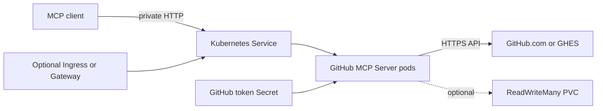

<!-- SPDX-License-Identifier: Apache-2.0 -->

# GitHub MCP Server Chart Design

## Scope

This chart runs the official GitHub MCP Server in streamable HTTP mode for
internal MCP clients. It owns the Deployment, Service, optional token Secret,
ServiceAccount, PDB, NetworkPolicy, Ingress or HTTPRoute, and optional PVC.

## Architecture

The server is stateless by default. Replicas can scale horizontally while
persistence is disabled. A shared PVC is an escape hatch; scaled releases must
use ReadWriteMany storage.

## Key Design Decisions

- `app.port` changes the real HTTP listener and container port; `service.port`
  changes only the Service-facing port.
- `github.readOnly=true` is the default because MCP tools act with the token's
  authority. Toolsets and allow/deny lists further reduce exposure.
- The token can come from a chart Secret or an existing Secret. Production
  deployments should use an existing Secret and minimal GitHub scopes.
- ServiceAccount token automount remains disabled by default because the server
  calls GitHub, not the Kubernetes API.
- The optional security profile is disabled by default to preserve the `1.0.4`
  rendered contract. When enabled, it applies RuntimeDefault seccomp, a
  read-only root filesystem, disabled privilege escalation, and dropped Linux
  capabilities. Explicit security contexts override profile defaults.
- Ingress and Gateway API are independent public routing options. Operators
  should enable at most one unless both routes are intentionally required, and
  both require authentication outside the MCP server.

## Production Boundary

Operators own GitHub token creation, rotation, scope review, and audit. They
also own external authentication, TLS, DNS, network egress, rate-limit
capacity, replica sizing, and representative MCP workflow testing. The chart
does not install an identity-aware proxy or Gateway controller.

When NetworkPolicy egress isolation is enabled, built-in rules allow DNS and
HTTPS. GitHub Enterprise, proxies, and private dependencies can require
additional explicit rules. Persistence retention and access-mode guarantees
belong to the selected storage platform.

## Security Boundary

The MCP endpoint can perform every GitHub action permitted by both the enabled
tools and the configured credential. Network privacy is not authentication.
Expose the endpoint only to trusted clients and place any Ingress or Gateway
behind an identity-aware proxy, VPN, or equivalent control.

`app.args` is a complete upstream argument override. When it is nonempty, the
chart does not generate read-only, toolset, tool-list, deny-list, host, or port
arguments. Operators using it own the complete safety contract.

## Observability Boundary

TCP startup, readiness, and liveness probes verify that the listener accepts
connections. Kubernetes events and container logs cover workload health. The
chart does not install a ServiceMonitor, alerts, distributed tracing, or GitHub
API audit collection. Operators should monitor restarts, latency, GitHub rate
limits, token failures, and upstream audit logs.

## Known Gaps

- The upstream image metadata declares UID 0, so the chart does not force a
  non-root identity or fixed numeric IDs.
- TCP probes do not validate a complete MCP protocol exchange.
- The server does not provide end-user authentication for a public endpoint.
- Persistence is not required by the current stateless runtime.
- Direct token Secret changes may require a rollout to refresh environment
  variables in running pods.

## Non-Goals

- Creating GitHub tokens or GitHub App installations.
- Managing MCP client configuration.
- Installing an Ingress, Gateway, identity, or monitoring controller.
- Silently changing existing security contexts during chart upgrades.

## Validation

`make validate-chart CHART=github-mcp-server` is the required release gate. In
addition to clean installs, upgrade tests install the last published version
and verify normal and `--reuse-values` upgrades without changing stored values
or the default security contract.
