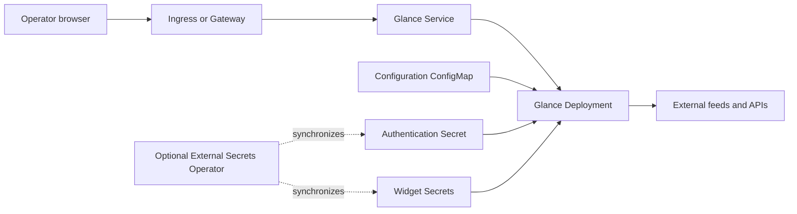

# Glance chart design

## Scope

Glance is a Go dashboard that renders configured feeds, bookmarks, and widgets.
The chart owns the Deployment, configuration ConfigMap, authentication Secret or
Secret reference, Service, optional routing resources, NetworkPolicy, and pod
security defaults. Operators own ingress and Gateway controllers, TLS, external
Secret stores, feed credentials, public assets, and cluster-level policy.

The upstream image has no database server, worker process, application storage
volume, or built-in Prometheus endpoint. Configuration and credential sources
are the durable deployment state. Browser-local Todo data is not stored in a
Kubernetes PVC.

## Architecture

Glance is stateless from Kubernetes' perspective. Multiple replicas share
immutable configuration and signing material, but their widget caches and login
rate limits remain process-local.

## Key Decisions

### Authentication contract

The chart enables native authentication and configures one dashboard account.
All users of that account share the same view; it is not a multi-tenant portal.
Generated passwords contain 32 random alphanumeric characters. Session keys
encode 64 random bytes, matching the tagged upstream implementation exactly.
Helm lookup reuses an existing Secret during upgrades. Inline values deliberately
override retained material, while `existingSecret` transfers ownership to the
user or External Secrets Operator. Offline `helm template` cannot look up the
cluster; GitOps systems that continuously render offline should use an existing
Secret.

Neither password nor signing key appears in the ConfigMap. Glance resolves
projected files through its native secret interpolation. Configuration is
rendered with `toYaml` rather than `tpl` so custom-api widget Go templates remain
literal. The chart owns auth and server sections and rejects attempts to
override them through `config.data`. This keeps ports, probes, and credential
mounts aligned.

### Availability and scheduling

RollingUpdate uses zero unavailable pods and a one-pod surge. Two replicas can
share configuration and signing material without a data volume. A shared cookie
can authenticate on either pod, but the chart does not claim distributed rate
limiting. An optional PDB requires two or more replicas and cannot allow all
replicas to be unavailable. Topology spreading is explicit; node capacity
remains the operator's responsibility.

### Network and exposure

Default ingress admits only pods in the deployment namespace. DNS plus outbound
HTTP/HTTPS allows ordinary feeds. Operators can replace destination CIDRs or add
explicit egress for intranet APIs. The policy requires an enforcing CNI. Trust
of proxy headers is opt-in and must be coupled to restricted proxy access.
Ingress and Gateway resources refer to existing controllers. Gateway listeners
terminate TLS; subpath deployments require a prefix-stripping rule at the proxy.

## Production Boundary

Production operators must preserve the complete configuration, assets, username,
and credential source. Retaining the signing key preserves sessions across pod
replacement. Two replicas improve process availability only when they can be
scheduled on independent failure domains; a one-node validation cluster does not
prove zone resilience. Important third-party widgets require separate functional
monitoring because pod readiness does not verify their upstream APIs.

## Security Boundary

The default pod runs as UID/GID 10001 with a read-only root filesystem, dropped
capabilities, RuntimeDefault seccomp, and no ServiceAccount token. Configuration,
assets, and Secret projections are read-only. No Docker socket or hostPath is
mounted. Docker-container widgets need a separately secured API integration; the
chart does not expose the host daemon to satisfy a dashboard widget.

Native login is enabled by default, but TLS, trusted proxy configuration, Secret
delivery, provider token scope, and external rate limiting remain operator-owned.
Sensitive public deployments should enforce limits at a trusted ingress edge.

## Observability Boundary

Native `/api/healthz` probes are independent of third-party feed availability.
The functional gate additionally checks authentication, dashboard content,
cross-pod cookies, Secret retention during Helm upgrade, and session reuse after
pod replacement. ExternalSecrets is exercised against a real operator and
validated with its CRD schema. No ServiceMonitor points at a nonexistent metrics
endpoint. Operators must monitor the public TLS route and critical widgets.

## Upgrade and Recovery

A configuration checksum rolls pods after Helm-managed config changes. Explicit
authentication values also participate in a checksum; generated random values
do not cause incidental rollouts. Updating a referenced Secret requires a
controlled rollout or an external reloader. Rotating the signing key invalidates
existing sessions; retaining it preserves sessions across restarts.

Backups comprise values and configuration, static assets, and the credential
source. There is no database or application PVC to copy, and browser-local data
must be recovered from the browser profile.

## Known Gaps

- Widget caches and login rate limits are not shared between replicas.
- The chart has no native metrics endpoint or bundled ServiceMonitor.
- Feed reachability and correctness are outside Kubernetes readiness.
- Secret projection updates do not guarantee application-level reloads.
- Browser-local Todo data is not part of Kubernetes backup or replication.

## Non-Goals

- Providing a multi-tenant identity or authorization layer.
- Installing ingress, Gateway, External Secrets, or monitoring controllers.
- Mounting a Docker socket or Kubernetes API credentials for widgets.
- Claiming database recovery, distributed caching, or geographic redundancy.
- Persisting or synchronizing browser-local data.

<!-- @AI-METADATA
type: guide
title: Glance DESIGN
description: Product-specific Glance deployment and operation contract
keywords: glance, helm, authentication, widgets, kubernetes
purpose: Operate the Glance chart safely
scope: charts/glance
-->
