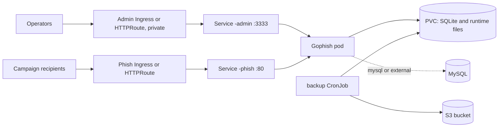

<!-- SPDX-License-Identifier: Apache-2.0 -->

# Gophish Chart Design

## Scope

This chart packages the official Gophish image for authorized security
awareness training workflows. It keeps the default install private and
single-replica, because upstream Gophish stores state locally by default and
does not document a Kubernetes-native HA mode.

## Architecture

The detailed architecture record lives in [docs/architecture.md](docs/architecture.md).
It captures upstream image behavior, database mode decisions, network surface
separation, TLS choices, persistence, and site sync notes.

## Design Choices

- Separate admin and phishing Services, Ingresses, and Gateway API HTTPRoutes,
  so campaign traffic can use a different hostname, policy, and network path.
- Safe SQLite defaults with explicit persistence boundaries.
- External MySQL and HelmForge MySQL dependency paths for production database
  lifecycle ownership.
- Generated `config.json` stored as a Secret, with `existingSecret` support for
  operator-managed configuration.
- NetworkPolicy, dual-stack Service fields, ServiceAccount token control, and
  backup support for SQLite mode.

## Production Boundary

- SQLite mode remains single-replica. Multi-replica experiments require
  `database.mode=external` or `database.mode=mysql` and separate validation of
  shared database behavior.
- Chart-managed backup covers SQLite mode only. MySQL backup is delegated to the
  MySQL dependency or external database tooling.
- Use Gophish only for authorized assessments with written approval from the
  organization being tested.

## Security Boundary

- The admin UI is privileged and should stay private behind port-forward, VPN,
  SSO, reverse proxy auth, or an internal Gateway or Ingress.
- Gophish prints a temporary admin password to the logs on first boot; rotate
  it at the first login and restrict log access.
- The pod runs non-root without privilege escalation, with every capability
  dropped and `RuntimeDefault` seccomp. See [docs/security.md](docs/security.md).

## Observability Boundary

- Probes check the admin and phishing listeners; they do not verify campaign
  delivery or SMTP reachability.
- Gophish logs to stdout. The chart ships no metrics endpoint or
  ServiceMonitor because Gophish exposes none.

## Current Gaps and Improvement Candidates

- No chart-managed backup for MySQL modes.
- The initial admin password cannot be seeded from a Secret.
- No PodDisruptionBudget; the workload is single-replica by design.

## Explicit Non-Goals

- Managing SMTP relays, sending domains, or DNS records for campaigns.
- Multi-replica Gophish with SQLite.
- Any use outside authorized security awareness programs.

## Validation Focus

From `helmforge-ops`, use `make validate-chart CHART=gophish` as the required
gate. It exercises Helm lint, template rendering, unit tests, kubeconform with
real schemas, Artifact Hub lint, and k3d behavioral validation for every CI
values file. From the `charts` repository, `./test.sh gophish` remains the
repo-local CI parity helper.
