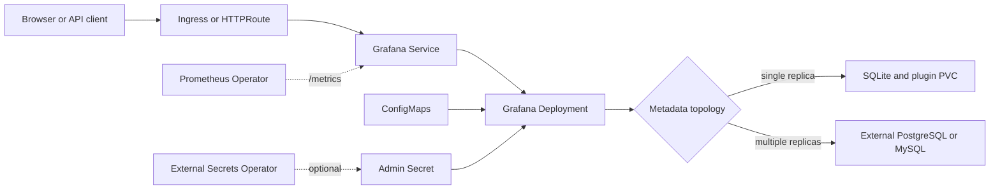

# Grafana chart design

## Scope

This chart deploys Grafana OSS as a Kubernetes `Deployment`. It owns the HTTP
Service, optional exposure resources, administrator credential integration,
Grafana configuration, declarative provisioning, optional persistent storage,
monitoring integration, and workload security boundaries.

The chart deliberately supports two metadata topologies:

- one Grafana replica with SQLite on a persistent volume;
- multiple active-active replicas with an externally operated PostgreSQL or
  MySQL database.

## Architecture

## Design choices

### Durable local default

Grafana starts with SQLite and a retained `ReadWriteOnce` PVC. This makes the
default installation useful without silently losing dashboards, users, alert
state, and plugins on pod replacement. The `Recreate` deployment strategy
avoids two pods concurrently opening the same SQLite database during upgrades.

### Guarded high availability

Grafana documents SQLite as unsuitable for high availability. The chart rejects
`replicaCount > 1` with SQLite. Multiple replicas require PostgreSQL or MySQL.
They also reject a shared `ReadWriteOnce` claim; external-database HA normally
uses declarative provisioning and no local persistence, or an explicitly
designed `ReadWriteMany` volume when local plugins must be shared.

### Declarative provisioning

Datasources, dashboard providers, dashboards, and unified-alerting documents
are ConfigMaps derived from values. Checksums cover their payload values so a
change triggers a rollout without coupling rollout state to metadata.

### Credential ownership

The chart can own administrator and external-database Secrets, reference
existing Secrets, or render native ExternalSecret resources. Inline values are
convenient for local evaluation; existing Secret ownership is the production
boundary. The generated administrator password is retained with Helm `lookup`.

### Listener and service separation

`grafana.port` changes the actual Grafana process listener and the named
container port. `service.port` is independent and targets the `http` port by
name. Ingress and HTTPRoute resources always reference the Service, never the
container port directly.

## Production boundary

A production installation is not created merely by increasing replicas.
Operators remain responsible for:

- an available and backed-up external PostgreSQL or MySQL service for HA;
- TLS and correct `grafana.rootUrl` at the edge;
- datasource, SMTP, SSO, webhook, and plugin egress policy;
- database and storage backup with rehearsed restore procedures;
- plugin compatibility and upgrade testing;
- alerting HA peer configuration when unified alerting needs deduplication.

The chart does not install a database subchart. This keeps database lifecycle,
backups, upgrades, and availability separate from Grafana application releases.

## Security boundary

Grafana runs as UID/GID 472 with `runAsNonRoot`, RuntimeDefault seccomp, dropped
capabilities, no privilege escalation, and a read-only image filesystem. Only
the data, log, and temporary paths are writable. The ServiceAccount token is
not mounted by default and no RBAC permissions are created.

NetworkPolicy ingress is enabled by default for same-namespace callers. Egress
is intentionally not isolated by default because Grafana commonly reaches many
operator-defined datasources and identity systems. Enabling egress isolation
requires modeling DNS, the external database, datasources, SMTP, SSO, webhooks,
and plugin download destinations.

## Observability boundary

Startup, readiness, and liveness use Grafana's `/api/health` endpoint. Native
Prometheus metrics remain available on `/metrics` through the application
Service. A ServiceMonitor is optional because the Prometheus Operator CRD is an
external cluster contract. Grafana logs to stdout; `/var/log/grafana` remains a
bounded writable path for settings that use file logging.

## Upgrade and storage behavior

The PVC is annotated `helm.sh/resource-policy: keep` by default. Uninstalling
the release therefore does not delete SQLite data. This retention is not a
backup. SQLite file copying requires Grafana to be stopped or an
application-consistent storage snapshot. External databases must be backed up
using their native procedures.

## Known gaps

- No chart-native database, PVC-to-object-storage backup job, or restore hook.
- No dashboard sidecar; declarative values avoid Kubernetes API access and RBAC.
- No automatic alerting gossip topology; operators configure Grafana Alerting
  HA for their network and failure model.
- No automatic plugin compatibility validation beyond pinned version syntax.

## Non-goals

- Operating PostgreSQL, MySQL, Prometheus, an ingress controller, or Gateway.
- Fetching dashboards from the public internet at runtime.
- Granting Grafana cluster-wide discovery permissions.
- Hiding unsafe SQLite or volume-sharing combinations behind presets.

## Alternatives considered

The upstream community chart exposes a very broad configuration surface and
multiple sidecars. HelmForge instead provides a smaller, explicit contract with
safe persistence, canonical routing, native External Secrets, and fail-fast HA
validation. The Grafana Operator remains a better choice when Grafana instances
and dashboards must be managed as dedicated custom resources across namespaces.

<!-- @AI-METADATA
type: chart-design
title: Grafana Chart Design
description: Architecture, boundaries, and trade-offs for the HelmForge Grafana chart
keywords: grafana, design, sqlite, postgresql, high-availability, provisioning
purpose: Explain why the chart renders each topology and its production boundaries
scope: Chart
relations:
  - charts/grafana/README.md
  - charts/grafana/values.yaml
path: charts/grafana/DESIGN.md
version: 1.0
date: 2026-11-25
-->
