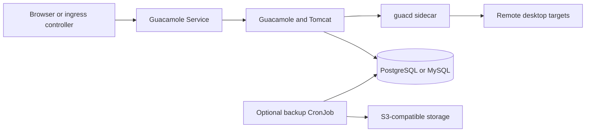

# Apache Guacamole Chart Design

## Scope

This chart deploys Apache Guacamole as a clientless remote desktop gateway for
RDP, VNC, SSH, telnet, and Kubernetes access. It packages the Guacamole web
application, the `guacd` protocol daemon, database initialization, optional
identity provider integrations, and scheduled database backups into one
production-oriented Helm release.

The chart owns Kubernetes orchestration, database bootstrap, the listener
configuration bridge, exposure, backup jobs, and supported identity-provider
environment variables. It does not own remote desktop endpoints, identity
provider clients, database high availability, or cluster ingress policy.

## Architecture

The runtime workload is a single Deployment with two containers:

- `guacamole`: the Java/Tomcat web application that serves HTTP on port 8080.
- `guacd`: the protocol daemon that handles remote desktop protocol sessions on
  port 4822.

`guacamole` talks to `guacd` over `localhost`, keeping protocol traffic inside
the pod. The Kubernetes Service exposes only the HTTP endpoint. This avoids a
separate `guacd` Service and keeps remote desktop protocol handling private to
the application pod.

The Deployment includes an init container that waits for the configured
database endpoint before starting the application containers. HTTP startup,
liveness, and readiness probes check the web application, while TCP probes check
the `guacd` sidecar.

## Design decisions

### Database strategy

Apache Guacamole requires a relational database for users, connection
definitions, permissions, and authentication state. The chart supports three
database modes:

- PostgreSQL subchart, enabled by default.
- MySQL subchart, selected with `database.type: mysql`, `postgresql.enabled:
  false`, and `mysql.enabled: true`.
- External PostgreSQL or MySQL, selected by setting `database.external.host` and
  disabling the bundled database subchart.

Database connection values are resolved through helpers so the Deployment, init
job, and backup CronJob share one source of truth for host, port, database name,
username, password secret name, and password key. Inline external passwords
create a chart-managed Secret; `database.external.existingSecret` delegates
password ownership to the platform.

### Schema initialization

When `initDb.enabled` is true, a post-install hook Job initializes the Guacamole
schema. The job waits for the database, generates the vendor-specific schema
with Guacamole's bundled `initdb.sh`, checks for the `guacamole_user` table, and
applies the schema only when it is missing.

This keeps first installs self-contained while avoiding destructive behavior on
reinstalls or external databases that already contain Guacamole data. Operators
can set `initDb.enabled: false` when database provisioning and migrations are
managed outside the chart.

### Authentication integrations

The chart enables Guacamole authentication extensions through environment
variables consumed by the official image:

- OIDC uses authorization, JWKS, issuer, client ID, scopes, username claim, and
  groups claim settings. The redirect URI is auto-derived from the first ingress
  host when `oidc.redirectUri` is empty.
- SAML uses IdP metadata or IdP URL, entity ID, callback URL, strict mode,
  request/response compression, and group attribute settings. Entity ID and
  callback URL can also be derived from ingress.
- TOTP is enabled with `totp.enabled`.

The chart does not create identity provider objects. It expects the external IdP
to own client registration, redirect URIs, scopes, certificates, and group claim
mapping.

### Listener and networking contracts

The official web image generates a writable `CATALINA_BASE` under `/tmp` and
explicitly sources additional scripts from `/opt/guacamole/entrypoint.d` before
starting Tomcat. The chart mounts a focused script at that supported extension
point and changes only the HTTP connector to `containerPorts.http`. The named
`http` port is consumed by probes, the Service, and NetworkPolicy.

The official guacd entrypoint forwards additional arguments to the daemon. The
chart passes `-l guacd.port` and writes the daemon PID beneath `/tmp`, so the
sidecar listener and the web application's `GUACD_PORT` always agree under a
read-only root filesystem. The custom-port k3d scenario proves both processes
become Ready on non-default ports; neither value is Kubernetes metadata only.

The Service exposes the web application on independent `service.port`. Ingress
is optional and supports `ingress.ingressClassName`, annotations, host paths,
and TLS entries. Tomcat RemoteIpValve settings preserve client IP and protocol
information behind a trusted reverse proxy.

### Backup strategy

When `backup.enabled` is true, the chart creates a CronJob that dumps the active
database into an `emptyDir` scratch volume and uploads the compressed archive to
an S3-compatible endpoint:

- PostgreSQL backups use `pg_dump --clean --if-exists`.
- MySQL backups use `mysqldump --single-transaction --quick`.
- Uploads use the HelmForge `mc` image and optional bucket creation.

S3 credentials can be supplied inline for chart-managed Secret creation or via
`backup.s3.existingSecret` for externally managed credentials. The backup flow
stores database state only; remote desktops and target systems remain external
to Guacamole.

## Production boundary

The Deployment intentionally has one replica because the pod couples the web
application and guacd sidecar. The chart does not claim session continuity or
horizontal scaling guarantees. Production operators must size resources,
choose persistent and highly available database services, test database and S3
restore procedures, and define disruption and recovery objectives.

The bundled database modes provide a self-contained installation, but they do
not replace a platform database service with independent backups, monitoring,
encryption, and failover. The backup CronJob covers database state only and
must be validated against the operator's object store and retention policy.

Remote desktop target reachability, DNS, firewall policy, proxy limits, TLS
termination, identity-provider availability, and certificate lifecycle remain
platform responsibilities.

## Security boundary

The chart uses official Apache Guacamole images pinned by tag and immutable
multi-architecture digest. The images run as their upstream non-root UIDs. The
default pod applies `RuntimeDefault` seccomp; both application containers forbid
privilege escalation, drop every Linux capability, use a read-only root
filesystem, and receive explicit `/tmp` `emptyDir` mounts for supported runtime
writes. Kubernetes API token mounting is disabled for the Deployment and jobs.

Ingress isolation is enabled by default and admits same-release callers plus
explicit `networkPolicy.ingressFrom` peers. Egress remains unrestricted because
guacd must reach operator-selected remote desktop targets and the web container
may reach external identity providers. Clusters must use a NetworkPolicy-capable
CNI, and ingress controllers outside the release must be added explicitly.

Chart-managed Secrets support disposable installs, while existing Secret and
External Secrets paths support platform-owned credentials. Kubernetes Secrets
protect delivery, not source control; production credentials must come from a
secret manager or encrypted deployment system.

The default `guacadmin` account is created by Guacamole itself after schema
initialization. Operators must change the default password immediately after
first login or rely on OIDC/SAML controls for production access.

## Observability boundary

HTTP startup, readiness, and liveness probes target the named web listener. TCP
probes target the real guacd listener. Application, Tomcat, and guacd output is
available through container logs; Kubernetes events and restart counts provide
the first operational signal. The chart does not create a ServiceMonitor,
dashboards, alert rules, tracing backend, or log pipeline because Guacamole does
not expose a stable native Prometheus endpoint.

## Validation coverage

The CI values cover:

- Default PostgreSQL deployment.
- MySQL deployment.
- External PostgreSQL deployment with an in-cluster fake endpoint for k3d plus
  a documented operator-owned database example.
- OIDC with ingress-derived callback behavior.
- SAML with ingress-derived callback behavior.
- S3 backup CronJob rendering.
- Non-default Tomcat and guacd listeners through a behavioral k3d scenario.
- Default security contexts, token controls, NetworkPolicy, and immutable image
  references through focused unit tests.

Full validation for chart changes must use `make validate-chart
CHART=guacamole`.

## Known gaps

- A single pod couples the Guacamole web application and guacd availability.
- NetworkPolicy cannot express DNS names or the arbitrary remote desktop targets
  selected by administrators, so the default policy does not isolate egress.
- The chart does not expose application-native metrics or automate alerts.
- Database backup does not include target systems and is not a restore test.
- The default `guacadmin` credentials must be changed after first login.

## Non-goals

The chart does not create Guacamole users or connections, provision remote
desktop targets, manage identity-provider applications, install an ingress
controller, operate database high availability, select retention policy, or
define cluster-wide network and admission controls. It does not claim that a
rendered backup is recoverable without an operator-tested restore exercise.

<!-- @AI-METADATA
type: chart-design
title: Apache Guacamole Chart Design
description: Architecture and operational design for the Apache Guacamole HelmForge chart
keywords: guacamole, guacd, remote desktop, postgresql, mysql, oidc, saml, backup
purpose: Explain chart architecture, tradeoffs, and validation boundaries
scope: Chart
relations:
  - charts/guacamole/Chart.yaml
  - charts/guacamole/values.yaml
  - charts/guacamole/templates/deployment.yaml
  - charts/guacamole/templates/initdb-job.yaml
  - charts/guacamole/templates/backup-cronjob.yaml
path: charts/guacamole/DESIGN.md
version: 1.0
date: 2026-06-14
-->
