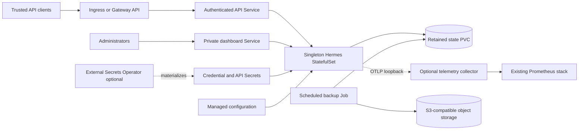

# Hermes Agent design

## Architecture

One StatefulSet Pod owns the gateway, optional dashboard, persistent state and
configuration lifecycle. Separate Services keep the authenticated API,
administrative dashboard and metrics endpoints independently selectable by
NetworkPolicy. Backup Jobs mount the retained state, while the telemetry
collector deliberately has no state or credential mount.

## One trusted agent per release

Hermes combines an agent loop, persistent memory, learned skills, SQLite session history, scheduled work, messaging adapters and an OpenAI-compatible API. These
capabilities share one state directory and execution identity. The chart deploys one StatefulSet replica and one retained PVC; adding replicas would create
competing gateway writers. Kubernetes reschedules the singleton, with downtime. This is not an HA or multi-tenant isolation design.

Use separate releases, Secrets, storage and network policies for mutually untrusted agents. API credentials permit the selected tools. The optional dashboard
has full administrative access to the same state and process namespace. The default API toolset contains only memory; enabling terminal, browser, MCP or other
tools expands that trust boundary.

## Design Decisions

- Use a singleton StatefulSet because Hermes state and schedules have one writer
  and upstream does not provide distributed coordination.
- Retain the PVC and generated API identity so uninstall/reinstall and ordinary
  upgrades do not silently replace agent state or credentials.
- Start the official image through explicit non-root foreground commands instead
  of its root-oriented s6 initialization path.
- Separate API, dashboard and metrics Services and peer allowlists because they
  expose different privilege levels.
- Make configuration ownership explicit through `managed` and `seed` policies
  rather than overwriting dashboard-edited configuration unpredictably.
- Validate backups before publishing a completion manifest and restore only into
  empty state so a failed recovery cannot overwrite a working agent.

## Official image and immutable execution

The chart pins the official Nous Research multi-platform image by release and manifest digest. The tested release is v2026.9.24; its internal Python version
string is 0.21.2. Linux amd64 was exercised in k3d; an arm64 manifest is present but was not runtime-tested here.

The image's standard s6 startup performs root-only initialization. Kubernetes instead starts the official gateway/dashboard foreground commands as UID/GID 10000
with a read-only root filesystem and all capabilities dropped. A configure init container creates state directories, reconciles declared files and synchronizes
the image's bundled skills. A small exec-only entrypoint discovers the bundled Chromium binary without downloading anything. Runtime lazy installation is
disabled.

The Pod shares its process namespace so the Kubernetes sandbox process reaps orphaned children and the dashboard can observe the gateway PID. No host PID
namespace, host Docker socket, default API token, ClusterRole or privileged container is used. The collector has no agent-state mount; the backup uploader has
only completed archive staging.

## Security Boundary

The chart protects the API with a retained bearer credential, requires Secrets
for first-class provider and messaging credential fields, and defaults to
memory-only tools. `extraEnv` is an operator-controlled escape hatch that can
also inject literal values, so operators must keep credentials out of values
files and use `valueFrom.secretKeyRef` when extending the environment.
The gateway and dashboard share one trusted process and state boundary; enabling
terminal, browser, MCP, messaging or dashboard access grants materially broader
authority to their authenticated users.

The Pod runs without a Kubernetes API token, host namespaces, a host socket,
privileged mode or added Linux capabilities. NetworkPolicy limits inbound peers
and permits public HTTPS egress by default, but it cannot identify DNS names or
prove that an external endpoint is trustworthy. TLS termination, certificate
issuance, Secret rotation, external identity providers and provider-side access
controls remain operator responsibilities.

## Configuration and identity lifecycle

`config.policy=managed` reconciles config.yaml at every Pod initialization. `seed` writes it only when absent and is required for dashboard editing. SOUL.md is
chart-managed only when `config.soul` is nonempty; an empty value leaves an existing persona untouched. Seed mode also preserves existing provider, monitoring
and platform configuration: changing values alone does not replace the seeded file. Choose a deliberate maintenance migration back to managed mode when needed.

Generated API credentials use live Helm lookup and are retained with the PVC. Render-only GitOps controllers should supply an existing Secret or ESO-generated
Secret; random render output is not a stable identity. Secret changes do not automatically restart environment consumers. Roll the StatefulSet after credential
rotation. Secret names, keys and chart-created retention are explicit contracts.

## Connectivity and health

The API listens on container port 8642. Ingress and HTTPRoute target its Service; dashboard administration uses a separate private Service on 9119. Network
policies select container ports independently of user-facing Service ports. Inbound API, dashboard and metrics peers are separate allowlists. Public HTTPS
egress is available by default; private provider/MCP/S3 endpoints require explicit extra rules. The chart does not provide DNS-name-aware egress filtering.

Liveness uses inexpensive public process health. Readiness parses authenticated `/health/detailed`: upstream can return HTTP 200 while reporting degraded
readiness. A healthy gateway is not proof that a paid model credential has quota or that an external messaging platform is reachable.

## Production Boundary

The chart owns Kubernetes resources, startup reconciliation, health probes,
retained storage, optional telemetry wiring and a guarded backup/recovery path.
Operators own provider availability and billing, tool authorization, StorageClass
durability, capacity planning, network egress policy, alert routing, backup
retention, restore drills and maintenance downtime for the singleton writer.

Runtime validation uses a deterministic local provider and does not prove live
cloud credentials, messaging delivery, remote SSH/MCP endpoints, OIDC providers
or production object-storage policy. Those integrations need environment-specific
acceptance before they are enabled for users.

## Observability Boundary

Hermes exports native gateway-health metrics through OTLP. An optional official collector accepts OTLP only on loopback and exposes Prometheus metrics through a
restricted Service. ServiceMonitor and PrometheusRule integrate with an existing Prometheus Operator. These are native gateway/scheduler metrics, not inferred
token costs or request accounting.

## Recovery Boundary

Backups use the pinned native exclusion policy, backup lock and SQLite online backup helper inside a stricter archive pipeline. Missing files, unreadable data
and failed database snapshots prevent success. Checksums cover every member and the complete ZIP. The uploader reads the remote archive back and compares its
bytes before publishing the completion manifest. The consistency boundary is each SQLite database; ordinary files and separate databases are not captured in one
global transaction.

Recovery validates an archive in staging before copying to an empty volume. A persistent incomplete marker prevents gateway startup after interrupted
publication. A completion marker makes later Pod restarts idempotent. Importing upstream backup code has initialization side effects, so recovery uses a
temporary HERMES_HOME and a separate target path. It never invokes native service-revival or overwrite import commands.

## Known Gaps

- arm64 is present in the upstream manifest but is not exercised by the local
  runtime suite
- one writer means upgrades, rescheduling and node drains cause downtime
- backup consistency is per SQLite database, not one transaction across all
  databases and ordinary files
- NetworkPolicy cannot express DNS-aware egress restrictions
- Secret changes require an explicit StatefulSet rollout for environment
  consumers
- provider quota, billing and live messaging reachability are not Kubernetes
  readiness signals

## Non-Goals

- horizontal scaling or transparent high availability
- multi-tenant isolation inside one release
- automatic credential or certificate rotation
- installing External Secrets Operator, Gateway API or Prometheus Operator
- sandboxing arbitrary terminal, browser, MCP or remote execution tools
- overwriting populated state during restore

## Comparison and implementation provenance

The community chart at <https://github.com/ultraworkers/hermes-agent-helm-chart> already offers useful non-root security, API authentication, ESO and network
isolation. This implementation was written independently using HelmForge conventions. It adds a verified current image, explicit configuration ownership,
retained identity/state, semantic readiness, native telemetry and tested S3 disaster recovery. No unsupported operator or multi-tenant CRDs are installed.

## Validation scope

The chart-owned runtime harness drives the real Hermes agent and memory tool using a deterministic local OpenAI-compatible provider. It checks authentication,
network isolation, state survival, metrics, dashboard login, ESO and S3 recovery in the relevant profiles. This validates integration mechanics without paid API
calls or messages to real users. Cloud provider credentials, live Telegram/Discord/Slack delivery, remote SSH services and OIDC identity providers still require
environment-specific acceptance.
