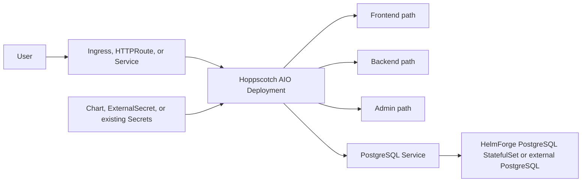

# Hoppscotch Chart Design

## Scope

This chart deploys Hoppscotch Community Edition using the official AIO image. It is designed for self-hosted API
workspaces that need a single Kubernetes workload with frontend, backend, admin dashboard, PostgreSQL, authentication,
SMTP, and edge routing managed consistently.

Supported deployment modes:

- development mode with bundled HelmForge PostgreSQL enabled by default
- production mode with bundled or external PostgreSQL
- optional OAuth, SMTP, External Secrets, Gateway API, NetworkPolicy, and ServiceMonitor integrations

## Architecture

The chart enables subpath based access so one service and one hostname can expose the web app, backend APIs, WebSocket
endpoint, and admin dashboard.

## Main Design Choices

- Use the official `docker.io/hoppscotch/hoppscotch` AIO image to keep the chart operationally simple.
- Use the HelmForge PostgreSQL subchart for bundled persistence.
- Run Prisma migrations in an init container before the application starts.
- Bootstrap `pg_trgm` on fresh bundled PostgreSQL databases and keep a pre-upgrade hook for existing PVCs.
- Persist `DATA_ENCRYPTION_KEY` and `WEBAPP_SERVER_SIGNING_KEY` through Kubernetes Secrets.
- Use the HelmForge-standard `ingress.ingressClassName` field for Ingress class selection.
- Expose `proxy.appUrl` as an optional `PROXY_APP_URL` bootstrap value for self-hosted proxy defaults.

## Production Boundary

For production, operators should define:

- stable `DATA_ENCRYPTION_KEY` and `WEBAPP_SERVER_SIGNING_KEY` through existing Secrets or External Secrets
- PostgreSQL storage class, size, backup, restore, and retention policy
- hostname, TLS, and WebSocket-capable ingress or Gateway API configuration
- OAuth provider credentials and callback URLs
- SMTP settings for magic links and invitations
- resource requests, limits, PDB, and NetworkPolicy settings

## Security Boundary

The chart protects the workload boundary by running the application and database extension hook as non-root users,
dropping Linux capabilities, disabling privilege escalation, and disabling Kubernetes API credential automounting by
default. NetworkPolicy can restrict application ingress and baseline egress to DNS and PostgreSQL. TLS termination,
OAuth application registration, SecretStore policy, and authorization within external PostgreSQL remain operator or
platform responsibilities.

Sensitive values may come from chart-managed Secrets, explicitly named existing Secrets, or External Secrets. The
chart never provisions the external secret backend. Operators must preserve `DATA_ENCRYPTION_KEY` and
`WEBAPP_SERVER_SIGNING_KEY` across upgrades and must avoid placing production credentials directly in values files.

## Observability Boundary

Kubernetes readiness and liveness probes verify the AIO HTTP endpoint. When both metrics switches are enabled, the
chart creates a ServiceMonitor that scrapes `/backend/health` through the named `http` Service port. The chart does not
deploy Prometheus, collect application logs, define alerting rules, or guarantee that the health response exposes
Prometheus metrics; operators must verify the endpoint contract for their pinned Hoppscotch release and provide the
monitoring stack, log aggregation, dashboards, and alerts.

## Known Gaps and Limitations

- The official AIO image keeps frontend, backend, admin, and proxy processes in one Deployment; this chart does not
  model the split upstream topology or independent component scaling.
- Prisma migrations run in every new pod's init sequence. Operators should coordinate disruptive upgrades and back up
  PostgreSQL before rollout because the chart does not serialize migrations across independent Helm releases.
- The bundled PostgreSQL dependency is suitable for straightforward installations, but the chart does not manage
  database backup policy or external high-availability services.
- `readOnlyRootFilesystem` remains disabled for the AIO container because the upstream runtime writes temporary files.
- ServiceMonitor creation only wires discovery; the monitoring stack and endpoint compatibility remain external.

## Explicit Non-Goals

- deploying Hoppscotch's split frontend/backend/admin image topology
- managing OAuth application registration in external identity providers
- managing PostgreSQL backups directly in this chart
- provisioning ingress controllers, Gateway controllers, or SecretStores

<!-- @AI-METADATA
type: design
title: Hoppscotch Chart Design
description: Design document for the Hoppscotch Helm chart architecture, database model, routing, and production boundaries

keywords: hoppscotch, design, architecture, postgresql, ingress, gateway-api, oauth, smtp, helm, kubernetes

purpose: Document chart architecture, operational choices, production boundaries, and non-goals
scope: Chart Design

relations:
  - charts/hoppscotch/README.md
  - charts/hoppscotch/docs/database.md
  - charts/hoppscotch/docs/authentication.md
  - charts/hoppscotch/docs/production.md
path: charts/hoppscotch/DESIGN.md
version: 1.0
date: 2026-06-02
-->
