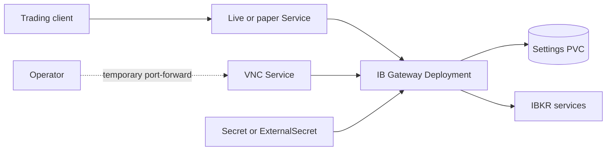

# IB Gateway chart design

## Scope

The chart translates the `gnzsnz/ib-gateway-docker` Compose contract into a
private Kubernetes singleton. It owns the workload, TCP Services, credential
projection, settings volume, optional ExternalSecret resources, NetworkPolicy,
and an optional disruption budget. IBKR accounts, subscriptions, order-risk
controls, encrypted client transport, backups, and external egress policy remain
operator responsibilities.

## Architecture

One Deployment owns IBC, Xvfb, IB Gateway, and the upstream `socat` proxies. A
single Service selects the active live and paper ports. An optional second
Service exposes VNC for maintenance. A PVC contains only TWS settings, while a
projected Secret supplies credentials. NetworkPolicy restricts API and VNC
clients without pretending that changing IBKR endpoints can be expressed as a
stable default egress allowlist.

## Main Design Decisions

### Singleton lifecycle

An IBKR account session is not a replicated service. Concurrent logins can
replace or downgrade one another, while mobile two-factor approval and IBC
restarts belong to one process tree. The schema and template constrain
`replicaCount` to one, and `Recreate` prevents overlap during upgrades.

The optional PodDisruptionBudget fixes `minAvailable` at one. It protects the
only session from voluntary eviction but can block node drains, so it remains
disabled by default and must be enabled only with an operator response plan.

### Fixed upstream listener ports

The image fixes its public `socat` proxies at 4003 for live and 4004 for paper,
and x11vnc listens on 5900. The chart marks these as fixed protocol ports rather
than exposing fake configurability. Client-facing Service ports 4001 and 4002
remain independently configurable and target the named listeners.

### Credential lifecycle

Passwords use upstream `_FILE` variables and a projected Secret. Usernames use
Secret references because upstream does not provide username-file variables.
The chart-managed Secret is suitable for evaluation, while an existing Secret
or ExternalSecret is the deterministic production contract. A values checksum
restarts the Pod when references or key mappings change; external secret
controllers remain responsible for rotation-triggered rollout policy.

### Health semantics

The public container ports are `socat` proxies and can listen before account
authentication finishes. With credentials configured, startup and readiness
inspect the internal live or paper Gateway listener. An intentionally empty
evaluation install checks the credential-waiting process so its logs can be
inspected before a Secret is added; the Service remains unusable. Liveness
checks process markers and deliberately does not make remote IBKR availability a
restart condition.

## Security Boundary

The upstream image runs with UID/GID 1000. The chart requires non-root execution,
drops all capabilities, disables privilege escalation, selects runtime-default
seccomp, and disables API-token automount. The root filesystem remains writable
because upstream generates runtime files below its home directory and `/tmp`.

The raw TCP API and VNC carry no chart-provided authentication or encryption.
Both stay ClusterIP-only by default and require explicit NetworkPolicy peers and
private encrypted transport outside the cluster. A Ready Pod proves local
listener state, not account authorization or safe trading permissions.

## Production Boundary

Production operators must supply an existing Secret or ExternalSecret, restrict
API and VNC peers, manage IBKR egress, back up the settings PVC when needed, and
schedule Recreate downtime with two-factor approval available. The chart does
not provide session failover, account recovery, encrypted TCP termination, or a
stable IBKR destination allowlist.

Only `/home/ibgateway/tws_settings` is durable. The IBC configuration is
regenerated so expanded credentials are not retained. Recovery consists of
restoring optional settings, recreating the credential Secret, and completing
IBKR login and two-factor approval.

## Observability Boundary

Startup and readiness inspect the active internal API listener, while liveness
checks the IBC process marker. Application and login diagnostics remain in Pod
logs and Kubernetes events. There is no documented Prometheus endpoint, so the
chart does not publish a misleading ServiceMonitor, dashboard, or alert set.
Operators should monitor readiness, restarts, PVC capacity, login failures,
session conflicts, and the outcome of settings backups.

## Known Gaps and Limitations

- IBC was retired by its maintainers on 2026-09-01 and receives limited fixes.
- A local listener cannot prove market-data subscriptions, order permissions,
  provider availability, or successful order execution.
- Persistent `jts.ini` state can retain the original timezone across upgrades.
- The writable root filesystem is required by the upstream desktop runtime.
- Voluntary eviction protection can intentionally stop a node drain.

## Non-Goals

Horizontal scaling, rolling updates, HPA, HTTP Ingress, Gateway API HTTPRoute,
public exposure, bundled encrypted tunnels, Prometheus metrics, automated
trading strategies, and Kubernetes-managed IBKR account failover are outside the
upstream contract and are not implemented by this chart.
