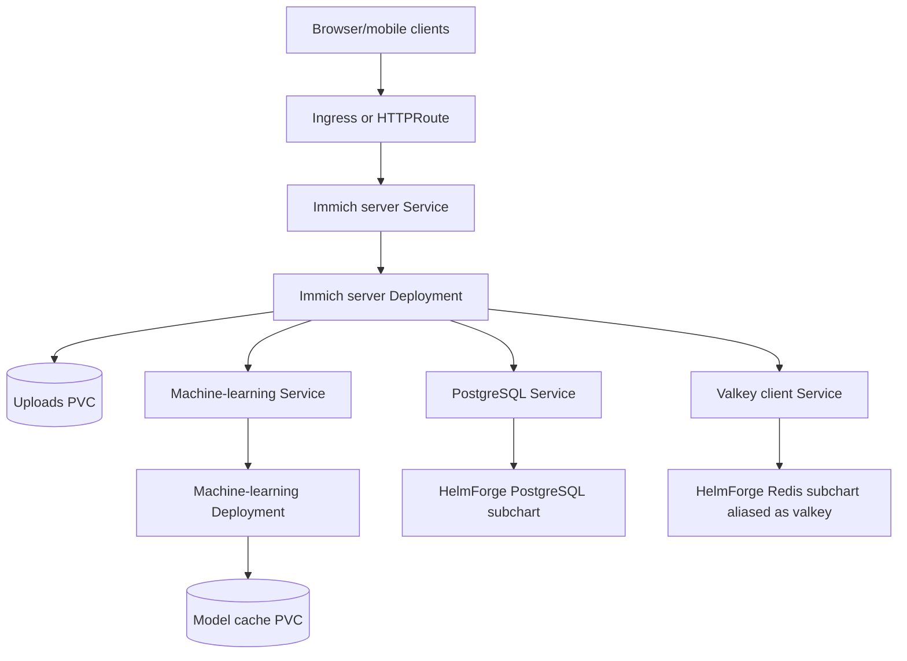

# Immich Chart Design

## Scope

This chart deploys Immich server, Immich machine learning, PostgreSQL, and a
Redis-compatible cache using Helm-native resources and HelmForge subcharts.

Supported dependency modes:

- bundled HelmForge PostgreSQL subchart with the Immich VectorChord image
- bundled HelmForge Redis subchart aliased as `valkey`
- external PostgreSQL and external Redis/Valkey-compatible cache
- optional External Secrets Operator resources for externally owned credentials

## Architecture: Bundled Dependencies

## Main Design Choices

- Use official Immich images for server and machine-learning workloads.
- Use the HelmForge PostgreSQL chart, overriding the image to Immich's
  VectorChord PostgreSQL build.
- Use the HelmForge Redis chart aliased as `valkey` because Immich consumes the
  Redis protocol and the existing HelmForge chart is the shared cache primitive.
  Standalone and cluster modes use the Redis client service; replication mode
  points Immich at the primary service.
- Keep upload persistence separate from database/cache persistence.
- Fail render-time validation when server replicas or autoscaling use upload
  persistence without `ReadWriteMany`.
- Use `Recreate` automatically when upload persistence is enabled without
  `ReadWriteMany`, avoiding RollingUpdate surge contention on a single RWO PVC.
- Use the same non-surge behavior for the machine-learning model cache when it
  uses non-RWX persistence.
- Use a single `gateway` values block for Gateway API HTTPRoute support.

## Explicit Non-Goals

- object storage provisioning
- automated Immich backup jobs
- database major-version migrations
- installing Ingress controllers, Gateway API CRDs, or External Secrets Operator
- replacing Immich's application-level migration flow

## Production Boundary

Production deployments should provide explicit values for:

- upload storage class and size
- PostgreSQL and cache credentials through Secrets or External Secrets
- durable PostgreSQL and cache storage
- Ingress or Gateway API TLS
- resources and topology constraints
- backup and restore runbooks outside this chart

## Security Boundary

The chart controls Kubernetes workload hardening and Secret references, but it
does not become an identity provider, certificate authority, or network
perimeter. Server and machine-learning pods disable ServiceAccount token
automounting by default, use the RuntimeDefault seccomp profile, drop Linux
capabilities, and prevent privilege escalation. Init containers run as the
unprivileged UID and GID `65534` with a read-only root filesystem.

Database and cache credentials cross the chart boundary through Kubernetes
Secrets. They may be generated by bundled dependencies, supplied through
`existingSecret`, or reconciled by an already-installed External Secrets
Operator. The chart never installs the operator or a SecretStore. Direct
password values remain available for local evaluation, but production
deployments should use externally managed Secrets with explicit rotation and
recovery procedures.

NetworkPolicy is opt-in because Immich needs database, cache, machine-learning,
DNS, and external API connectivity. The compatibility defaults are deliberately
broad: namespace ingress and unrestricted egress. Platform owners are
responsible for replacing those rules with namespace, pod, CIDR, and port
selectors appropriate to their trust boundaries. TLS terminates at an existing
Ingress or Gateway implementation.

## Observability Boundary

Kubernetes readiness and liveness probes cover the server and machine-learning
HTTP health endpoints. The Helm test verifies Service reachability, while the
behavioral gate also checks rollouts, endpoints, restarts, logs, and warning
events. Structured server logs are enabled by default through
`server.logFormat=json`, and the log level is configurable.

The chart intentionally does not create a ServiceMonitor, PodMonitor,
PrometheusRule, log collector, or alerting policy because Immich does not expose
a stable chart-owned metrics contract. Operators should collect container and
Kubernetes metrics, centralize JSON logs, and alert on probe failures, restart
growth, PVC capacity, PostgreSQL health, queue backlog, and failed application
migrations using their platform observability stack.

## Known Gaps and Limitations

- Uploads use a filesystem PVC; object-storage provisioning and lifecycle
  policies are outside the chart.
- Horizontal scaling requires a ReadWriteMany uploads volume, and
  machine-learning scaling requires ReadWriteMany model-cache storage.
- The bundled database is single-instance. High availability, disaster
  recovery, and cross-region replication require an external PostgreSQL
  service.
- PostgreSQL extension installation and major-version migrations are not
  automated for external databases.
- Backup jobs, restore orchestration, and application-level recovery tests are
  intentionally external to the Helm release.
- Metrics scraping and alerting resources are not rendered until Immich offers
  a stable upstream metrics interface suitable for a chart-level contract.

<!-- @AI-METADATA
type: design
title: Immich Chart Design
description: Design document for the Immich Helm chart architecture and dependency modes
keywords: immich, design, postgresql, redis, valkey, machine-learning
purpose: Document chart design choices and production boundaries
scope: Chart Design
relations:
  - charts/immich/README.md
  - charts/immich/docs/production.md
path: charts/immich/DESIGN.md
version: 1.0
date: 2026-05-29
-->
