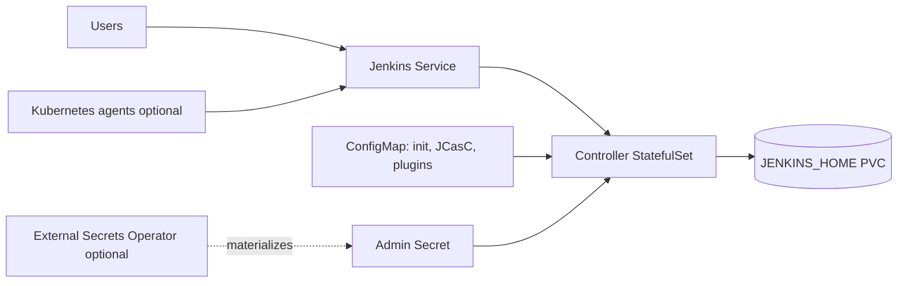

# Jenkins Chart Design

## Scope

This chart deploys a single Jenkins controller with persistent `JENKINS_HOME`,
optional Configuration as Code, optional plugin bootstrap, and Kubernetes
networking integrations.

Jenkins controller high availability is intentionally out of scope because the
standard Jenkins controller is stateful and single-writer. Production resilience
comes from persistence, backups, upgrade discipline, and externalized
configuration.

## Architecture

Optional integrations:

- Ingress and Gateway API HTTPRoute
- NetworkPolicy boundaries
- ExternalSecret for admin credentials
- ServiceMonitor for Jenkins Prometheus plugin endpoints
- RBAC for Kubernetes agent workflows

## Main Design Choices

- Use the official `jenkins/jenkins` LTS image with Java 21.
- Use a StatefulSet so the controller has stable storage identity.
- Keep replica count fixed at one.
- Support initial admin bootstrapping while allowing externally managed
  credentials.
- Keep plugin bootstrap opt-in because plugin resolution performs network I/O
  and changes startup time.
- Support JCasC as mounted ConfigMap snippets, but do not force the plugin.
- Render External Secrets Operator resources only when requested.

## Security Boundary

The Jenkins controller and plugin installer run as UID/GID 1000, drop all Linux
capabilities, disable privilege escalation, and inherit a RuntimeDefault seccomp
profile. The root filesystem remains writable because the official Jenkins
image and plugin tooling write outside the mounted home during initialization.
`JENKINS_HOME` is therefore the durable application boundary, not a substitute
for container hardening or image trust.

The controller ServiceAccount token remains mounted intentionally. Jenkins can
use the Kubernetes plugin to create ephemeral agent Pods, and that workflow
requires Kubernetes API authentication. Namespaced RBAC is opt-in through
`rbac.create`; operators that do not use Kubernetes agents should leave it
disabled and bind only the permissions their controller configuration needs.

Admin credentials cross from a chart-managed or external Secret into the
controller environment. `externalSecrets.enabled` requires
`admin.existingSecret` so one Secret name remains authoritative. JCasC scripts,
plugin coordinates, extra environment variables, volumes, and manifests are
operator-controlled inputs and must be reviewed as trusted configuration.
NetworkPolicy is opt-in because plugin downloads, SCM hosts, update centers,
Kubernetes API access, and build dependencies vary by installation.
Enabling it with defaults permits ingress from every Pod in the release
namespace and permits both all-cluster and all-IPv4 egress through
`networkPolicy.egress.allowCluster=true` and `allowInternet=true`. Set those
egress switches to `false`, retain only the required DNS and explicit extra
rules, and configure the ingress namespace and Pod selectors for a restrictive
policy. Set `networkPolicy.ingress.enabled=false` to deny all ingress.

## Observability Boundary

Kubernetes startup, readiness, and liveness probes check the Jenkins login
endpoint on `controller.httpPort`. Operators must not independently override
that listener with `--httpPort` in `controller.jenkinsOpts`; if retained for
compatibility, its value must equal `controller.httpPort` so the process,
container port, NetworkPolicy, and probes stay aligned. The chart exposes
controller logs and events through standard Kubernetes APIs and can render a
ServiceMonitor for the Jenkins Prometheus plugin endpoint. It does not install
that plugin, Prometheus, alert rules, dashboards, log aggregation, or
pipeline-level monitoring.

Operators should alert on controller readiness, restarts, PVC capacity, JVM
pressure, queue depth, executor saturation, failed plugin initialization, and
backup freshness. A healthy HTTP probe proves that the controller responds; it
does not prove that credentials, agents, SCM integrations, or representative
pipelines work.

## Known Gaps And Operational Risks

- Jenkins controller upgrades and plugin upgrades can mutate persisted state;
  Kubernetes rollback does not roll back `JENKINS_HOME`.
- The chart does not create backups or test restores. Operators must protect the
  PVC and verify a restore before core, Java, or plugin changes.
- `plugins.install.initializeOnce=true` favors deterministic restarts but does
  not continuously reconcile plugin state after the marker is written.
- A single controller has planned downtime during restart, rescheduling, and
  storage reattachment. PDB protection does not provide controller HA.
- Kubernetes agent RBAC is namespaced and generic; production permissions may
  need a narrower policy derived from actual pipeline requirements.
- NetworkPolicy cannot infer every SCM, registry, update center, proxy, agent,
  or internal dependency endpoint.

## Production Boundary

Production users should configure persistence, backups, explicit admin
credentials, plugin pinning, JCasC, resource sizing, network policy, and a
controlled upgrade process.

## Explicit Non-Goals

- active-active Jenkins controller HA
- bundled backup controller
- automatic plugin upgrade policy
- installing the Kubernetes plugin by default
- managing build agents outside Jenkins configuration
- installing ingress, Gateway, Prometheus, or External Secrets operators

<!-- @AI-METADATA
type: design
title: Jenkins Chart Design
description: Design document for the Jenkins Helm chart
keywords: jenkins, ci, cd, statefulset, jcasc, plugins
purpose: Document chart architecture, decisions, and production boundaries
scope: Chart Design
relations:
  - charts/jenkins/README.md
  - charts/jenkins/docs/production.md
  - charts/jenkins/docs/jcasc-and-plugins.md
path: charts/jenkins/DESIGN.md
version: 1.0
date: 2026-05-29
-->
